Les dernières améliorations de [LEGO Digital Designer (version 1.6) et de LEGO Factory](http://www.lego.com/eng/factory/default.asp) m’ont semblées suffisamment significatives pour que le système soit réellement opérationnel. Les deux améliorations les plus notables sont :  
**–** Le support des fichiers LDraw dans LDD, ce qui simplifie considérablement la réalisation du modèle, surtout si celui-ci utilise un montage non conventionnel.  
**–** Le prix du modèle calculé à la pièce et non plus par sachet ouvert, ce qui rend le prix du modèle abordable.

D’autre part, LDD 1.6 débarque avec un nouveau sachet de pièces sur le thème "train" avec notamment des pièces indispensables lorsqu’on veut faire des modèles train, comme les essieux, les aimants d’attelage, les rails 9V (certains diront peut-être qu’ils ont fait ça pour écouler leur stock de rails 9V... [^1]), le moteur 9V, etc...

L’occasion était trop belle ! Je me suis donc attelé à la réalisation d’un petit wagon (petit pour que son prix reste abordable tout de même). Comme je suis plus à l’aise avec des vrais LEGO en main, j’ai d’abord réalisé un prototype avec des pièces assez standard. Pour avoir utilisé les versions précédentes de LDD, je sais que la panoplie de pièces n’est pas aussi étendue que dans MLCAD. De plus la panoplie de pièces qu’on a le droit d’utiliser pour pouvoir acheter le modèle sur le shop@home est encore plus restreinte. C’est pour cette raison que j’ai veillé à ne pas utiliser des pièces trop anciennes ou trop spécifiques.

Voici le résultat :

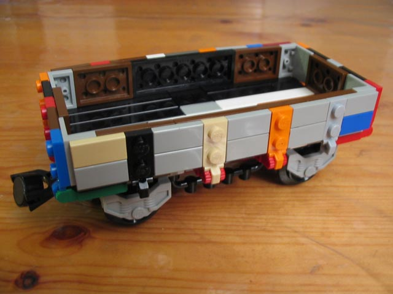

Ne faites pas attention aux couleurs, à ce stade de la réalisation, seul le montage compte, je pioche donc les pièces par type sans me soucier de la couleur qui me tombe sous la main.

De plus, j’ai vérifié que le wagon roulait sans encombres sur les rails courbes et dans les aiguillages, en particulier lorsque plusieurs de ces wagons étaient attelés ensembles.

Une fois mon modèle en main, j’ai tenté de le reproduire sous LDD. Hélas... je n’ai pas réussi à connecter certaines pièces, comme par exemple l’essieu sur une plaque 2x8, où alors si j’y arrivais par miracle, c’est la deuxième plaque 2x3 que je ne pouvais connecter.

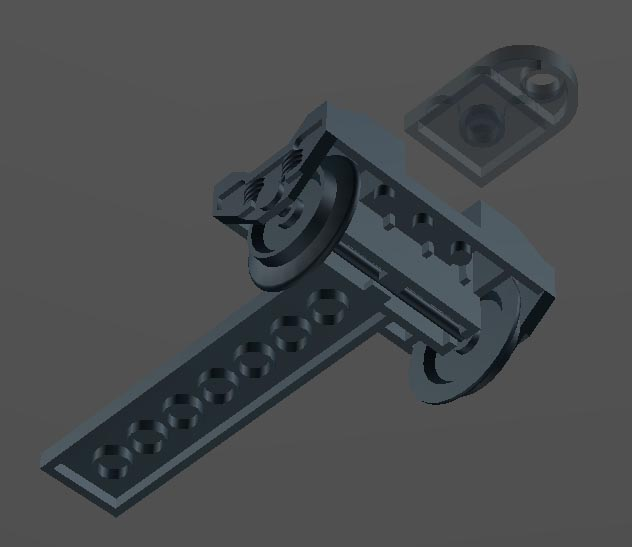

Bien sûr il y a dans LDD un bouton permettant de désactiver la fonctionnalité de connexion automatique, mais cela devient impossible de placer une pièce dans l’espace, puisque vous n’avez qu’une seule vue en 3D. LDD a été conçu pour les enfants et il fonctionne bien si vous ne faites qu’empiler des briques (ou à la limite du SNOT très léger), mais dès que vous cherchez à faire du montage un peu compliqué, ce logiciel vous mettra sur les nerfs !

Après une demi-heure vaine à tenter de réaliser mon châssis, j’ai finalement décidé de modéliser mon wagon sous MLCAD puis de l’importer dans LDD.

Je ne m’étendrai pas sur l’utilisation de MLCAD puisque ce n’est pas le propos de cet article, néanmoins je précise que par habitude, j’ai ajouté des "steps" (étapes) de construction, même si je me doutais que cela n’allait servir à rien dans LDD. Or quelle ne fut pas ma surprise de constater que LDD a utilisé ces "steps" pour générer la notice !! Donc, je vous conseille vivement de bien découper votre montage avec des steps sous MLCAD, la notice de montage générée par LDD en sera que meilleure.

Voici le modèle de mon wagon sous MLCAD :

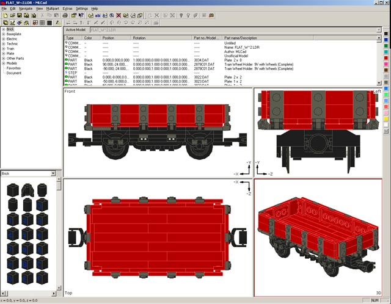

Lors de la modélisation sous MLCAD, je vous conseille d’avoir LDD ouvert en même temps, et de passer d’un logiciel à l’autre, ce qui est maintenant facile vu que LDD s’exécute en mode fenêtré (sous Windows) depuis la version 1.5, et non plus en plein écran comme avant.

Vous seriez avisé de vérifier dans LDD la disponibilité des pièces dans le sachet de pièces utilisables pour LEGO Factory. Au moment où je rédige cet article, il n’y a qu’un seul sachet disponible, il s’agit du sachet "MyTrain". Les sachets utilisables pour LEGO Factory apparaissent dans la fenêtre "Available Assortement". Si vous passez la souris dessus vous avez un petit descriptif qui apparait avec le nom du sachet, le nombre de briques qu’il contient et éventuellement le mot "Expired" s’il n’est plus disponible à la vente. Dans l’image ci-dessous, on constate par exemple que le sachet de briques vertes n’est plus disponible.

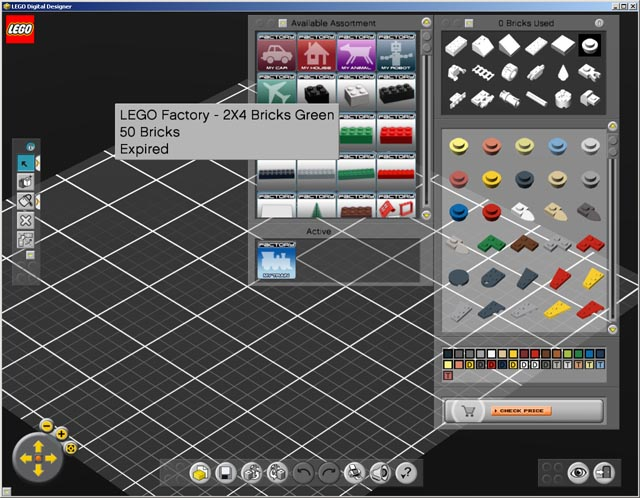

En bas de cette fenêtre apparaissent les sachets actifs, c’est à dire ceux que vous allez utiliser pour votre modèle. Par défaut à la création d’un nouveau modèle, le sachet "MyTrain" est actif. Simplement en cliquant sur les sachets, on les ajoute ou enlève de la liste active.

Donc pour en revenir à la modélisation sous MLCAD, activez le sachet "MyTrain" et uniquement celui-là dans LDD, et assurez-vous que la pièce que vous voulez utiliser dans MLCAD est disponible dans la liste de la fenêtre de droite.

Ne vous tracassez pas trop pour les couleurs sous MLCAD, vous pourrez par la suite les corriger facilement sous LDD. Les couleurs basiques sont bien reconnues par LDD à l’import du fichier \*.ldr, pour les couleurs un peu plus exotiques, c’est moins évident.

Pour ouvrir un fichier au format LDraw (\*.ldr ou \*.mpd) dans LDD, il suffit de le copier dans le répertoire "LEGO Creations\\Models" qui est créé à l’installation de LDD dans votre répertoire "Mes Documents" sur le bureau de Windows (les utilisateurs de Mac trouveront sans doute l’équivalent). Dans LDD, le fichier apparait sous la forme d’une icone avec une brique jaune. En passant la souris dessus, son nom apparait. Cliquez simplement dessus pour l’ouvrir.

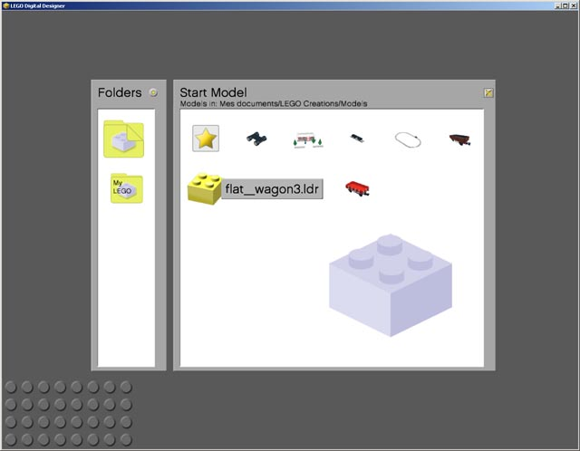

Au cours du montage dans MLCAD, sauvegardez régulièrement puis ouvrez le fichier sous LDD pour vérifier que tout se passe bien. Vérifiez que le nombre de pièces de votre modèle est bien le même sous MLCAD et sous LDD (car LDD ne vous prévient pas forcément s’il n’a pas reconnu certaines pièces). Pour connaître le nombre de pièces dans MLCAD, passez par le menu Extra > Repports > Parts... et pour LDD, le nombre de pièces est affiché en permanence en haut à droite.

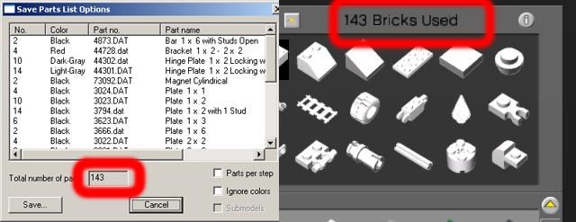

Voici ce que donne l’import de mon modèle de wagon plat dans LDD.

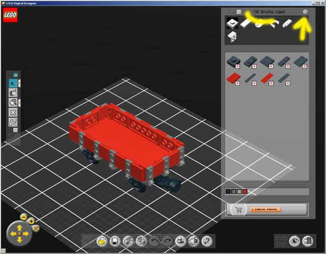

Je constate que deux pièces ont disparu (nombre de pièces souligné en jaune). Je les retrouve assez facilement, il s’agit des barrières placées sous le châssis. Je sais que ces pièces existent dans le sachet "MyTrain", mais apparemment LDD ne les a pas reconnues. On les rajoutera donc plus tard. Mais pour l’instant cliquez sur l’icone en haut à droite indiqué par la flèche jaune, cela ouvre la fenêtre des sachets disponibles.

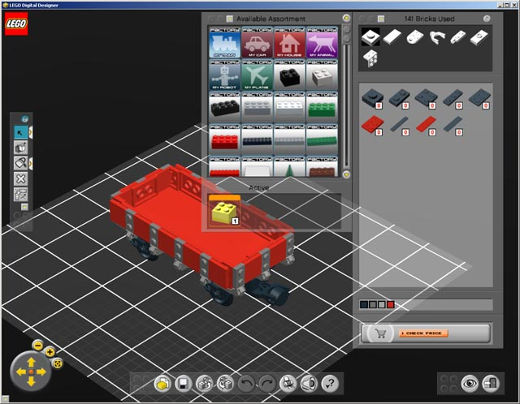

On constate que le sachet actif est un sachet custom représenté par une brique jaune. Si vous téléchargez sur le site LEGO votre modèle maintenant, vous ne pourriez pas l’acheter sur le shop@home, puisque pour cela vous devez utiliser uniquement des sachets disponibles (en l’occurrence ici, le sachet "MyTrain").

Il faut donc ajouter le sachet "MyTrain" en cliquant dessus, comme suit :

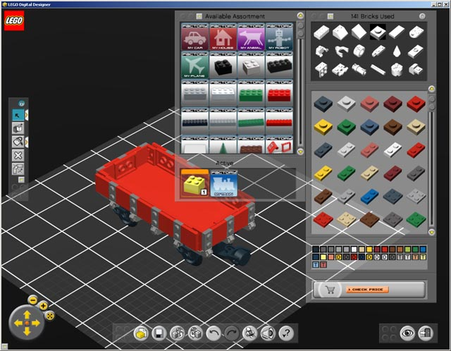

Puis vous devez enlever le sachet custom en cliquant dessus. En enlevant le sachet custom, certaines couleurs de pièces peuvent changer, car LDD essaye de remplacer au mieux les couleurs. Par exemple les gris (anciens gris) vont être remplacés par leur version "bluish" (nouveau gris), de même pour le marron qui sera remplacé par le "reddish" marron (nouveau marron). Il se peut aussi que certaines pièces disparaissent si vous avez utilisé des pièces absentes du sachet "MyTrain". Si cela vous arrive je vous conseille d’aller corriger le problème dans MLCAD et de rouvrir le fichier sous LDD.

Voici le résultat après suppression du sachet custom :

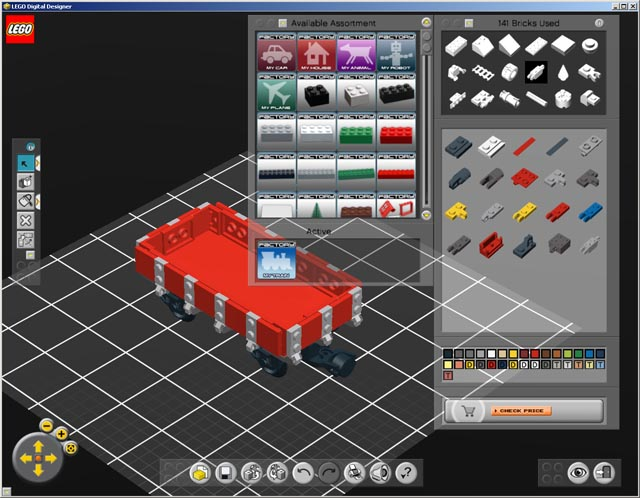

On constate que les charnières en gris foncé ont été remplacées par des charnières en gris clair. Mais on ne peut pas faire grand chose, car en regardant la liste des pièces disponibles, on s’aperçoit que les charnières plates 2x1 mâles n’existent que dans cette couleur !

Si certaines pièces ont changé de couleur et que la couleur ne vous satisfait pas, il y a un moyen simple de corriger les couleur. Cliquez sur l’outil pot de peinture dans la barre d’outils à gauche. Ensuite cliquez sur la pièce dont vous voulez changer la couleur. Une petite palette de couleur apparaît avec la liste des couleurs disponibles pour cette pièce. Le changement de couleur ne bouleverse pas la notice de montage, c’est pour cette raison que je vous conseille d’utiliser cet outil plutôt que de supprimer la pièce et d’en remettre une à la bonne couleur.

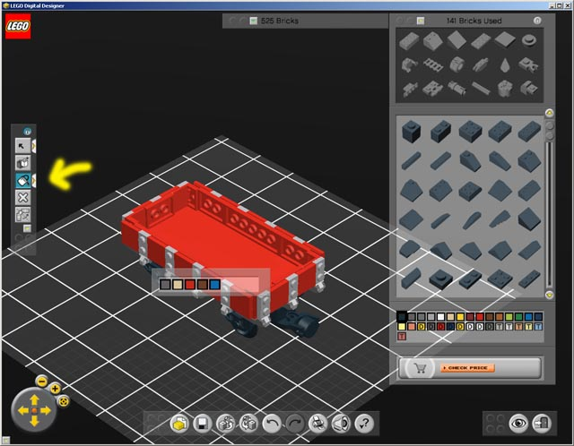

Exemple de changement de couleur d’une pièce : j’ai sélectionné l’outil pot de peinture au bout de la flèche jaune et j’ai cliqué sur une tile du flanc du wagon, il ne me reste plus qu’à choisir la nouvelle couleur.

Pour finir je rajoute les pièces qui manquent car elles n’ont pas été reconnues par LDD, à savoir les barrières sous le châssis. Ces pièces seront rajoutées à la fin lors de la génération de la notice de montage, ce qui peut rendre la notice de montage plus difficile à lire, mais il faudra faire avec.

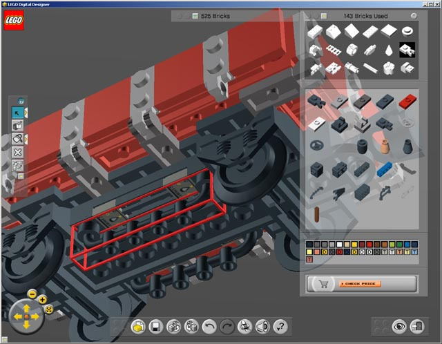

Avant de télécharger votre modèle sur le web, il est fortement conseillé d’ajuster la vue, car c’est la vue courante au moment du téléchargement qui sera utilisée pour générer l’image représentant votre modèle sur le site LEGO. Vous pouvez régler la vue dans le mode construction, mais je vous conseille de passer dans le mode visualisation, car c’est plus sympa et cela vous permettra aussi de vérifier la notice. Pour cela il faut cliquer sur l’icone représentant un oeil en bas à droite de l’écran. Vous obtenez l’écran suivant, dans lequel on constate que l’icone de l’oeil s’est transformé en icone de brique pour repasser dans le mode construction.

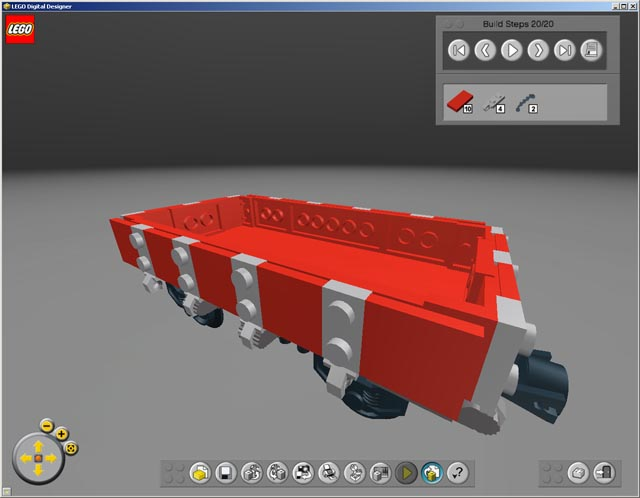

Choisissez une vue sympa pour votre modèle. Voici les raccourcis clavier pour déplacer la vue (ce sont les mêmes que dans MLCAD, car c’est une sorte de standard pour les logiciels de CAD 3D) :  
**–** Alt + clic gauche + souris : tourne la vue  
**–** Alt + clic molette + souris : translate la vue  
**–** molette : zoom in/out

J’ai choisi volontairement de zoomer d’assez près, car j’ai constaté que lors de la génération de l’image par le site LEGO, la vue avait tendance à être reculée d’un cran, ce qui réduit la taille du modèle dans l’image.

Dans ce même écran, vous pouvez faire défiler les étapes de la notice de montage en utilisant les boutons situés en haut à droite de l’écran.

C’est le moment de sauver votre modèle au format LDD (\*.lxf) en cliquant sur l’icone représentant une disquette en bas de l’écran. Donnez lui un nom explicite car ce nom sera automatiquement utilisé sur le site du Shop@Home pour titrer votre modèle. J’ai choisi d’utiliser un nom qui commence par "Save 9V Train" (ou S9VT pour les intimes) juste histoire de soutenir la campagne de sauvetage.

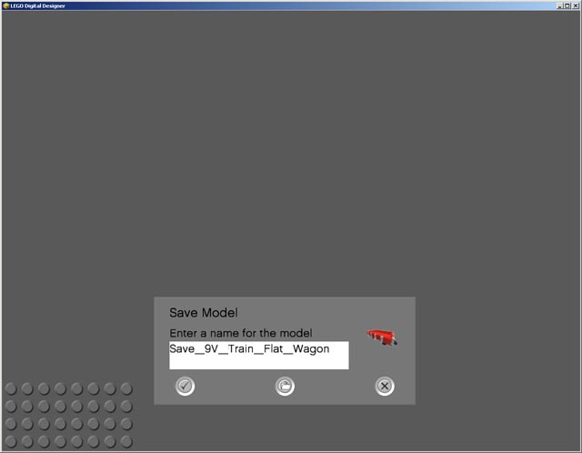

Il ne reste plus qu’à repasser en mode construction et à cliquer sur le gros bouton "check price" avec un caddie. Cela ouvre votre navigateur web favori sur une page du site LEGO avec une licence à approuver.

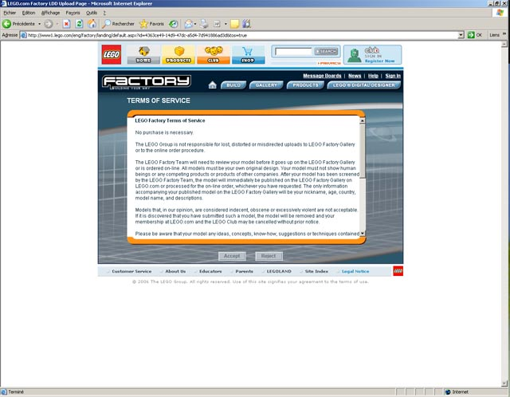

Acceptez la et vous verrez enfin la récompense de tous vos efforts, à savoir votre modèle sur le Shop@Home !!!

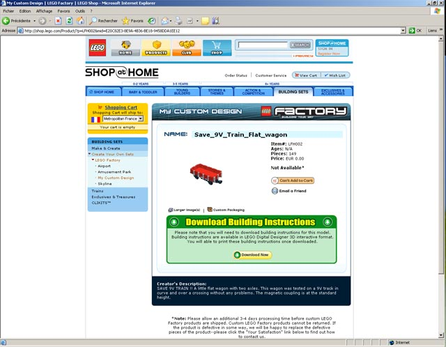

[Le wagon sur le Shop@Home](http://shop.lego.com/Product/?p=LFH002&mid=E20C82E3-8E9A-4B36-BE18-9458DDA1EE12).

Il est possible de personnaliser l’image qui sera imprimée sur la boite lorsque vous commandez sur le shop@home. J’ai testé cette fonctionnalité par curiosité, mais comme c’est assez marginal pour le sujet qui nous préoccupe, je vous laisse découvrir cela par vous-même.

Je ne vous ferai pas l’affront de vous expliquer comment commander sur le Shop@Home, donc passons directement à la réception du modèle. Voici la boite que j’ai reçue :

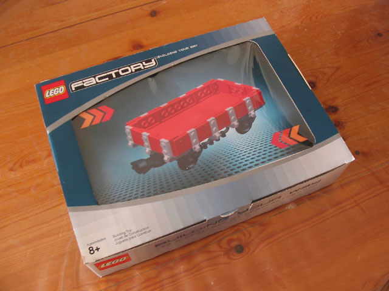

Ah ! Il n’y a pas à dire, ça fait quand même un certain effet de recevoir son propre modèle dans une boite estampillé LEGO !

Une fois déballé, voilà ce dont à quoi on a droit :

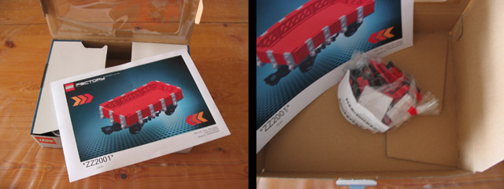

On constate que la boite est au format A4, cela permet à LEGO d’imprimer votre modèle sur une feuille A4 et de la glisser sous le blister. Je précise que la feuille imprimée est de très bonne qualité, du genre papier glacé.

En revanche les pièces sont conditionnées dans un seul sac plastique fermé par un scotche rouge du style de ce que l’on reçoit lorsqu’on commande au BULK.

Sans plus attendre je commence le montage non sans une certaine anxiété. Auront-ils oublié des pièces ?

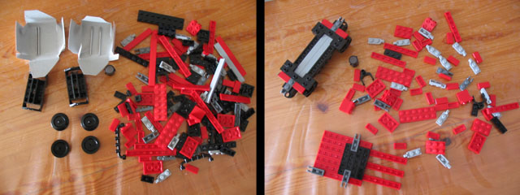

Première surprise, les essieux ne sont pas montés, contrairement à ce dont on a l’habitude de voir pour les sets officiels. Et tout de suite aussi je remarque qu’ils ont mis une boite d’axes métalliques en trop.

La photo de droite a été prise au cours du montage.

Et voici le modèle une fois terminé, à coté du prototype qui m’a servi à le créer :

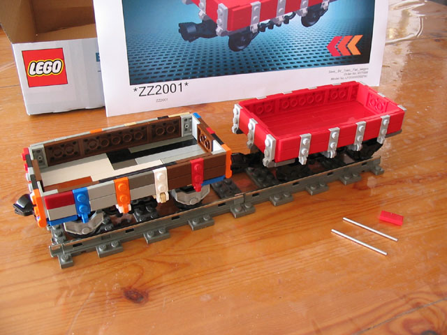

Devant on aperçoit les pièces en trop : les axes métallique et une tile rouge 1x2. Là je suis surpris, car ce n’est pas le genre de pièce qu’on a l’habitude de voir en surnombre. En revanche, pas de plate 1x1 en surplus (ce wagon en compte 4), comme on a l’habitude de voir dans les sets officiels.

Pour finir cet article (j’espère qu’il vous aura donné envie d’essayer LEGO Factory par vous-même), voici mon wagon seul :

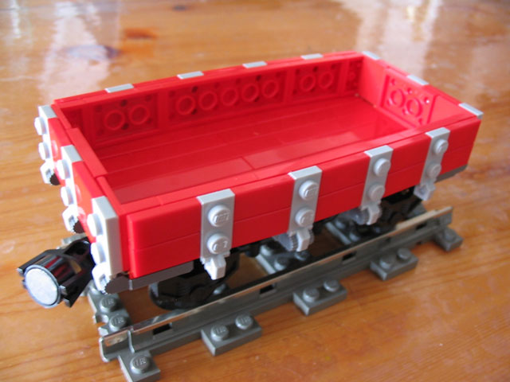

[^1]: En tout cas cela vous permet par exemple d’acheter un seul aiguillage, celui de gauche, ou celui de droite si vous ne voulez pas acheter la boite qui contient les deux aiguillages.
