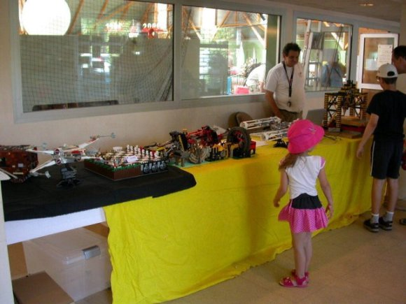
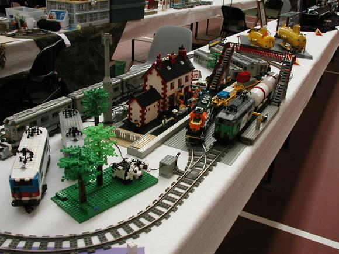

Suite à une rencontre lors du Salon de la Maquette 2005, notre association a été invitée par le DLBM (Deuil La Barre Modélisme) à venir exposer lors de l’exposition pour leur vingtième anniversaire.

C’est sous un week-end ensoleillé que trois de nos adhérents, Richard, Erik et Jean-Louis, ont fait le déplacement. En fait cinq personnes ont participé à cette exposition. Les trois personnes ci-dessus, plus Philo et Didier, qui nous ont prété des modules GBB pour l’un et des trains pour l’autre.

A l’entrée de l’exposition, Richard présentait sa fraiseuse et Jean-Louis maintenait en activité le GBB et présentait quelques modèles UCS StarWars, ainsi que son jeu d’echec sur le thème d’Endor.

**GBB, Fraiseuse et StarWars**

A l’interieur, Erik présentait un petit réseau ferriovaire comprenant sa gare et quelques trains.

**Le réseau**

Petit réseau présentant tout de même quelques trains dont du materiel français, la gare, les vaches et des aiguillages motorisés.

Attendus par quelques exposants et malgré leur déception de voir un si petit réseau, les trains ont toujours eu le même succès, au près des plus jeunes comme des plus agés.

Côté Technic, le GBB et la fraiseuse ont également su surprendre les visiteurs et exposants.

Remercions encore Deuil-La-Barre Modélisme pour l’accueil.
