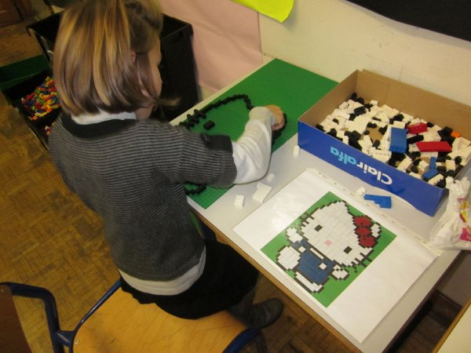
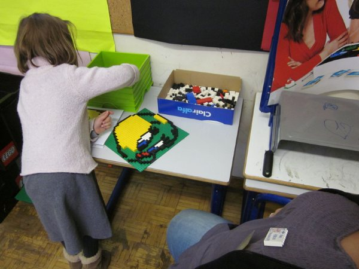
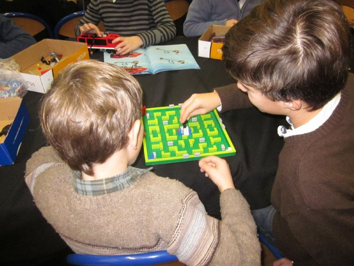
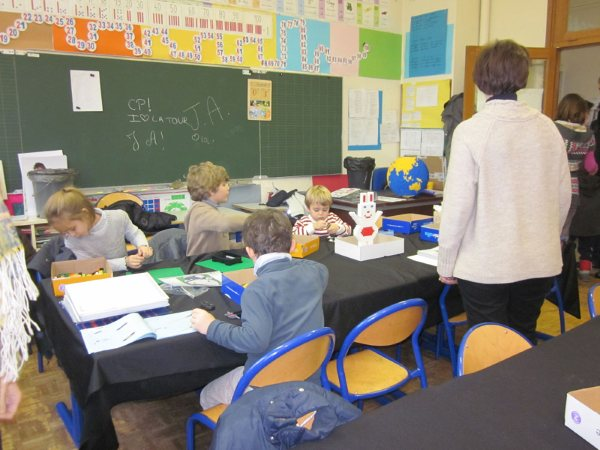
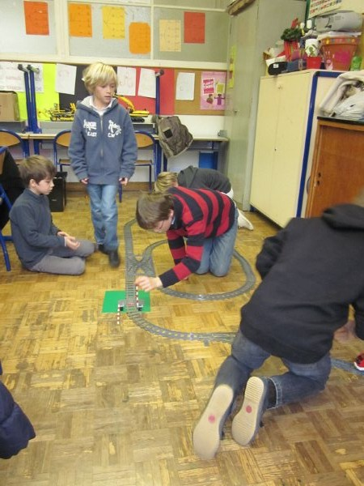

FreeLUG a été contactée par cette association d’écoles afin de mettre en place une ou plusieurs activités autour de la brique LEGO.

Etant volontaire pour participer à ce projet, j’ai pris contact avec les organisateurs afin de discuter de leur souhait quant à l’animation.

Après plusieurs conversations téléphoniques, il en ressort  
que la société LEGO France leur fournit trois caisses de briques de base variées, que les "ateliers" ne durent que 1h, que les enfants ont entre 5 ans et 15 ans, qu’ils doivent s’inscrire sur un planning et que le thème cette année se porte sur l’ile Maurice.

Le défi est donc de trouver des idées d’ateliers respectant les contraintes d’horaire, de pièces, et ayant un intérêt pour tous les âges.

Après une petite enquête auprès des listes de diffusion FreeLUG ainsi que mes propres recherches, il en ressort un certains nombre de propositions. Pour cela je n’ai pas tenu compte des contraintes de disponibilité de la matière premières (au pire me suis je dit, je prend dans mon stock personnel) ainsi que du thème.

Il en ressort un brouillon de documents d’une vingtaine de pages regroupant une douzaine d’activités pouvant intéresser tout les âges et tenir dans le délai d’une heure.

Nous avons ensuite rencontré, Nelly (ma femme), Simon et moi même, une personne de l’association afin de présenter ces différentes activités et de sélectionner les plus intéressantes et les plus pratiques à mettre en place.

Notre choix se porte donc sur :  
**–** des mosaïques  
**–** montages simples,

  
**–** des sets à (re)monter (trains et ToyStory),  
**–** 2 ateliers RCX,  
**–** des livres "d’idées"  
**–** et les jeux de société.

Le week-end de l’animation, nous sommes aidés de quelques parents pour assister les enfants dans leurs constructions.

Environ 150 enfants sont venus nous voir durant le week-end, certains plusieurs fois. Et je dirais qu’il y avait autant de filles que de garçons (y compris sur la robotique)

Parmi les points à améliorer que j’ai pu constater :  
**–** il manquait d’animateurs : il faut souvent aider les plus petits à lire les plans ou trouver les pièces  
**–** j’avais ramené mon stock de rail : dans un premier temps les enfant faisait ce qu’ils voulaient avec, mais la place n’était pas suffisante à terre pour jouer. Le lendemain, j’ai alors pris un nombre réduit de rails que j’ai posés sur les tables. Du coup, j’ai du remonter quelques fois les trains "volants" : il faut donc de la place au sol, bien délimiter si on veux laisser libre les enfants pour faire leur circuit.

**–** j’avais ramené le bulldozer et la pelleteuse, mais les fréquences faisaient conflit avec les train PFS, j’ai donc du les ranger (la salle étant trop petite pour les éloigner)  
**–** les trains et les sets Toys Story ont pu être montés/démontés plusieurs fois : il faut penser à mettre un "règlement intérieur" à l’entrée du stand précisant que la nourriture/confiserie/boisson n’est pas autorisée (des pièces se retrouvent collantes après) , et de mordre les pièces LEGO (un outils spécial est à la disposition des enfants pour le démontage)  
**–** penser à prévoir avec l’organisation, un lieu pour décharger/charger la voiture (éventuellement un parking), et un stand qui ne se trouve pas dans les étages (car il faut tout monter à pied, et c’est plutôt fatiguant).
