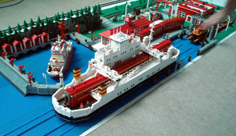
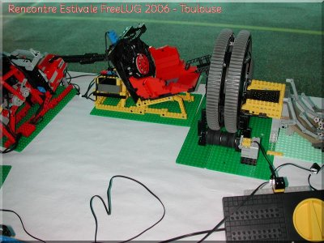
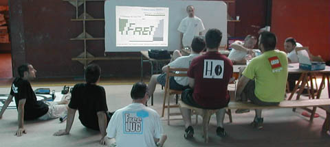
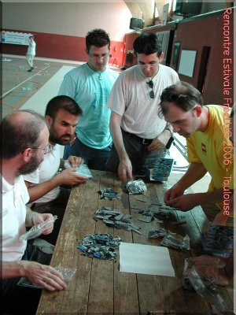
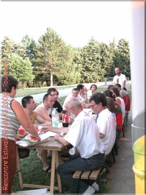
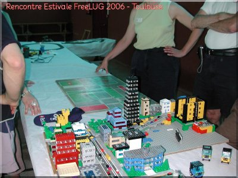
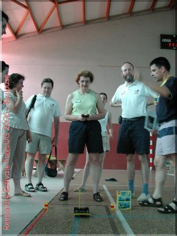
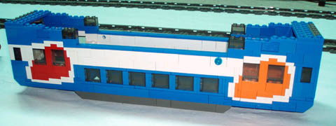
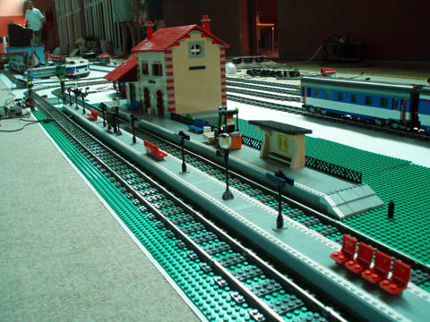

Et voila, la quatrième Rencontre Estivale FreeLUG est finie. Les 14, 15 et 16 Juillet 2006 ont été trois jours bien remplis : modèles, trains, Technic, et de nombreuses présentations.

Trois jours bien occupés et beaucoup de plaisir à tous se retrouver pour la vingtaine de participants à cette rencontre. La chaleur était au rendez vous, peut être même un peu trop dans ce grand gymnase.

La première matinée fut consacrée à l’organisation de la salle, mise en place des tables sur la zone bétonnée, puis déroulage des deux moquettes et des nappes en papier.

Une fois l’installation terminée, nous sommes passés aux choses sérieuses : les LEGO.

Le week-end s’est organisé autour de trois grands axes.

D’un coté le train qui s’est étalé sur une bande d’environ 30m au sol dont une longue ligne droite. Jean-Marc a placé son ensemble port et ferry. De nombreux wagons et locomotives, aux détails que seuls les spécialistes du train détectent, ont ensuite pris place sur le réseau.

En face des trains, sur la zone des tables, le coté technique / robotique. Un pont roulant piloté par Mindstorm, une enfilade de lanceur de balles, pardon de [GBB](/articles/362/), un NXT et différentes autres constructions.

**GBB**

Et enfin le troisième aspect, non négligeable, fut celui des présentations. Chacune fut l’occasion d’en apprendre un peu plus sur des sujets dont d’autres adhérents discutent : NQC, MLCAD, SNOT, Brickfinder. Le planning précis du week-end a permis à chacun de pouvoir s’organiser et suivre les présentations qui l’intéressait le plus.

Un draft a également pris place la dimanche grace à Alain (Grrr\_31). La technique fut simple, des tas de pièces identiques selon le nombre de boites à l’origine. Les boites choisies furent le [mini ISD](http://guide.lugnet.com/set/4492) et le [mini shuttle](http://guide.lugnet.com/set/4494) Star Wars. Comme d’habitude, des joies et des regrets sur les pièces obtenues. « Ohhh j’voulais celle la ... »

**draft**

Les repas du midi ont été l’occasion de discuter de notre sujet préféré, à l’ombre sur des tables le long du batiment.

L’arrivée des pizzas du vendredi soir à été un moment attendu ! Presque autant que les premières saucisses de Toulouse cuites au barbecue du samedi soir. Saucisses que nous sommes ensuite allés digérer en regardant le feu d’artifices sur la commune d’à coté, Montgiscard, en bord du canal du midi.

**Vendredi soir : Pizza et pastèque**

Ces dames et demoiselles ont également profité de la région en se rendant le samedi au lac de St Férréol où elles purent se baigner. D’autres se sont rendus à la cité de l’Espace le vendredi ou le dimanche.

Le week-end a commencé par un restaurant avec les premiers arrivés le jeudi soir au "Tommy’s" du coté de Labège et fini par à nouveau un restaurant le "O’quebec" pour donner un avant-goût canadien à Erik.

**Khan**

Oussk’il a fait chaud ! Heureusement que la quantité de boissons avait été prévu. Les Toulousains se sont donnés à fond pour que tous passent un excellent week-end. Merci aux compagnes qui ont cuisinées pour nous.

J’ai beaucoup apprecié de voir un beau réseau de train, qui même au sol ne perd rien de sa valeur. Peut etre même plus agréable car on pouvait s’alonger sur la moquette.

Eric nous a ravit avec sa ville en micro-taille sur 3 plaques grises 48\*48. Il nous a également fait le plaisir d’amener quelques gadgets sur le thème de LEGO.

**microville**

la ville micro-taille d’Eric

Les présentations furent vraiment l’occasion d’apprendre. J’espère que Jean s’en sortira avec tant d’info pour son petit neurone ! Il a courageusement assisté à tout ! Chapeau ma poule :). Le planning précis a vraiment été un atout non négligeable, certes pas évident à mettre en place, il a fallut courrir après les orateurs !

Rémi nous a beaucoup amusé avec sa course de voiture impilotable, enfin surtout pour la gente féminine ! La taille du gymnase fut une aire de jeu excellente pour cette petite voiture qui n’avance pas bien vite.

**course**

En tout cas, merci à tout ceux qui ont aidés à l’organisation de ce week end, présent ou non. Certes, la salle a été obtenue que tardivement, ce qui a eu pour conséquence d’avoir peut être moins de participants. Par contre, l’organisation était carré et à permis à tous de savoir ce qui se passait et quand.

Bon, on attend maintenant les propositions pour la REF 2007 !!!

**Didier Enjary**

Pour ma part j’ai surtout retenu trois thèmes : le train, le Technic et le CAD.

Parmi le train, le plus bel ensemble est sans doute celui de Jean-Marc avec son imposante et détaillée reconstitution d’une zone portuaire avec un transbordement de wagon ferroviaire sur ferry.

Erik comme à son habitude à réussi encore une fois à placer un maximum de SNOT dans ces créations, notamment dans ses matériels roulants. La réalisation de plusieurs livrées a donné une impression de feu d’artifices de couleurs bien en vogue en ce week-end du 14 juillet.

Banban, toutefois, n’était pas en reste avec sa gare, sa locomotive New Heaven et ses wagons LDD. Toutefois il faisait concurrence à Xavier avec ces feux couplés à des cantonnements.

Xavier avait amené ses nombreux "bricolages" : rails et aiguillages modifiés et alimentation surpuissante pour propulser le TGV sur les 20m de droites.

En Technic, je retiendrais particulièrement les nouveautés que nous avons pu admirer grâce à Nicolas, Philo et Rémi. (pardon à ceux que j’oublie). Pendant que le NXT de Philo perdait la boule, ces GBBs, eux, nous faisaient tourner en rond - Annie préférant pour sa part se concentrer sur une grue à chenille récalcitrante. Nicolas était très fier de nous montrer la nouvelle dépanneuse à laquelle apparemment il ne manquait plus aucune pièce. Rémi pour sa part nous amusait avec un concours de pilotage.

Puis, Erik nous a présenté en détail ses astuces de montage de très haut vol. Enfin, épaulé par Banban et avec les commentaires avisés de Philo nous avons présenté les logiciels de CAO "MLCAD" et "LPub". Steps et Buffer Exchange sont un peu moins obscurs aujourd’hui qu’ils ne l’étaient hier, je l’espère.

**Banban**

Je précise que ma gare était une exclusivité REF 2006 et qu’elle sera détruite très prochainement. Le but de ce MOC était uniquement de mettre en situation mon [système de cantonnement](https://www.freelug.org/spip.php?article517) dont vous retrouverez l’article sur le site de FreeLUG.

Les tests grandeur nature du système de cantonnement n’ont pas été inutiles, entre les faux contacts que Xavier bouchait avec son doigt, et les aiguillages qui isolaient certaines portions, pas facile de faire tomber le système en marche !

D’autre part n’oublions pas l’atelier "cublego" qui aurait mérité un peu plus de participants. Un manque certain de cubes pleins pour surélever les autres cubes a sans doute limité les possibilités.

Enfin mentionnons la visite de quelques passionnés qui ont su dénicher l’adresse et qui ont été très généreux avec la boite à don, sans doute ont-ils apprécié la visite ?

**Eric chatpin31**

Je suis très heureux d’avoir retrouvé des fans de briques après ma première rencontre à L’AG 2006. J’ai passé de bons moments en profitant des constructions des autres membres , lors d’échanges d’idées , de pièces et n’oublions pas les rigolades lors des repas. Sylvie et moi sommes très contents de ce week-end et nous espèrons vous revoir à d’autres occasions.

## Photos de la rencontre

[FreeLUG Photos](http://photos.freelug.org/main.php/v/FreeLUG/Evennements/ref2006/photos/)

[Didier BS](http://www.brickshelf.com/cgi-bin/gallery.cgi?f=194626)

[Jac BS](http://www.brickshelf.com/cgi-bin/gallery.cgi?f=194582)

[Remi BS](http://www.brickshelf.com/cgi-bin/gallery.cgi?f=194956)

[Eric FreeLUG](http://gallery2.freelug.org/main.php/v/chatpin/ref+2006/)
