LEGO nous avait habitué à modifier régulièrement le système d’alimentation de ses trains. Après avoir utilisé les grosses piles, le 12v, le 9v, c’est le retour des piles pour notre plus grand malheur ou bonheur. Voici ce que je pense de ce nouveau système. Je connais tous les anciens systèmes.

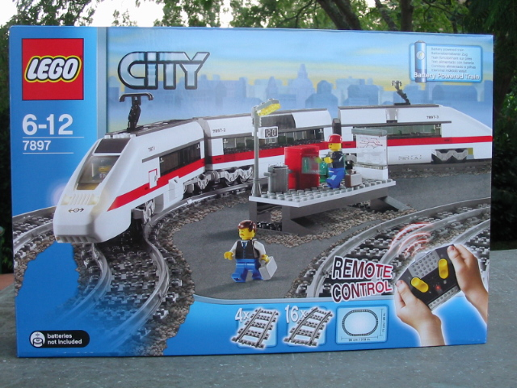

**7897**

la boite.

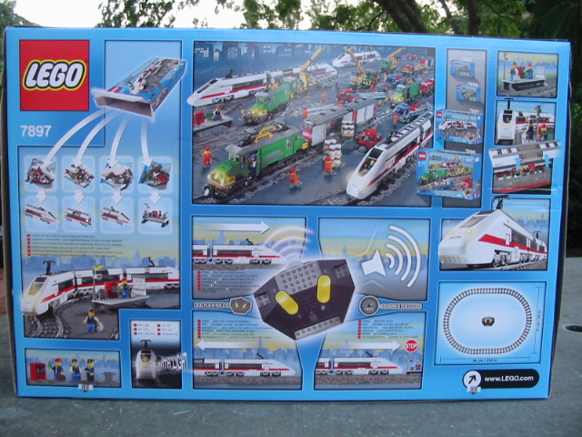

**7897**

le dos de la boite

## **Montage**

L’ouverture de la boîte se passe sans encombre.  
Le set est réparti en quatre sachets et, à part, on trouve : le moteur, la télécommande, les aimants, la planche autocollante, les nouveaux rails, les livrets d’instructions, les bases de trains et les metapièces du cockpit.

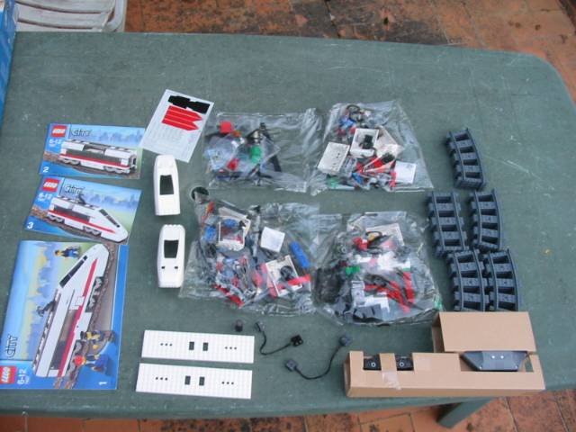

revue des pièces

Le montage se fait en suivant les 4 livrets d’instructions correspondant aux 4 sachets. Les roues de train sont maintenant en pièces détachées. Il faut assembler les axes des roues. Le nouveau moteur est assez léger en poids. Le montage est très facile, pas de technique particulière. Les autocollants sont à manier toujours avec finesse. Par contre, on constaste un jeu important au niveau de la metapièce cockpit, regrettable.

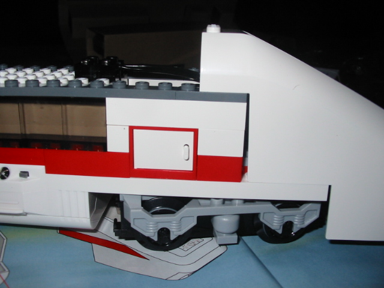

**cockpit**

jeu entre la metapièce et le reste de la locomotive.

Vue des ergots pour le boîtier de piles. A manier prudemment.

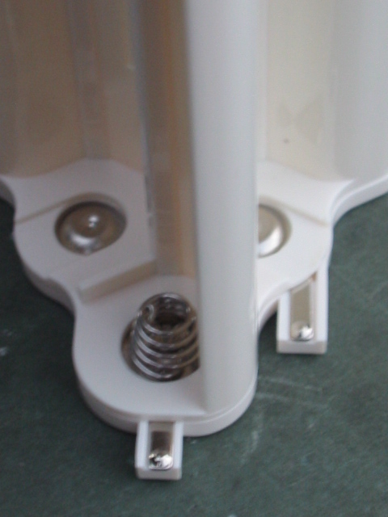

**boitier à piles**

Au rayon nouveauté, les roues du moteur ont une bande caoutchouteuse pour une meilleure adhérence.

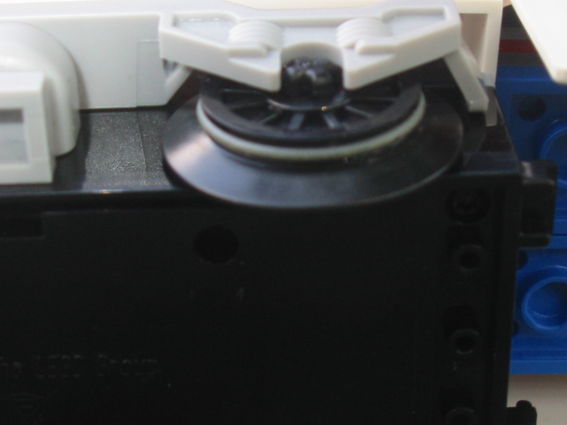

**roue motrice**

## **Ca roule**

Ne pas oublier de mettre les 6 piles LR6 pour le moteur et les 3 piles de la télécommande. 9 piles en tout.  
La prise en main est facile, on arrive à bien doser les accélerations et les ralentissements. Il y un bouton pour arrêter le train d’un coup et un pour le klaxon : le gadget qui plaira aux enfants. Les boutons sur le train, ON/OFF et sélecteur de fréquence, sont un peu petits pour les adultes.

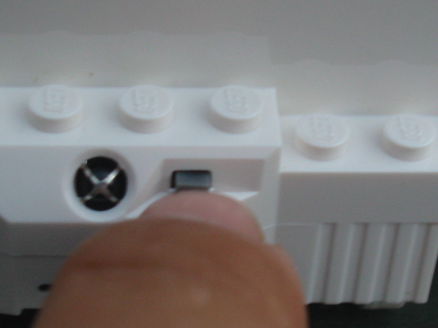

**bouton ON/OFF**

Pour accéder au sélecteur de fréquence sur le train, il faut soulever le toit.

Pas de problème particulier pour le faire rouler sur les rails 9 volts. Attention à l’encombrement des parties avant et arrière qui sont très importantes comparées aux autres trains déjà sortis. Cela peut poser problème sur des réseaux déjà construits. Par contre, une petite led rouge éclaire la voie au niveau du module irc. Dommage qu’elle marche tout le temps, ce n’est pas du meilleur effet. Le train émmet un léger sifflement lorsque le moteur marche.

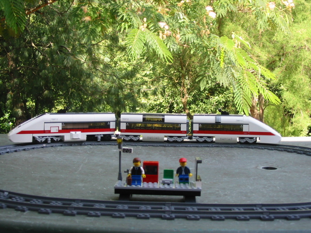

## Impression

Je trouve le train un peu plus joli en vrai que sur les photos. Cela reste malgré tout le train le moins réussi que LEGO a fait. Le principal intérêt est sans doute le nouveau système de commande qui pour moi marche bien. Restent les plus gros inconvénients de ce sytème : les piles à changer et l’encombrement du boîtier dans la locomotive. Quant à la réutilisation des pièces, là je suis plus sceptique. La base de train avec le support à piles supportera mal les moc. Au niveau des pièces, les metapièces cockpit (un peu moins moches avec les autocollants) ainsi que les pièces de toit ne sont pas très réussies. C’est dommage, je trouve que le mélange des couleurs est réussi. Le train est un peu plus grand que le précédent : plus de voitures et train plus long. La loco et le wagon de queue n’ont pas la même longueur, dommage. La voiture passager est la plus réussie ainsi que le quai, même s’il manque la rampe d’accès pour les piétons. Je trouve que l’intérieur est un peu nu et manque d’originalité. Trois minifigs dans le set font un peu juste.

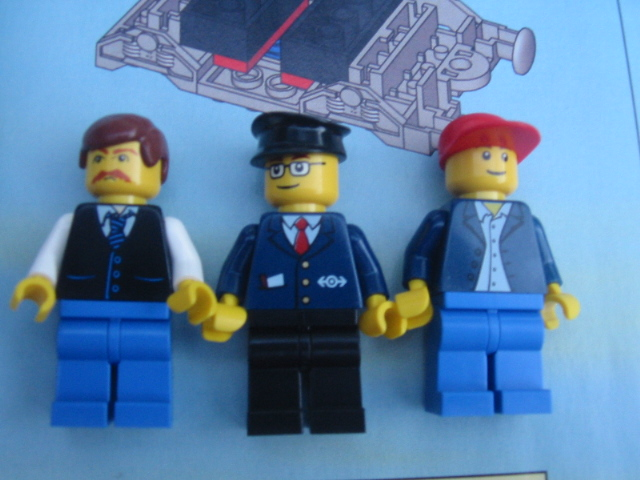

**3 minifigs**

Je suis plutôt inquiet pour les nouveaux trains à venir. Je me demande comment on pourrait motoriser la loco BNSF (par exemple) avec ce système. Le train de marchandise me semble beaucoup plus attractif (il sera livrable début septembre). Dans les derniers trains sortis, je trouve les trains marchandises beaucoup plus attractifs. Reste le coût des rails qui est très nettement inférieur aux rails métalliques 9V. Cela reste un train acceptable au niveau de son prix mais d’un intérêt limité pour les AFOLs.

_L’avis de Sylvie_

Le montage est très facile. J’ai été agréablement surprise par la longueur des wagons et la taille finale du train. Il fait beaucoup plus petit sur le site. Bonne surprise également en ce qui concerne les couleurs. Il rend plutôt pas mal.

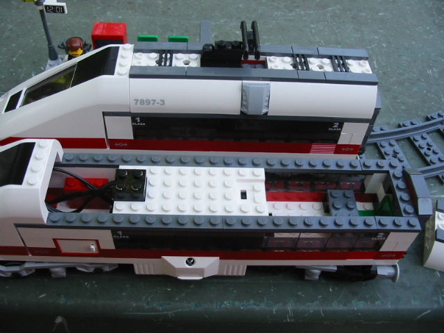

**locomotive**

un peu vide

Par contre, Ils auraient pu faire un effort pour l’aménagement des wagons. La locomotive est vide à l’arrière. Le wagon, qui a une partie du toit transparent, laissait présager un peu plus d’imagination que 3 pauvres tables.  
Je suis déçue par les toits préformés d’autant que d’autres pièces de toit existent. Mais la déception finale concerne le poste de pilotage.  
Pour moi, c’est la catastrophe, tant sur le plan esthétique que sur le plan technique. La jointure entre le poste de pilotage et la locomotive est monstrueuse (peut-être devrait-on leur apprendre à utiliser une équerre).

Vivement le train de marchandises. Ce n’est pas possible que ce soient les mêmes concepteurs.

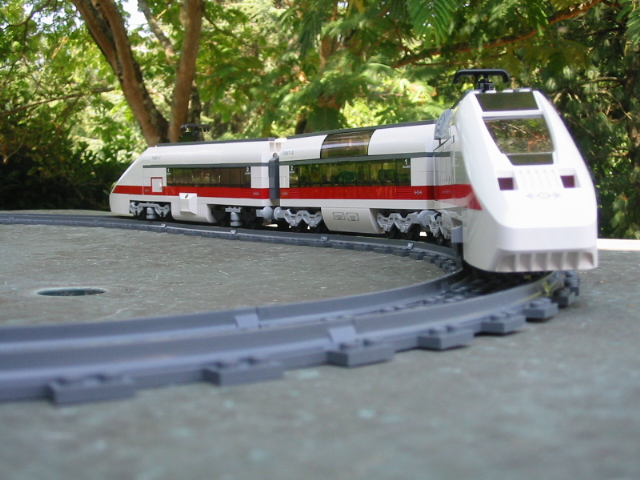
