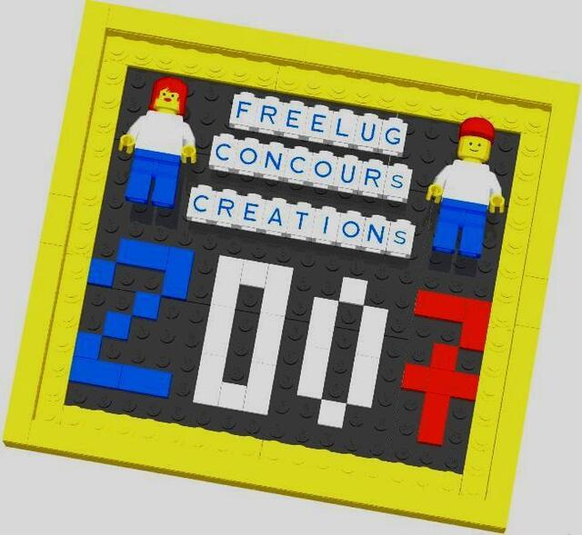

FreeLUG propose à ses adhérents un concours de créations en briques LEGO pour son Assemblée Générale 2007.

**Logo concours**

Logo pour le concours de l’Assemblée Générale 2007

Les créations seront présentées en vrai le jour de l’Assemblée Générale. Les photos des créations seront ensuite déposées sur le site web de FreeLUG, sauf si le participant s’y oppose expressément. Tous les thèmes peuvent être abordés. Chaque participant recevra un lot.

**Bonne chance à tous !**

## Règlement du concours de créations en briques LEGO 2006-2007

_Article 1 :_ Les participants doivent être à jour de leur cotisation à l’association FreeLUG au titre de l’année 2007.

_Article 2 :_ Les créations seront présentées lors de l’Assemblée Générale qui aura lieu les 17 et 18 Février 2007.

_Article 3 :_ Le Jury est composé des membres du CA.

_Article 4 :_ Les créations doivent être originales. Sont exclus les modèles officiels. Sont exclues également les créations qui pourraient représenter des scènes ou objets à caractère discriminatoire envers une personne ou un groupe de personnes, et/ou une atteinte aux mœurs.

_Article 5 :_ Chaque participant peut présenter plusieurs créations. Par souci d’équité il ne sera récompensé qu’une seule fois si plusieurs de ses œuvres sont retenues après la délibération du jury.

_Article 6 :_ Seul le jury aura compétence pour gérer tout litige concernant la participation ou les récompenses entre les participants.

_Article 7 :_ Le jury se réserve le droit d’annuler le concours si le nombre de participants n’était pas suffisant (inférieur à 10) ou pour toute autre circonstance exceptionnelle.
