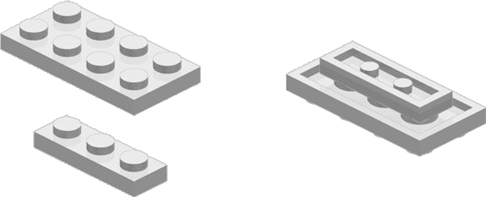

Nous vous avions laissé dans [l’article précédent](/articles/531/) avec cette interrogation : 6 ou 8 de large pour mes trains ?..en vous donnant le pour et le contre mais sans vraiment trancher...et pour cause, il fallait y penser mais il existe une meilleure solution : c’est le 7.

Il est vrai cette "solution" n’est pas évidente car 7 est un nombre impair, c’est pour cela que nous n’y avions pas pensé immédiatement.

Comme nous l’avions vu, si l’on souhaite respecter les proportions entre l’écartement des voies et la largeur des matériels roulants, le 8 de large est bien plus adapté que le 6 de large.

Mais d’autres éléments comme les tailles des roues disponibles, les rayons de courbure des rails rendent les 8 de large tout aussi inadaptés. Il faut dès lors faire un compromis : c’est le 7 de large.

Le 7 tenons de large cumule les avantages du 6 et du 8 de large :  
**–** possibilités d’inclure des détails pour le réalisme.  
**–** encombrements réduits pour une bonne circulation sur les réseaux.

Le seul problème réside dans les techniques de montage pour obtenir des dimensions impaires et surtout pour faire cohabiter les dimensions paires et impaires. La solution réside dans le décalage d’une pièce par rapport à une autre d’un demi-tenon.

Pour y parvenir nous pouvons utiliser une pièce présentant elle même un décalage. La première qui nous vient à l’esprit car elle est courante est la "jumper plate" :

mais d’autres peuvent être très utiles aussi :

Enfin ne résistons pas à vous montrer ce montage astucieux, ne réclamant pas de pièces rares, très solide et malgré cela peu utilisé :

La [motrice de Pascal](http://www.brickshelf.com/cgi-bin/gallery.cgi?f=119428) est une 8 de large mais le capot moteur est large de 5 tenons, grâce à l’emploi de jumper plates.

Vous trouverez dans la webographie des exemples de réalisations.

**Webographie**

[LEGO Trains in perfect size](http://www.brickshelf.com/cgi-bin/gallery.cgi?f=74539), Reinhard Beneke, 2004

[Homa’s world of Bricks](http://www.holgermatthes.de/bricks_us/index.htm?http://www.holgermatthes.de/bricks_us/offset.htm), Holger Matthes
