Petit à petit, le nombre de maquettes de locomotives (et autres matériels roulants) créées par des fans adultes de LEGO ne cesse d’augmenter.

Cet article a pour but de recenser ces maquettes. Vous pourrez ainsi, si vous le désirez, prendre connaissance de ce qui a déjà été fait avant de vous lancer dans la reproduction d’un modèle. Toutefois, nous nous sommes limités aux modèles ayant circulé en France.

La liste ci-dessous présente les modèles avec un lien vers une galerie de photos de la maquette correspondante. Ces photos permettent souvent à elles seules de reproduire la maquette en les étudiant de près. Parfois vous trouverez aussi un lien vers le ficher CAO (MLCAD) de la maquette. Au mieux, le lien vers la notice de montage est donné.

## Locomotives électriques

**BBB6002**

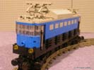

  
**–** Auteur : Philippe Label (fr)  
**–** Galerie : [http://photos.freelug.org/main.php/...](http://photos.freelug.org/main.php/v/Frogleap/Le-grenier-aux-Lego/Trains/BBB-6002/)

**BB7200**

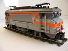

  
**–** Auteur : Alban Nanty (fr)  
**–** Galerie : [http://www.brickshelf.com/cgi-bin/g...](http://www.brickshelf.com/cgi-bin/gallery.cgi?f=152867)  
**–** Fichier CAD : [http://www.brickshelf.com/gallery/B...](http://www.brickshelf.com/gallery/Banban/BB7200-Loco/bb7200.mpd)

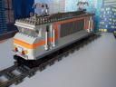

  
**–** Auteur : Loys Bailly (fr)  
**–** Galerie : [http://www.brickshelf.com/cgi-bin/g...](http://www.brickshelf.com/cgi-bin/gallery.cgi?f=181302)

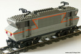

  
**–** Auteur : Emmanuel Bernard (fr)  
**–** Galerie : [http://www.oab.fr/LEGO/train%20LEGO...](http://www.oab.fr/LEGO/train%20LEGO%20SNCF.htm)

**BB8500**

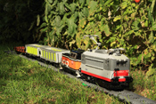

  
**–** Auteur : Paul Mauduit (fr)  
**–** Galerie : [https://www.flickr.com/photos/13110...](https://www.flickr.com/photos/131103326@N05/albums/72157677744469852)

**BB8501**

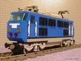

  
**–** Auteur : Philippe Label (fr)  
**–** Galerie : [http://photos.freelug.org/main.php/...](http://photos.freelug.org/main.php/v/Frogleap/Le-grenier-aux-Lego/Trains/BB-8501/)

**BB9200 Capitole**

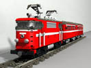

  
**–** Auteur : Timothy Gould (au)  
**–** Galerie : [http://www.brickshelf.com/cgi-bin/g...](http://www.brickshelf.com/cgi-bin/gallery.cgi?f=172809)  
**–** Fichier CAD : [http://www.brickshelf.com/gallery/t...](http://www.brickshelf.com/gallery/timgould/Trains/TrainMPDs/capitole_v1.mpd)

**BB15000**

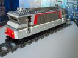

  
**–** Auteur : Loys Bailly (fr)  
**–** Galerie : [http://www.brickshelf.com/cgi-bin/g...](http://www.brickshelf.com/cgi-bin/gallery.cgi?f=181303)

**BB17000/BB25500**

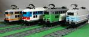

  
**–** Auteur : Erik Amzallag (fr)  
**–** Galerie : [http://photos.freelug.org/main.php/...](http://photos.freelug.org/main.php/v/brickerik/Moc/trains/BB17000/)

**BB 26000 Sybic**

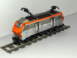

  
**–** Auteur : Tim Gould (au)  
**–** Galerie : [http://www.brickshelf.com/cgi-bin/g...](http://www.brickshelf.com/cgi-bin/gallery.cgi?f=184763)  
**–** Fichier CAD : [http://www.brickshelf.com/gallery/t...](http://www.brickshelf.com/gallery/timgould/Trains/TrainMPDs/sybic.mpd)

**BB 75000**  
**–** Auteur : Denis Huot (fr)  
**–** Notice : [La BB 675084 Infra : la notice](/articles/1569/)

**CC6500**

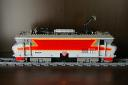

  
**–** Auteur : Alain Parra (fr)  
**–** Galerie : [http://www.brickshelf.com/cgi-bin/g...](http://www.brickshelf.com/cgi-bin/gallery.cgi?f=383080)  
**–** Article : [MOC - Locomotive CC 6500 RC / 1ère partie](/articles/779/)  
**–** Notice : [MOC - Locomotive CC 6500 RC / 3ème et dernière partie](/articles/736/)

**CC40100**

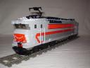

  
**–** Auteur : Nicolas Filatre (fr)  
**–** Galerie : [http://www.brickshelf.com/cgi-bin/g...](http://www.brickshelf.com/cgi-bin/gallery.cgi?f=241208)

**Traxx E 186 Euro Cargo Rail**

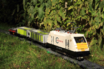

  
**–** Auteur : Paul Mauduit (fr)  
**–** Galerie : [https://www.flickr.com/photos/13110...](https://www.flickr.com/photos/131103326@N05/albums/72157655805189312)

## TGV

**Duplex**

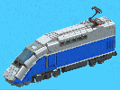

  
**–** Auteur : James Mathis (us)  
**–** Galerie : [http://www.brickshelf.com/cgi-bin/g...](http://www.brickshelf.com/cgi-bin/gallery.cgi?f=27375)  
**–** Notice : [http://www.brickshelf.com/cgi-bin/g...](http://www.brickshelf.com/cgi-bin/gallery.cgi?f=27376)

**PBKA**

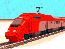

  
**–** Auteur : James Mathis (us)  
**–** Galerie : [http://www.brickshelf.com/cgi-bin/g...](http://www.brickshelf.com/cgi-bin/gallery.cgi?f=26383)  
**–** Fichier CAD : [http://www.brickshelf.com/gallery/j...](http://www.brickshelf.com/gallery/jamathis/Trains/Passenger/ThalysPBKA/v1/z_thalys_v1.mpd)

**Nord**

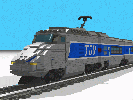

  
**–** Auteur : James Mathis (us)  
**–** Galerie : [http://www.brickshelf.com/cgi-bin/g...](http://www.brickshelf.com/cgi-bin/gallery.cgi?f=28106)  
**–** Fichier CAD : [http://www.brickshelf.com/gallery/j...](http://www.brickshelf.com/gallery/jamathis/Trains/Passenger/TGVNord/v1/z_tgv_nord_v3.mpd)

**Postal**

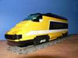

  
**–** Auteur : Xavier Viallefont (fr)  
**–** Galerie : [http://www.brickshelf.com/cgi-bin/g...](http://www.brickshelf.com/cgi-bin/gallery.cgi?f=173965)

## Automotrices électriques

**MS 61 rénovée**

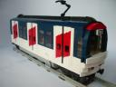

  
**–** Auteur : Arnaud/74louloute (fr)  
**–** Galerie : [http://www.brickshelf.com/cgi-bin/g...](http://www.brickshelf.com/cgi-bin/gallery.cgi?f=397017)

**Z6300**

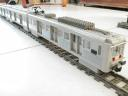

  
**–** Auteur : Erik Amzallag (fr)  
**–** Galerie : [http://www.brickshelf.com/cgi-bin/g...](http://www.brickshelf.com/cgi-bin/gallery.cgi?f=229986)  
**–** Galerie : [http://photos.freelug.org/main.php/...](http://photos.freelug.org/main.php/v/brickerik/Moc/trains/Z6300/)

**Z20500**

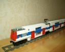

  
**–** Auteur : Pascal Brugier (fr)  
**–** Galerie : [http://www.brickshelf.com/cgi-bin/g...](http://www.brickshelf.com/cgi-bin/gallery.cgi?f=34212)

## Automotrices thermiques

**X4300**

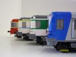

  
**–** Auteur : Nicolas Filatre (fr)  
**–** Galerie : [http://www.brickshelf.com/cgi-bin/g...](http://www.brickshelf.com/cgi-bin/gallery.cgi?f=268540)

## Locomotives diesels

**BB61000**

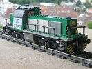

  
**–** Auteur : Nicolas de Strasbourg (fr)  
**–** Galerie : [http://lego.nico.free.fr/lego-fret.htm](http://lego.nico.free.fr/lego-fret.htm)

**BB62400 bleue et jaune/grise**

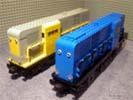

  
**–** Auteur : Philippe Label (fr)  
**–** Galerie : [http://photos.freelug.org/main.php/...](http://photos.freelug.org/main.php/v/Frogleap/Le-grenier-aux-Lego/Trains/BB62400/)

**BB63000 Arzens**

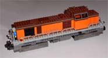

  
**–** Auteur : Pascal Bréard (fr)  
**–** Galerie : [http://www.brickshelf.com/cgi-bin/g...](http://www.brickshelf.com/cgi-bin/gallery.cgi?f=117364)  
**–** Fichier CAD : [http://www.brickshelf.com/cgi-bin/g...](http://www.brickshelf.com/cgi-bin/gallery.cgi?f=119539)  
**–** Notice : [http://www.brickshelf.com/cgi-bin/g...](http://www.brickshelf.com/cgi-bin/gallery.cgi?f=119428)

**BB63000 Fret**

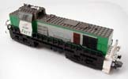

  
**–** Auteur : Pascal Bréard (fr)  
**–** Galerie : [http://www.brickshelf.com/cgi-bin/g...](http://www.brickshelf.com/cgi-bin/gallery.cgi?f=43244)

**BB67000**

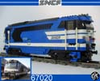

  
**–** Auteur : Jérôme Tessier (fr)  
**–** Galerie : [http://www.brickshelf.com/cgi-bin/g...](http://www.brickshelf.com/cgi-bin/gallery.cgi?f=209565)

**BB 67400**

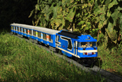

  
**–** Auteur : Paul Mauduit (fr)  
**–** Galerie : [https://www.flickr.com/photos/13110...](https://www.flickr.com/photos/131103326@N05/albums/72157650643451006)

**A1A A1A 68000**

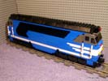

  
**–** Auteur : Philippe Label (fr)  
**–** Galerie : [http://photos.freelug.org/main.php/...](http://photos.freelug.org/main.php/v/Frogleap/Le-grenier-aux-Lego/Trains/A1A-A1A-68000/)

**CC72000**

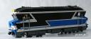

  
**–** Auteur : Alain Parra (fr)  
**–** Galerie : [http://www.brickshelf.com/cgi-bin/g...](http://www.brickshelf.com/cgi-bin/gallery.cgi?f=383081)  
**–** Article et notice : [MOC : CC 72000 « PFS Ready »](/articles/891/)

## Autorails (diesel)

**X-73500**

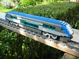

  
**–** Auteur : Nicolas de Strasbourg (fr)  
**–** Galerie : [http://lego.nico.free.fr/autorail.htm](http://lego.nico.free.fr/autorail.htm)

## Vapeurs

**030TB**

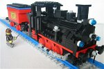

  
**–** Auteur : Nicolas de Strasbourg (fr)  
**–** Galerie : [http://lego.nico.free.fr/legodecauv...](http://lego.nico.free.fr/legodecauville.htm)

**141R**

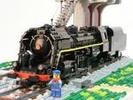

  
**–** Auteur : Richard Lemeiter  
**–** Galerie : [http://photos.freelug.org/main.php/...](http://photos.freelug.org/main.php/v/Charlie/ATAT/141R840/)

## Locotracteurs, draisine et autres matériels moteurs

**Draisine**

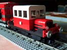

  
**–** Auteur : Loys Bailly (fr)  
**–** Galerie : [http://www.brickshelf.com/cgi-bin/g...](http://www.brickshelf.com/cgi-bin/gallery.cgi?f=182663)  
**–** Fichier CAD : [http://www.brickshelf.com/gallery/C...](http://www.brickshelf.com/gallery/Chimere/MOCs/Draisine/draisine.mpd)

**Draisine**

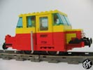

  
**–** Auteur : Jérôme Teissier (fr)  
**–** Galerie : [http://www.brickshelf.com/cgi-bin/g...](http://www.brickshelf.com/cgi-bin/gallery.cgi?f=209812)

**Y 8000**

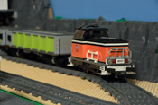

  
**–** Auteur : Paul Mauduit (fr)  
**–** Galerie : [https://www.flickr.com/photos/13110...](https://www.flickr.com/photos/131103326@N05/albums/72157650309610670)

## Wagons

**Wagon multimodal Modalohr**

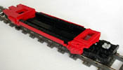

  
**–** Auteur : Alban Nanty (fr)  
**–** Notice : [http://www.brickshelf.com/cgi-bin/g...](http://www.brickshelf.com/cgi-bin/gallery.cgi?f=164651)

**Grue ferroviaire**

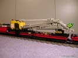

  
**–** Auteur : Philippe Label (fr)  
**–** Galerie : [http://photos.freelug.org/main.php/...](http://photos.freelug.org/main.php/v/Frogleap/Le-grenier-aux-Lego/Syst_mes-de-levage/Grue-Ferroviaire/)  
**–** Notice : [http://www.brickshelf.com/cgi-bin/g...](http://www.brickshelf.com/cgi-bin/gallery.cgi?f=155125)

**Réfrigéré STEF**

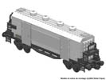

  
**–** Auteur : Didier Enjary (fr)  
**–** Notice : [http://www.brickshelf.com/cgi-bin/g...](http://www.brickshelf.com/cgi-bin/gallery.cgi?f=184519)

**Wagon plat**

  
**–** Auteur : Didier Enjary (fr)  
**–** Notice : [http://www.brickshelf.com/cgi-bin/g...](http://www.brickshelf.com/cgi-bin/gallery.cgi?f=210483)

**Tombereau type EAOS**

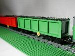

  
**–** Auteur : Erik Amzallag (fr)  
**–** Galerie : [http://photos.freelug.org/main.php/...](http://photos.freelug.org/main.php/v/brickerik/Moc/trains/EAOS/)

**Porte conteneur DHL**

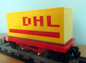

  
**–** Auteur : Paul Maduit (fr)  
**–** Galerie : [https://www.flickr.com/photos/13110...](https://www.flickr.com/photos/131103326@N05/albums)

## Voitures

**Voiture Corail Couchettes**

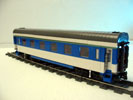

  
**–** Auteur : Alban Nanty (fr)  
**–** Galerie : [http://www.brickshelf.com/cgi-bin/g...](http://www.brickshelf.com/cgi-bin/gallery.cgi?f=186247)

**VB2N Transilien**

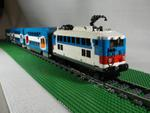

  
**–** Auteur : Erik Amzallag (fr)  
**–** Galerie : [http://photos.freelug.org/main.php/...](http://photos.freelug.org/main.php/v/brickerik/Moc/trains/VB2N/)

**RIO/RIB Transilien**

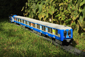

  
**–** Auteur : Paul Mauduit (fr)  
**–** Galerie : [https://www.flickr.com/photos/13110...](https://www.flickr.com/photos/131103326@N05/albums/72157679230840975)

**Voiture USI livrée TER**

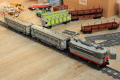

  
**–** Auteur : Paul Mauduit (fr)  
**–** Galerie : [https://www.flickr.com/photos/13110...](https://www.flickr.com/photos/131103326@N05/albums/72157684346195030)

## Voie métrique et étroite

**Locomotive Péchot Bourdon de 1888**

  
**–** Auteur : Paul Mauduit (fr)  
**–** Galerie : [https://www.flickr.com/photos/13110...](https://www.flickr.com/photos/131103326@N05/albums/72157695791775695)

**Locotracteur Baldwin 50HP de 1917**

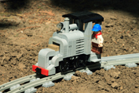

  
**–** Auteur : Paul Mauduit (fr)  
**–** Galerie : [https://www.flickr.com/photos/13110...](https://www.flickr.com/photos/131103326@N05/albums/72157695791775695)

**Locotracteur Crochat**

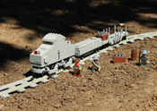

  
**–** Auteur : Paul Mauduit (fr)  
**–** Galerie : [https://www.flickr.com/photos/13110...](https://www.flickr.com/photos/131103326@N05/albums/72157695791775695)

## Manque de pièces et adaptation

Les modèles sont souvent assez complexes, contenant plusieurs centaines de pièces, ces pièces étant parfois rares soient parce qu’elles sont anciennes ou qu’il s’agit de couleurs « exotiques » comme le chrome. Toutefois il est bien souvent possible de trouver des solutions de remplacements en choisissant une autre pièce ou en modifiant localement le montage.

Les modèles sont généralement présentés uniquement dans une des nombreuses livrées que les séries d’engins ont pu recevoir au cours de leur vie. Même si il n’est pas toujours facile de modifier un modèle LEGO pour en changer la livrée, faites attention à en choisir une qui soit en correspondance avec les pièces dont vous disposez. Les couleurs LEGO choisies pour reproduire certaines livrées (l’orange et le brun pour une livrée Arzens par exemple) sont plus difficiles à obtenir que d’autres comme le vert et le blanc d’une livrée Fret. Les couleurs LEGO les plus courantes sont dans l’ordre le noir, le gris, le blanc, puis le rouge et le jaune, le bleu, le gris foncé ainsi que le vert étant moins courant.

Par ailleurs, certaines séries de locomotives ne se distinguent entre elles que par des détails extérieurs mineurs (châssis de 14,700 ou 14,940m des BB8500 et BB17000), détails qui ne sont de toutes façon pas reproductibles en maquettes LEGO. Des détails plus importants peuvent être adaptés. Par exemple la BB9288 « Capitole », malgré ses pantographes unijambistes, pourra être adaptée à partir d’une BB9200. Il peut donc être facile pour vous, avec un minimum de créativité, de reproduire une BB8100 à partir d’une BB25500 et une BB7200 à partir d’une CC6500.

Malgré tout cela, il se peut que vous manquiez encore de certaines pièces.

Si vous en avez les moyens et que votre collection de pièces est encore petite vous pouvez alors acheter des sets qui contiennent ces pièces en consultant les inventaires des boites sur [Peeron](http://www.peeron.com/). La plupart des sets récents sont disponibles sur le [magasin en ligne de la société LEGO](http://shop.lego.com/brickjournal).

Si vous avez déjà une collection conséquente vous préférerez acquérir uniquement des pièces détachées manquantes, par exemple sur [BrickLink](http://www.bricklink.com/).

Si vous n’avez que peu de moyen, levez vous tôt les dimanches matin pour écumer les vide-greniers. Par votre assiduité et avec un peu de patience, votre collection de pièces LEGO augmentera à peu de frais. C’est aussi le meilleur moyen de trouver des pièces anciennes très recherchées.

Vous avez noté des erreurs ? Vous avez créé un modèle et vous souhaitez le faire apparaître ? Merci de laisser un message, pour une prise en compte lors de la prochaine mise à jour de l’article.
