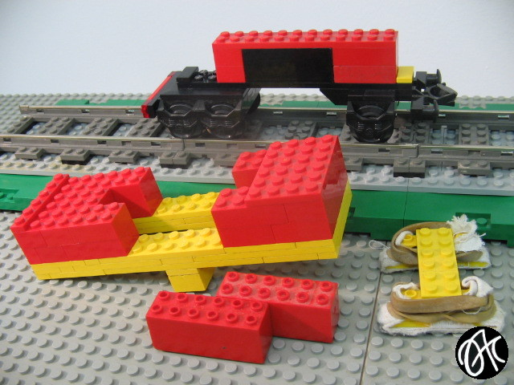
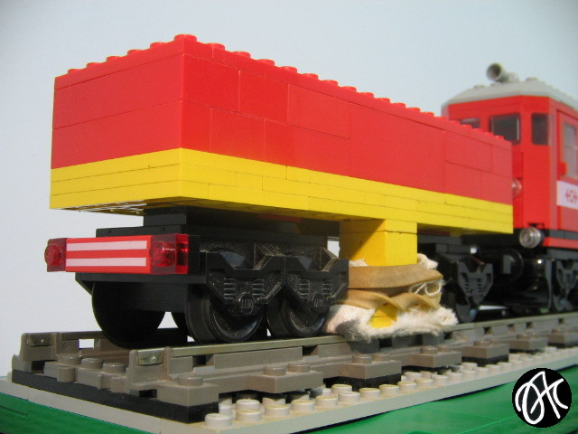
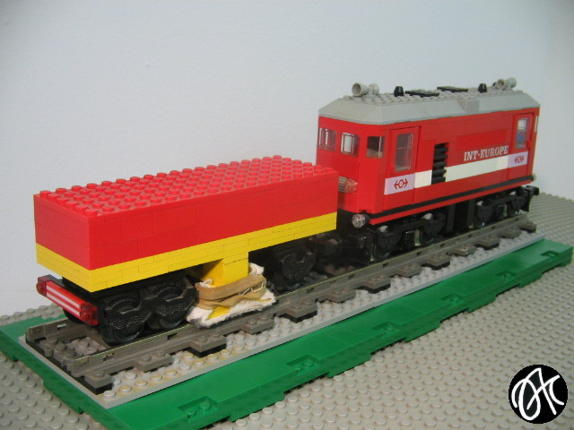

Un wagon pour le nettoyage des voies 9V.

On ne peut pas y échapper, cela vient du système, mais sûrement que certains d’entre vous pourront expliquer cela mieux que moi. Je leur en laisse le soin. Pour ma part, j’ai eu cet inconvénient lorsque je faisais du modélisme ferroviaire, et évidement, je le retrouve avec mes trains LEGO. Alors, quel est ce problème ? Et bien, les rails qui conduisent l’électricité s’encrassent. Ils se recouvrent d’une fine pellicule de poussière qui nuit fortement à la bonne circulation du courant entre les rails et les roues. D’ailleurs, ces mêmes roues s’encrassent aussi, mais l’article suivant concerne les rails ; pour les roues, je n’ai pas encore la solution...

Voilà donc ma méthode de nettoyage, elle vient du modélisme, d’ailleurs ! Il se fait avec un chiffon sec, ou peut être imbibé de produit améliorant les contacts, mais je n’ai pas essayé. Pour se faire, j’ai construit un wagon spécial, que je vous détaille dans ces quelques lignes. Il permet de passer partout, même sous les tunnels ou la caténaire... La configuration n’est pas obligatoire, c’est aussi un essai. Les essieux ne soutiennent pas directement les frotteurs, ils servent seulement à bien les maintenir sur les rails. Si vous optez pour deux roues, ne les éloignez pas trop du centre. Le faux chassis pour les essieux est lesté.

**Vue éclatée**

Les différents éléments de ce wagon spécial.

Ensuite, vient se placer, grâce à un bloc de briques qui fait tiroir, le wagon en lui même, allourdi aussi par 2 lests LEGO, qui permettent aux frotteurs de bien se plaquer sur les rails. Le morceau de chiffon est placé sur une plate de 1X6. Je me sert de pièces usées, mais ce ne sont pas elles qui s’abîment vraiment...

**Le wagon d’entretien**

Vue générale du wagon de nettoyage des voies

Ils suffit de passer ce wagon de temps en temps sur le réseau. Prenez une loco puissante, car le wagon est lourd. Bin, vous avez mis 3 lests LEGO !! Après le passage du "nettoyeur", je peux me permettre de faire des ralentis comme j’aime...

**Le train d’entretien**

Une loco puissante pour tracter ce lourd wagon.

Il est dans la logique, aussi que, avec des rails propre, les moteurs s’encrassent moins.

En fichier joint, la notice MLCad de montage du wagon d’entretien.  
Si vous avez des commentaires à apporter ou des questions à poser, n’hésitez pas.

**Nettoyeur**

Wagon d’entretien des voies
