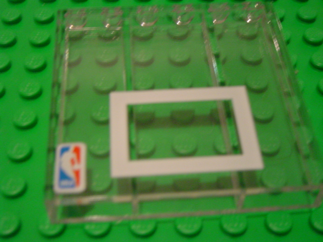
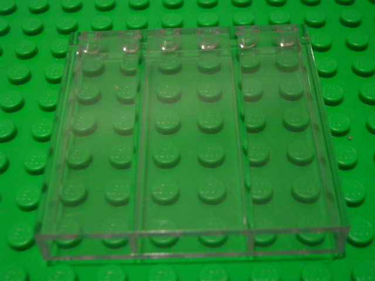
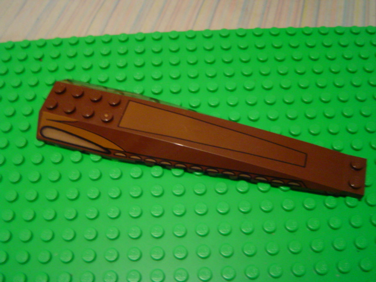
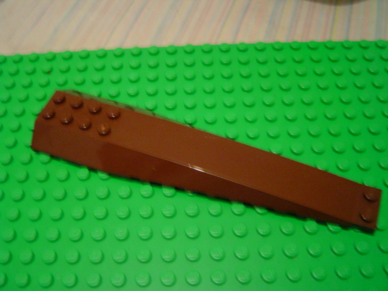
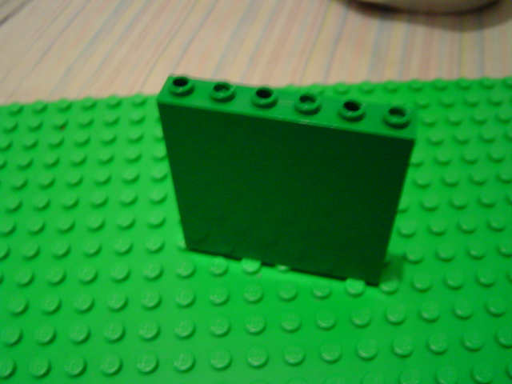
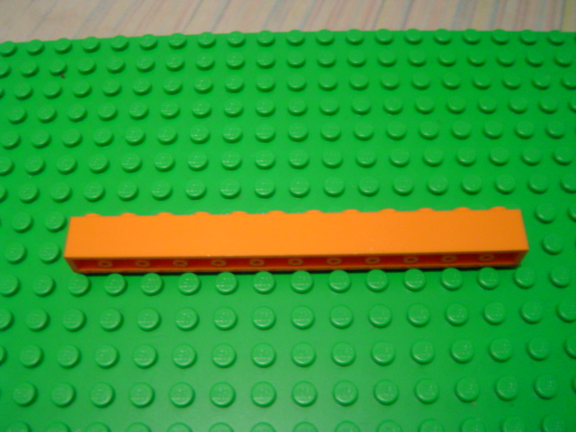
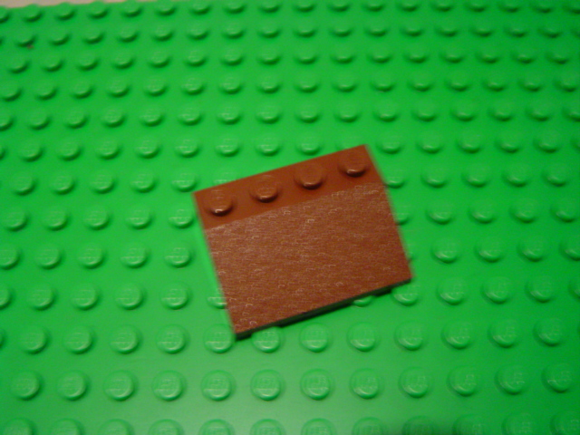

## Qu’est-ce que c’est ?

Les pièces « PNITS » sont des pièces qui n’apparaissent dans aucun modèle LEGO officiel ! Leur nom : Parts Not In The Sets.

Certains adeptes des achats sur Bricklink ou les bons observateurs des photos de MOCs sur Brickshelf ont dû remarquer parfois la présence de pièces LEGO que l’on ne trouve nulle part !

Pour faire simple, je vais leur donner un nom : Parts Not In The Sets (PNITS) Que l’on pourrait traduire par pièces non répertoriées dans les modéles LEGO.

## D’où proviennent-elles ?

Il y a 2 catégories :  
**–** Des pièces qui ne possèdent pas le marquage prévu pour un set LEGO où elles sont uniques dans la couleur donnée. Elles échappent à cette opération car on peut supposer que le nombre de pièces fabriquées est plus important que le nombre de pièces nécessaires pour réaliser la quantité de boites à commercialiser (Par exemple, on est obligé de produire 300000 pièces pour une utilisation de 240000 pour mettre dans les sets).

Exemple :  
Brick 1x6x5 trans. clear avec marquage « panneau de but basket »

**brick 1x6x5 trans clear "Panel Basket NBA"**

Et la pièce PNITS :  
Brick 1x6x5 Trans clear

**brick 1x6x5 trans clear**

ou

**Wedge, Decorated 16 x 4 Triple Curved with Bronze and Black Geonosian Fighter Pattern**

et la pièce PNITS :

**Wedge 16 x 4 Triple Curved**

**–** Des pièces fabriquées exclusivement pour l’usage des Masters Builders pour les créations dans le parc LEGOLAND.  
Exemple :  
Brick 1x6x5 Green

**brick 1x6x5 green**

Brick 1x12 Orange

**brick 1x12 orange**

Slope 3x4 33° Brown

**Slope 3x4x1 33°**

## Comment sont-elles apparues sur le marché ?

Et bien là aussi plusieurs sources possibles et probables.  
Tout d’abord l’existence même des AFOLs et de leur nombre croissant a contribué à augmenter la recherche des pièces rares partout où cela était possible. Et en particulier sur les lieux de production.  
Le changement de politique de la société LEGO de ces dernières années qui a eu pour objectif de diminuer les coûts, donc de réduire les stocks de pièces non utilisées. Ces pièces étaient sûrement détruites auparavant ; maintenant elles sont vendues sur plusieurs points de vente possibles : les pick-à-brick, les boites de pic’n’mix (vente de pièces en vrac : poids ou volume), dans les espaces de vente réservés au personnel de la société (dont certains sont devenus AFOLs également).  
Elles existent bien sûr en très petites quantités et les lots qui peuvent apparaître sur les sites de vente ne le restent pas très longtemps...

## Sont-elles nombreuses ?

A première vue et aux conditions d’apparition on pourrait supposer qu’un très petit nombre de pièces sont concernées ! Et bien non ! Il y en a énormément ! Leur recherche peut être fastidieuse et longue ! De plus une pièce PNITS peut un jour apparaître dans une boite :  
Exemple :  
Slope angle double convexe 1x2 Green  
« Photo »  
Qui était une PNITS il y a encore 2 ans !

Il faut aussi faire attention que certaines pièces ne soient considérées comme PNITS alors qu’elles appartiennent bien à un set LEGO mais dont l’inventaire n’a pas encore été mis en ligne.

En conclusion :  
Je ne sais pas si les collectionner peut avoir un avantage quelconque. Mais elles peuvent agrémenter vos constructions personnelles de façon originale et unique !  
Regardez vos stocks, peut être avez-vous la perle rare ! Et même si ce n’est pas le cas vous découvrirez plein d’informations utiles sur vos chères petites briques parmi tous les sites internet dédiés à cela [Bricklink](http://bricklink.com/) et [Peeron](http://peeron.com/).
