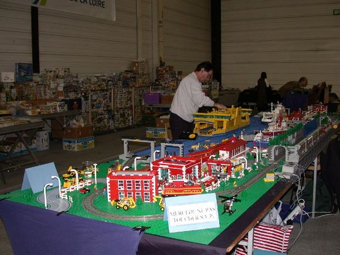

La 7e Exposition Internationale de Cholet (14 et 15 octobre 2006) vient de se terminer sur une note trés positive surtout pour FreeLUG représenté par Jean-Marc.

Prés de 150 exposants étaient là, j’ai noté la présence de Belges, d’Anglais avec leurs dioramas militaires de la guerre 39/45.

Comme pour les autres expositions, le succés a été au rendez vous , le bouche à oreille a fonctionné dés samedi matin, des papys et mamies m’ont promis de revenir avec enfants et petits enfants, ce fut une cohue incroyable le dimanche.  
J’ai du faire la police un peu car je ne pouvais pas travailler normalement.

Mon club de la maquette, sans me prévenir, m’avait inscrit en concours "Divers", résultat, une distinction du jury.  
Les organisateurs de Cholet et des clubs bretons sont venus nous voir et ont été impressionnés par notre savoir faire. Surtout, ils voient en LEGO, un nouveau créneau pour leur salon, ils espèrent vivement notre venue dans les deux ans à venir.

Samedi soir , le salon a organisé un grand repas (200 personnes) à 20 euros digne d’un restaurant gastronomique et une tombola ( j’ai gagné une des grandes maquettes QUEEN ELIZABETH II).

Prochain rendez vous : Relecq Kerhuon prés de Brest (21 et 22 Octobre) avant Lorient (18 et 19 Novembre).

Merci à Rémi, Patrick, Fabien, et autres dont je ne sais plus leurs prénoms pour leur passage à Cholet.

Galeries de photos :  
**–** [Photos de Rémi](http://www.brickshelf.com/cgi-bin/gallery.cgi?f=167736)  
**–** [Photos de Fabien](http://www.brickshelf.com/cgi-bin/gallery.cgi?f=210540)
