Tiens, un colis S@H ?! J’ai bien commandé quelques références en profitant des soldes, mais c’était hier ! Ma foi, si le « normal » devient de l’« express »...

« Perdu !... Joyeux Anniversaire ! »

Stupéfait, je découvre dans le colis la caserne 2007 des pompiers !

« Merci Louise ! »

**Découverte...**

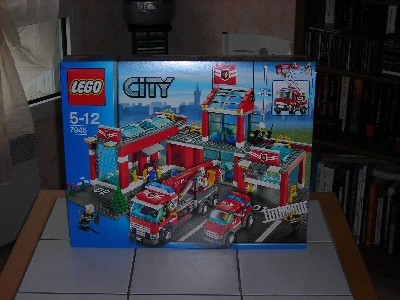

**La boîte providentielle**

Très attendue par les AFOLs fans de City, cette caserne des pompiers millésime 2007 renoue avec les sets majeurs de cette thématique qui ont fait le bonheur de nombreuses générations. Je ne mâcherai pas mes mots : cette caserne est un franc succès ! LEGO® confirme ainsi, par cette nouveauté et celles à venir, le renouveau du LEGO des « villes ». Un attachement de LEGO à la fois affectif à une gamme City dont l’ancêtre emblématique a fait ses beaux jours, mais également stratégique en vue de se mesurer à son véritable rival dans le coeur des enfants et de leurs parents : MegaTruc... Et que non : Playmobil !

La boîte à la classique livrée bleue dévoile six sachets numérotés, un septième anonyme contenant des poutres, les nouveaux bras télescopiques et un chassis XL, et en vrac les plaques de base, trois notices et une planchette d’autocollants.

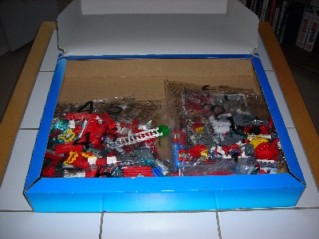

**A l’ouverture...**

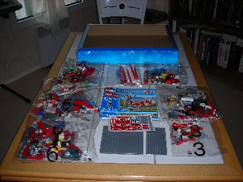

**Le contenu de la boîte**

LEGO persiste dans son choix du montage modulaire. La caserne se compose ainsi de trois modules joints par des chevilles, astuce qui la rend facile à ranger et évolutive ; une excellente chose pour les novices et... les autres. Deux modules pour le camion, un seul sachet pour la voiture du chef. Le montage se déroule sans anicroches, rapidement, trop rapidement... C’est le règne des cloisons faites de méta briques. Quelques surprises néanmoins : désormais les turntables sont à monter soi-même, et les briques 2x1 sont des modèles à rainures, même là où il n’y en a pas besoin !

La caserne est superbe, très détaillée. C’est une vraie réussite ! Les photos sont éloquentes. On regrettera simplement l’absence d’une plateforme héliport... J’ai particulièrement apprécié le retour des légendaires « rideaux » qui ont forgé le succès des casernes des années 80, la porte coulissante du rez-de-chaussée et les bras à vérins du camion qui renouvellent fort joliment le genre.

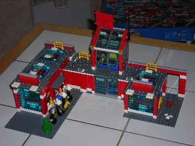

**La caserne dans toutes sa splendeur, véhicules remisés**

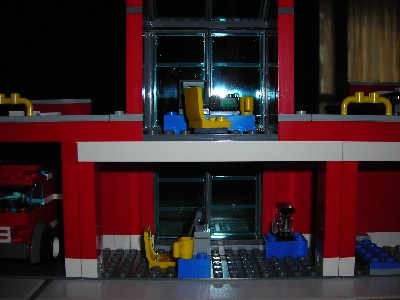

**Salle de repos, de contrôle...**

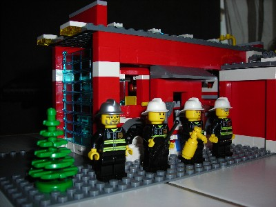

**La brigade au complet !**

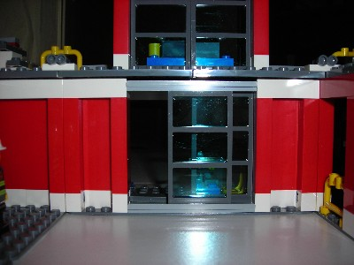

**La porte coulissante, très astucieuse**

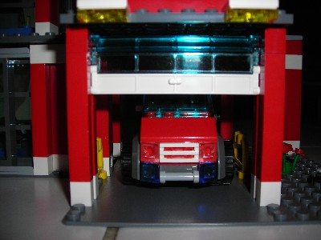

**Les "rideaux" sont de retour**

Cette caserne 2007 donne un sacré coup de vieux à son aînée. Ampleur, richesse, finesse (ah ! enfin des toits constitués de plates et non pas de ces briques épaisses typiques du « easy building » des années 90 qui ont fait le malheur de la gamme).

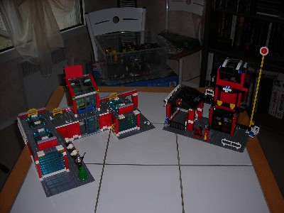

**Comparaison avec la caserne 7240 (à droite)... Sacré coup de vieux !**

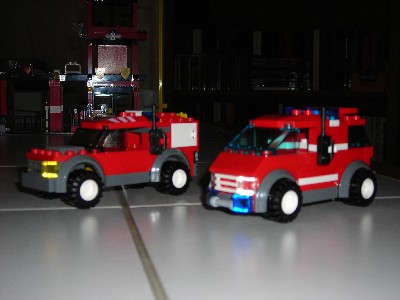

**L’ancienne et la nouvelle... Je préfère l’ancienne (second plan)...**

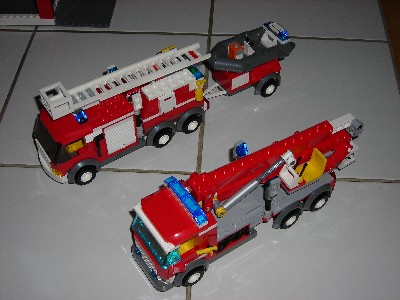

**Au premier plan le nouveau camion, au second celui de 2006 (réf. 7239) qui ne faisait pas partie de l’ancienne caserne...**

La transition du modèle 2005 vers le modèle 2007 est sereine. Hormis le choix de la tonalité des verreries (abandon du noir fumé au profit d’un bleu électrique plus lumineux mais moins classe), la compatibilité esthétique et architecturale est assurée (minifigs identiques, volumes respectés, bandes blanches des cloisons...).

_Quelques bémols : l’asymétrie, certes élégante, des garages qui ne permet de loger qu’un seul véhicule de grande longueur (de la pertinence de l’achat « en double » cher aux AFOLs !) ; la calandre du camion moins réussie que d’autres véhicules de cette génération ; la voiture du chef trop massive ; la lance à incendie du camion ; le prix... c’est un cadeau d’anniversaire magnifique mais un peu cher tout de même..._

**La caserne hantée**

La caserne 7945 serait-elle en proie à des phénomènes paranormaux ? Qui sait...  
Observez attentivement ces clichés comparatifs. Le premier est issu de la boite, le second de la couverture du catalogue professionnel LEGO disponible au dernier trimestre 2006.

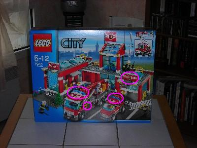

**La boîte**

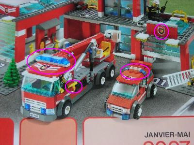

**Le catalogue des nouveautés 2007 premier semestre**

Sorcellerie ? Ahhh !!! Bien évidemment, rien de surnaturel en cela. La photo définitive, celle de la boîte, est en fait une reconstitution de celle du catalogue qui met très vraisemblablement en scène un modèle de présérie ou au pire un prototype finalisé. Pas de chamboulement, seules des pièces mineures ont été substituées. Dernières retouches esthétiques ou contraintes de production ? Les deux probablement (la cordelette de lance à incendie qui n’est plus sertie mais à nouer sent plus l’économie qu’autre chose !)... Quant aux autocollants, c’est souvent la dernière roue du carrosse ! Traquez donc les autres détails ! C’est une pratique courante. Un délai de trois à quatre mois entre la prise de commande et la livraison d’un produit est requis par LEGO pour en gérer la production. Ainsi, lors de la sortie d’une nouveauté, le distributeur commandera un produit supposé définitif mais qui subira néanmoins encore quelques retouches imperceptibles pour un non-initié... Nous verrons si, dans les prochaines éditions de catalogues, les photos du modèle - a priori figé jusqu’à la fin de sa carrière - seront actualisées.

Assurément, LEGO tient là un formidable produit. Ça sent le carton pour Noël 2007. Personnellement, je suis enchanté d’être né une première semaine de Janvier !
