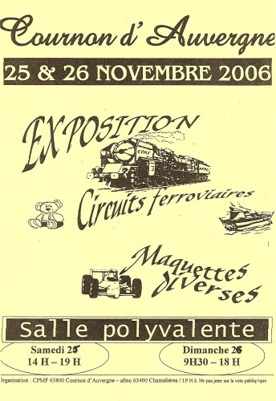

l’AFMC de Chamalières et la CPMF de Cournon, co-organisent leurs cinquième exposition de modélisme, les 25 et 26 Novembre 2006.

C’est à la salle polyvalente, à quelques pas des étangs de Cournon d’Auvergne qu’aura lieu cette exposition. Elle sera ouverte au public de 14h à 19h le Samedi, et de 9h30 à 18h, le Dimanche. Il vous sera demandé 4 Euro pour la visite des lieux.

**Affiche**

Scan de l’affiche de cette expo.

L’"Arverne Ferroviaire Miniature Club" présentera son réseau modulaire géant, 12x20m, avec 150m de voie, à l’échelle HO dans une grande salle, cette fois. Il reproduit la ligne reliant Clermont Ferrand à Vichy. Un module comprend la gare de Randan, le village où j’habite !

Ce club dispose de la salle dès le Lundi. Le grand réseau sera mis en place en début de semaine. Cela pour permettre aux membres de faire rouler leurs convois, et aussi de marquer la semaine du train miniature...

De mon côté, je pourrais commencer à assembler mes modules, dès le Mercredi. Ce n’est pas négligeable, car cette fois, j’ai demandé un espace de 6x1,40m. Mais mon réseau LEGO sera de 5m de long, seulement. Le restant sera occupé par des maquettes de vaisseaux spatiaux imaginaires.

Si vous passez par là ce week-end, n’hésitez pas à vous présenter, je serais heureux de discuter LEGO avec vous, et d’échanger quelques trucs...

Vous pourrez trouver plus d’information, en visitant le site du club AFMC.
