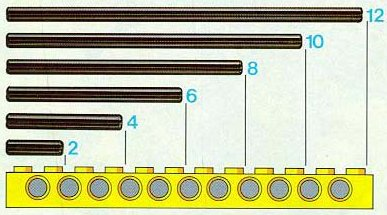
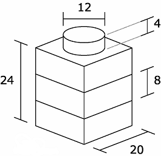
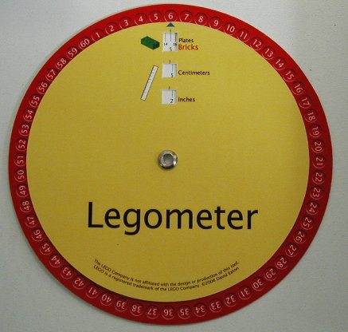
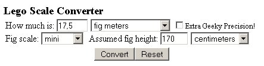

Imaginons-nous lors d’une exposition de trains LEGO, où nous présentons à un visiteur un "train en 6" et un "train en 8", nous oublions qu’il ne saisit pas forcément la subtilité...

## Les unités

Avant de traiter des échelles, il faut connaitre les unités que nous allons employer.

La plus commune est celle du tenon (stud en anglais). Bien que le tenon à proprement parler représente seulement la partie cylindrique se trouvant sur le haut d’une brique, il s’agit dans notre cas de l’unité de comptage. Une longueur d’un tenon représente en réalité la largeur d’une brique 1x1. C’est d’ailleurs l’unité employée par LEGO pour désigner la longueur des axes Technic dans les notices par exemple.

**Extrait de la notice du 8090**

Cette unité s’emploie pour les distances horizontales. Pour les hauteurs, il est d’usage de parler de "briques". Une hauteur de deux briques, vous l’aurez compris, représente la hauteur de deux briques empilées (on néglige la hauteur du tenon au sommet de l’empilement)

Pour affiner cette unité, on peut également parler en plates, ces pièces qui font le tiers d’une brique en hauteur. Ainsi, une hauteur de 5 plates est en fait une hauteur d’une brique et 2/3 d’une brique.

Les spécialistes des techniques de construction, comme le SNOT, se rappelleront du ratio 5:2, où 2 tenons est équivalent à 5 plates.

Il existe également une autre unité, que les personnes pratiquant la modélisation sur ordinateur à partir de la bibliothèque LDraw doivent connaitre, la LDU (LDraw Unit). Il s’agit de l’unité de mesure de base des pièces LDRAW.

**–** Largeur/profondeur d’une brique = 20 LDU ;  
**–** Hauteur d’une brique = 24 LDU ;  
**–** Largeur d’un tenon = 12 LDU.

Il en découle que la hauteur d’une plate est égale à 8 LDU.

**Unité de mesure LDraw (image LDraw)**

Enfin, une dernière unité est employée essentiellement par les personnes réalisant des dioramas, la plaque de base. Lorsqu’on parle d’un module 3x3, il faut comprendre qu’il s’agit d’une surface équivalent à un carré de coté égal à 3 plaques de base de 32 tenons par 32, soit finalement un carré de 96 tenons par 96.

_Mais en centimètres, ça fait combien ?_

Aux tolérances de fabrication près, une brique de 1 mesure 8mm ou environ 5/16 pouces.

On est donc en mesure de dresser le tableau récapitulatif suivant :

|  | LDU | Tenon | cm | pouce |
| --- | --- | --- | --- | --- |
| LDU |  1 | 1/20 | 0,04 | 1/64 |
| Tenon | 20 |  1 | 0,8 | 5/16 |
| cm | 25 | 1,25 |  1 | 0,39 |
| pouce | 64 | 3,2 | 2,54 |  1 |

On en retiendra qu’une brique fait 8mm de large et 9,6mm de haut, tandis qu’une plaque de base de 32 tenons fait 25,6cm.

David Eaton a réalisé un petit disque en carton, le Legometer, qui permet de faire la conversion tenon vers briques/plates/cm/pouces. Les présents au BrickFest 2006 ont pu en obtenir un :)

**Legometer : disque de conversion**

## Les échelles

Le sujet des échelles a déjà été traité dans plusieurs articles sur FreeLUG :  
**–** [Echelles des maquettes LEGO®](https://www.freelug.org/spip.php?article272)  
**–** [1/42,5 - Echelle applicable pour les trains et les villes LEGO®](/articles/529/)  
**–** [6 contre 8](/articles/531/)

Si leurs auteurs choisissent une échelle comprise entre 1/40 et 1/45, David Eaton laisse le choix aux utilisateurs de son outil de conversion en ligne de paramétrer leur préférence.

[http://www.suave.net/~dave/cgi/scale.cgi](http://www.suave.net/~dave/cgi/scale.cgi)

Cet outil permet de faire la conversion entre les unités classiques (mètre, pouce etc) et les unités LEGO citées ci-dessus (à l’exception faite des LDU).

L’avantage réside dans le fait qu’on puisse choisir l’échelle de conversion en fixant la taille d’un être humain.

Avec les bons paramétrages, on calcule rapidement que par exemple une locomotive de 17,50m ferait 54 tenons en considérant qu’un être humain mesure 1,70m. On est bien loin de nos locomotives de 30 à 40 tenons (technique du compressionnisme).

**Exemple du formulaire de conversion**

* * *

**Webographie**

[Brickwiki:LDU](http://brickwiki.org/index.php/LDU)
