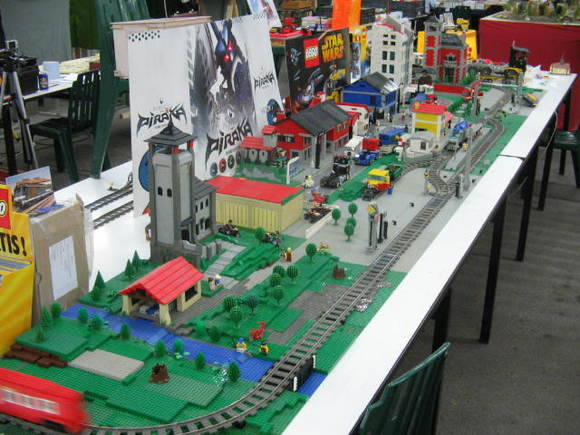
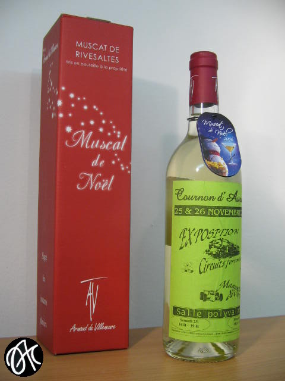

Le Club de modélisme ferroviaire de Chamalières (63) a un grand projet : reproduire la ligne reliant Clermont-Ferrand à Vichy en respectant l’échelle HO. Une bonne partie est déjà reproduite, ce qui induit un développé de réseau assez important : plus de 150m de voie. De ce fait, il est impossible d’avoir le réseau en fonctionnement continu. Il est rangé sur des "racks" et ne sort que pour les expositions.

Cette année, la ville de Cournon d’Auvergne a prêté une salle polyvalente aux deux clubs de la région, pour pouvoir organiser une exposition et présenter ce grand réseau. La salle était disponible toute la semaine, ce qui a permis au club de compléter quelques aménagements, et aussi d’en profiter pour faire rouler leurs rames. Petit rappel, une rame d’un train de voyageurs, c’est la locomotive plus 10 voitures de 30cm environ : c’est égal à un train d’environ 3m de long !!!

Cela a aussi permis de faire tourner de tous petits modèles, comme la fameuse Micheline reproduite par Märklin, il y a une vingtaine d’année. Avec le public, c’est impossible, car il y a des risques de vol... D’ailleurs, ma propre version en LEGO a bien plu.

Ne vous inquiétez pas, je vais en venir aux briques LEGO. Car de mon côté, j’ai aussi profité de cet espace mis à disposition, en proposant aux organisateurs un réseau en LEGO de 5m de long. Seul, ce n’est pas une mince affaire !! Mais, j’ai pu étaler les voyages, en commençant le Jeudi, et, de ce fait, étaler aussi la construction. Ma "pièce LEGO" fait "seulement" 4m de long. J’ai donc improvisé un module "prêt à emporter", que j’ai rajouté sur place. Le Vendredi soir, le réseau était achevé, ouf !! Le samedi matin, j’avais prévu de fignoler, avec des briques vertes pour bien tout rejoindre, et de placer les minifigs pour animer. Sauf que, dans la précipitation, j’avais oublié les têtes. Un jour, je partirai sans la mienne ! Heureusement, avec les trains qui tournaient, ça ne s’est pas trop vu. Je les ai placées le dimanche matin.....

J’ai vu passer environ 800 personnes, toutes plus étonnées les unes que les autres. Vous me direz que c’est pas énorme, par rapport à un "LEGOWorld", mais je vous répondrais que c’est déjà pas mal. Et que 5m de long, quand il faut faire le tour et surveiller deux pans de barrières, ça suffit. Mais, quel plaisir d’expliquer les choses, de répondre à toutes les questions, même si elle sont récurrentes :  
**–** Combien de temps pour tout monter ? deux jours,  
**–** Combien il y a de pièces ? 2,  
**–** Est-ce que tous vos LEGO sont là ? non, il y en n’a que 20% environ !!

Et puis d’autres en plus : il y en a pour combien de sous là ? Bin, pas facile à répondre.

De plus, j’ai distribué une bonne pile de catalogue, et je pense que j’ai fait envie à bon nombre de gamins, mais aussi aux parents qui ont encore leur LEGO dans le grenier. C’est toujours plaisant de voir des yeux grands ouverts.

Ce week-end est passé très vite, comme vous devez vous en douter. Tout fut démonté en 1 heure, c’est incroyable. Tout est rentré dans ma voiture en une fois pour le retour. C’est incroyable, aussi ! Je partage de bons moments avec les exposants que je commence à connaitre. Je suis d’ailleurs invité à une autre exposition, mais ce sera l’objet d’un autre article. C’est aussi intéressant de voir comment nos reproductions peuvent être appréciées par les modélistes. D’ailleurs ils se souviennent de toutes nos constructions, la série des BB... Et je suis reparti avec des projets en plus !

Une superbe bouteille de Muscat de Rivesaltes a été offerte à tous les clubs exposants. Cette bouteille est présentée dans un beau coffret en carton, et de plus, l’affiche de l’exposition prend la place de l’étiquette. C’est à boire avec modération, évidemment !!

**Muscat avec l’affiche de l’expo**

Bouteille offerte à tous les clubs participants

C’est un grand plaisir, de faire une exposition, mais c’est fatigant, beaucoup de tensions avant pour tout préparer, et le trac, comme les artistes. Mais, n’en sommes-nous pas ????

Je vous laisse contempler les photos que j’ai mises sur Brickshelf :  
[http://www.brickshelf.com/cgi-bin/g...](http://www.brickshelf.com/cgi-bin/gallery.cgi?f=218084)
