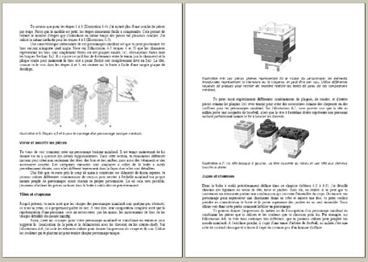
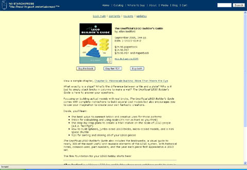
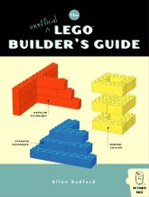

Le livre dont est extrait ce chapitre est paru initialement en 2005 en anglais sous le titre de "The Unofficial LEGO Builder’s Guide"

**ULBG Chapitre 4 fr**

Traduction française du chapitre 4 de "the Unofficial LEGO Builder’s Guide"

Nous remercions chaleureusement l’auteur du livre, **Allan Bedford**, qui a donné son accord pour la traduction du chapitre 4. Allan est un membre apprécié de la communauté des fans adultes de LEGO. Il maintient un site web, [http://www.apotome.com/](http://www.apotome.com/).

Nous tenons à remercier très sincèrement l’éditeur américain propriétaire des droits, [**No Starch Press**](http://www.nostarch.com/), et plus particulièrement le responsable des ventes pour l’autorisation de publication de la version française de ce chapitre offert à notre association.

Vous pouvez vous procurer le livre en anglais à cette adresse :

[The Unofficial LEGO Builder’s Guide](http://www.nostarch.com/frameset.php?startat=legobuilder)

A propos du livre :

Le guide non officiel du constructeur LEGO, qui se concentre sur la construction de modèles réels et qui comporte des instructions de montage, t’encourage aussi à développer ta propre imagination pour créer de fantastiques maquettes bien à toi.

Tu y apprendras par exemple comment faire des montages solides, à calculer et utiliser les échelles, à construire des sphères ou des éléments LEGO géants ou au contraire des micro-modèles.

Le chapitre 4 que nous te proposons ici se focalise sur les techniques de montages qui te permettront de créer des personnages à l’échelle "Miniland", celle-la même qui a été choisie pour les parcs LEGOLAND du monde entier.

Copyright (c) 2005 by Allan Bedford.  
Title of English-language original :  
The Unofficial LEGO Builder’s Guide, ISBN 1-59327-054-2, published by No Starch Press.  
French-language translation of chapter 4 by Didier Enjary.

Les droits pour la traduction en français sont disponibles.  
Les éditeurs intéressés peuvent contacter No Starch Press (sales@nostarch.com)

French translation rights are available.  
Any interested publishers should contact No Starch Press (sales@nostarch.com).
