Sur un livre de bébé destiné à ma fille il y a une superbe photo d’un modèle réduit d’une locomotive Climax (type B). Le design particulier de cette locomotive vapeur avec son embiellage incliné m’a donné envie de relever le chalenge de la faire en LEGO.

Pour commencer voici quelques photos de la bête :

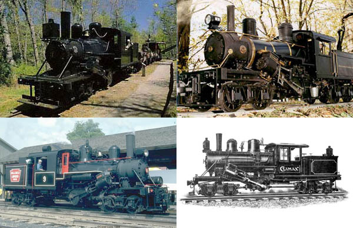

**Loco Climax type B**

Si cette locomotive vous intéresse vous pourrez visiter [ce site bien documenté sur cette locomotive](http://www.catskillarchive.com/rrextra/climax.Html) qui a existé dans 3 versions différentes et qui apparemment était utilisée pour transporter des rondins de bois. J’ai choisi de reproduire le type B (qui était aussi celui reproduit sur le livre de ma fille).

J’ai fait cette locomotive en 6 de large (contrairement à mon habitude) car le modèle originale est plutôt petit et le chassis ne dépasse pas des roues. Six tenons étaient donc à mon avis la taille idéale pour cette locomotive.

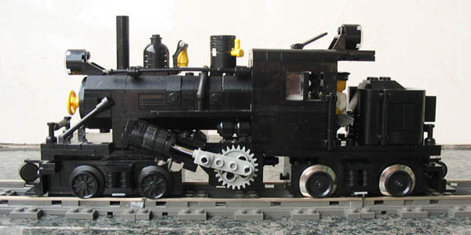

**Ma Loco Climax en LEGO**

Je ne vais pas vous détailler toute la notice de montage, mais seulement aborder quelques point délicats. Certaines parties du montage exigent en effet d’employer des pièces anciennes, car les nouvelles versions de ces pièces ne conviennent pas. Nous verrons cela par le détail.

Je commence par l’embiellage, qui sans doute vous intrigue le plus. Bien sûr il est fonctionnel, ce qui veut dire que lorsque la locomotive avance, les bielles tournent. Toutefois les bielles ne sont pas reliées aux roues. J’ai réalisé une première version de cette locomotive où tout était relié et la propulsion était assurée par un mini-moteur 9V (n°71427). J’avais prévu de brancher ce moteur sur le boitier à pile des nouveaux trains LEGO. Malheureusement il y avait beaucoup de frottement et la locomotive avançait vraiment trop lentement (mais ça fonctionnait). Le montage valait quand même son pesant de cacahuètes, avec cependant un ["illegal move"](/articles/252/) où j’avais serti un harpon (n°38) dans une vielle roue de train (la roue du n°4180). Notez au passage que le bout du harpon ressemble à un axe, ce qui me permettait d’y insérer un engrenage et ainsi entrainer la roue.

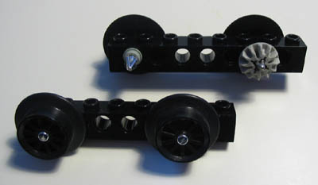

**"illegal move" utilisé pour la première version.**

L’embiellage fonctionne donc grâce au mini-moteur 9V caché dans la cabine. Ce moteur est alimenté par le moteur de train 9V, grâce à la prise sur le dessus du moteur. Ainsi les bielles tournent à la même vitesse que les roues. Pour ceux qui souhaiteraient utiliser un moteur de train modifié pour avoir du DCC, alors contrairement à d’habitude, il ne faut pas brancher le moteur sur la prise accessoire du DCC mais bien sur la même prise que le moteur lui-même.

Le piston est réalisé grâce à un harpon (n°38) qui court dans un tonneau n°2489 (pièce assez rare en noir). Le tonneau est fermé par une plate 2x2 ronde, mais **attention** il s’agit ici de l’ancien modèle ! L’ancien modèle possède un trou d’axe sur toute la hauteur de la plate alors que le nouveau modèle ne possède le trou d’axe que sur la partie supérieure, la partie inférieure formant un tube standard. En effet si vous utilisez le nouveau modèle alors le harpon ne glissera pas. Le comportement normal d’un trou d’axe est de retenir une barre par friction, mais l’ancienne version ne le faisait pas. Ainsi le harpon peut glisser facilement dans l’ancien modèle.

Cette plate 2x2 ronde est retenue par des plates 2x2 corner qui forment en même temps un guide pour la base du piston réalisée avec un bracket 1x1 n°42446. Sans cela la plate ronde sauterait constamment à cause du léger frottement du piston. L’ensemble tonneau + guide est simplement monté sur une brique charnière n°3937 et 3938 situé au centre de la locomotive, sous le réservoir d’eau.

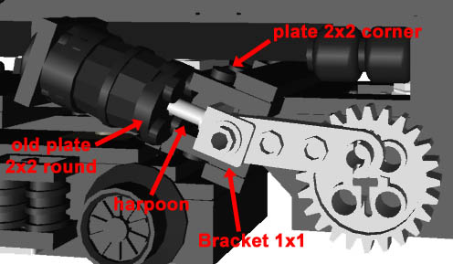

**Le piston et la bielle.**

Comme je le disais précédemment, le piston est relié à la bielle par un bracket 1x1 n°42446. Apparement il ne se décroche par du bracket à l’utilisation, pourtant le harpon est simplement clipsé et de plus dans le même sens que son déplacement.

La bielle est reliée à un engrenage 24 dents n°3648, là encore j’ai utilisé l’ancienne version de cette pièce (contrairement à la photo ci-dessus). L’ancienne version possède des trous d’axe sur les cotés que LEGO a supprimé car cela fragilisait la pièce. J’utilise un de ces trous pour fixer la bielle avec un axe-cheville n°3749. On peut utiliser la nouvelle version de cet engrenage et fixer la bielle dans un des 4 trous lisses (qui sont à la même distance) avec une cheville lisse n°3673, mais ça augmente un peu les frottements, car la cheville dépasse de l’autre coté.

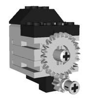

**Le moteur et ses engrenages.**

Sur le moteur j’ai mis un engrenage 24 dents couronne n°3650 et pas un engrenage 24 dents classique. Pourquoi me demanderez-vous ? Et bien parce que l’engrenage classique est plus épais que l’engrenage couronne et ne me permettait donc pas de rajouter un cache fait à l’aide de panel 1x2 n°30010.

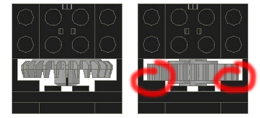

**L’engrenage standard frotte.**

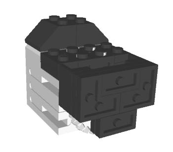

**Le moteur avec son cache-engrenage.**

Ca tombe bien, le cache engrenage nous amène à un endroit particulièrement enchevêtré. Sur la photo ci-dessus on peut voir que j’ai utilisé une plate 1x2 et deux plates 2x2 corner pour au final couvrir une surface 2x4. Pourquoi n’ai-je pas tout simplement utilisé une plate 2x4 dans ce cas ? Et bien parce que j’avais besoin d’un décalage d’un demi-tenon dans ce coin, et j’ai utilisé pour cela le "tube" de la plate 1x2. Ce tube vient se clipser dans le trou d’une brique 1x1 avec 4 tenons sur les cotés n°4733.

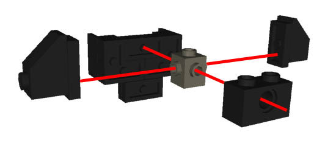

**la brique 1x1 avec 4 tenons sur les cotés et tout ce qui va avec.**

Les slopes 45° 1x2 n°3040a que vous voyez sur les cotés forment une partie du réservoir d’eau et sont montées en SNOT à cause de cette brique 1x1 avec 4 tenons sur les cotés et surtout à cause de ce que je vais emboiter sur le dessus de cette brique (j’y reviens après).

Vous aurez peut-être remarqué que ces slopes sont légèrement décalées par rapport aux plates 1x2 sur lesquels elles sont clipsées. Comment est-ce possible ? C’est possible car les plates 1x2 sont en fait des jumpers (plate 1x2 avec un seul tenon), et les slopes 45° 1x2 sont du type 1 (ou A), c’est à dire une fois encore de **l’ancien modèle** ! L’ancien modèle de ces pièces ne possède pas de tube central, alors que le nouveau en possède. L’absence de tube permet alors de les clipser avec un décalage quelconque (ici il est de 4 [LDU](http://brickwiki.org/index.php?title=LDU)).

Cela nous amène à ce que j’ai emboité sur le dessus de cette brique centrale... Et bien juste au dessus j’avais besoin de faire du [SNOT 180](http://brickwiki.org/index.php?title=SNOT_techniques), car je voulais utiliser la technique des briques rondes 2x2 tête bêche ([voir mon article sur la réalisation d’un canon](/articles/553/)) pour réaliser une cheminée avec sifflets.

Pour réaliser ce SNOT 180, j’ai utilisé une technique que je trouve plutôt astucieuse. Elle prend un peu de place en hauteur, mais peu en largeur et est étonnamment très solide. Elle se réalise simplement avec deux tiles 1x1 avec clip n°2555. Il suffit d’appuyer fermement et elles se clipsent sans problème.

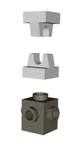

**SNOT 180 avec deux tiles 1x1 avec clip**

Ce SNOT 180 nous amène à la "cheminée" avec sifflets intégrés. Selon les versions cette locomotive semble avoir eu un ou plusieurs sifflets. J’ai été gourmand, j’en ai mis deux, mais on peut en mettre qu’un seul si on veut. Pour cela j’ai utilisé des robinets jaune n°4599.

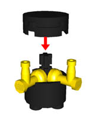

**Technique pour représenter des siflets.**

Remarquez que si vous utilisez une plate 2x2 ronde comme chapeau, vous ne pourrez pas complètement joindre les deux cylindres car les pieds de robinets sont un peu trop gros. Si on utilise une brique 2x2 ronde ou un dôme 2x2 à la place, les briques peuvent être jointives, mais par contre les robinets on tendance à tourner. J’ai donc préféré utiliser la plate 2x2 pour maintenir les robinets vers le haut.

Le compartiment à charbon contient pas mal de SNOT, notamment une combinaison de briques Technic à deux trous n°32000, mais finalement rien de bien méchant, il n’y a aucun décalage bizarroïde.

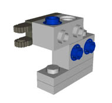

**L’intérieur du compartiment à charbon.**

Les tenons sur le coté servent à tenir la paroi du compartiment à charbon, le tenon bleu sur le dessus tient quant à lui le charbon. La charnière derrière tient une des deux petites boites à l’arrière du compartiment.

Voilà ! Je crois qu’on a fait le tour des précisions techniques que je voulais apporter. Finalement cette locomotive emploie pas mal de vieille pièces, mais après tout, c’est normal pour une vieille locomotive, non ?

Il ne vous reste plus qu’à faire les wagons pour transporter les rondins de bois. A vos briques !

Ci-dessous vous pouvez télécharger le fichier LDraw du modèle (ainsi que les pièces non officielles que j’ai utilisées).

**Fichier LDRAW de ma Loco Climax**

**Pièces non officielles utilisées par ma loco Climax.**

Voir aussi [la galerie Brickshelf de ma loco](http://www.brickshelf.com/cgi-bin/gallery.cgi?f=220029).
