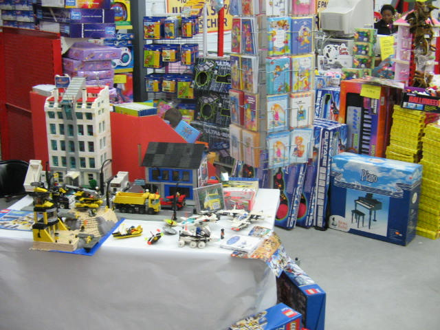

Pour la première fois, j’ai fait une animation LEGO dans un magasin de jouets. Voilà le déroulement de cet après-midi particulier.

J’ai pris l’habitude d’errer dans un magasin qui fait du discount sur les prix du jouet, dans la région clermontoise. Le prix sur les boîtes LEGO présentées est très intéressant. Après quelques achats importants, j’ai fini par être connu dans le magasin !! "Je suis monsieur LEGO !!". C’est donc tout naturellement que l’on m’a invité à présenter une partie de ma collection. J’ai accepté avec joie, mais, c’est non sans quelques soucis que j’ai essayé de relever ce nouveau défi.

Cette période du mois de décembre est très prenante pour tout le monde, et surtout pour les gérants d’un magasin de jouets. Du coup, quelques préparatifs nous ont échappés, qui j’espère seront réparés pour une prochaine édition. Le rendez-vous était pris pour ce samedi 9 Décembre, à 14h00. C’est à dire pour l’ouverture de l’après-midi. J’ai été bien accueilli, et une petite table recouverte d’un papier glacé blanc m’attendait. Elle a été très vite remplie par quelques MOC et la représentation d’une rue. La rue, en elle-même, surplombée par un hôtel, et mon bâtiment de bureau.

La directrice du magasin est arrivée vers 14h20. Elle m’a confiée le montage d’une boîte, en me laissant le choix entre deux références : 4748 ou 7047. Après une petite réflexion, mon choix s’est porté sur la base des gardes côte. J’y voyais des choses plus sympa à construire, comme le bateau et l’hélicoptère.

J’ai pris mon temps pour assembler ce set, proposé en magasin à 40 Euro tout de même. J’ai collé tout les autocollants, ce que je ne fais jamais !! Durant l’après-midi, j’ai vu passer quelques petites frimousses étonnées du pouvoir démentiel de cette petite brique. Une phrase d’une petite fille m’est restée gravée : "Trop long à construire, ça...". Un petit garçon a délaissé son père et son frère pour m’aider à assembler quelques briques sur la base. C’est là qu’on se rend compte qu’il n’est pas aisé pour un enfant de trouver toutes les pièces et de construire le modèle correctement. Surtout quand c’est le début, et que tout est encore en vrac dans la boîte, même si j’avais pu séparer les petites pièces des grosses.

Et puis l’après-midi est passée, j’ai mis 2h et demie pour monter le set, et j’ai eu quelques contacts sympas avec des clients. Ce qui est marrant, c’est qu’il faut un peu questionner les gens car ils n’osent pas dire qu’ils en ont chez eux, et qu’ils collectionnent, tout simplement.

**Présentation de MOC Lego**

La petite table regroupant mes principales constructions......

C’est une bonne expérience aussi, même si c’est un peu bizarre de s’installer là. L’endroit était un peu exigu par rapport à une exposition. On y est seul exposant aussi, mais j’ai été bien entouré avec une boisson et un croissant gentiment offert.

Je vais prendre un peu de repos, et vous donne rendez-vous pour "l’exposition Marsienne". Bonnes fêtes à tous, et que les briques remplissent vos bottes !!

[La galerie de photos](http://www.brickshelf.com/cgi-bin/gallery.cgi?f=220273)
