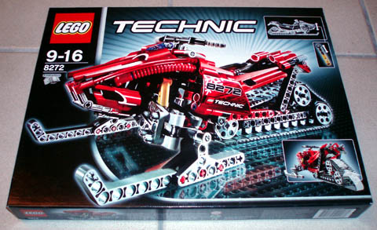
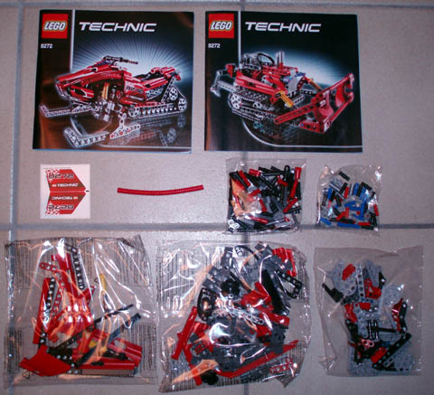
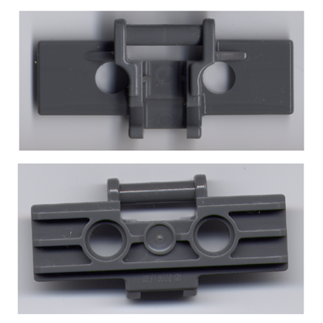
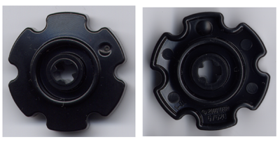
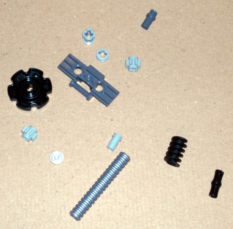
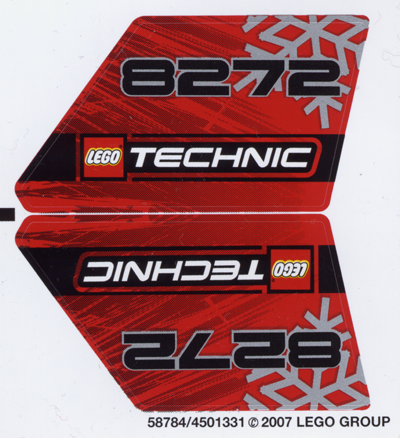
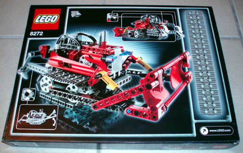

Nous avions découvert ce modèle en photos avant les fêtes de fin d’année. En vente aux Etats-Unis depuis lors, il nous a fallu attendre le mois de Janvier pour le commander en Europe. Pour un prix de [30euros](http://shop.lego.com/product/Default.aspx?p=8272) vous aurez [331 pièces](http://www.peeron.com/cgi-bin/invcgis/inv/sets/8272-1?withpics=yes) et des notices de montage pour deux modèles.

Ne nous attardons pas sur l’emballage en lui même qui ne présente pas de particularité.

Une fois la boîte ouverte, là encore, pas de surprise. On retrouve parmi les classiques sachets de pièces les notices de montage et la planche d’autocollants. Une petite surprise, un [tube flexible annelé](http://www.peeron.com/inv/parts/78) rouge [^1] se trimballe tout seul...attention à ne pas l’égarer.

Ouvrons les sachets. On trouve uniquement des pièces Technic "studless" [^2], c’est à dire lisses, sans tenons - les photos du modèle d’ailleurs ne laissaient aucun doute à ce sujet. La bonne surprise vient de ce que l’on découvre deux nouveaux types de pièces : des éléments de chenille plus larges que [les anciens](http://www.peeron.com/inv/parts/3873) et des roues d’entraînement adaptées à ceux-ci. Là encore les photos du modèle laissaient entrevoir ces nouvelles pièces.

* * *

La construction se passe sans mal. Un constructeur connaisseur des modèles Technic s’acquittera du montage en 1 heure. Il ne vous restera à la fin qu’une dizaine de pièces qui servent lors de la construction du modèle alternatif.

**Les fonctions mécaniques :**

On retrouve des grands classiques parmi les fonctionnalités mécaniques :

direction par pivotement d’un bras (sans crémaillère),

Video Player

[Vidéo de la publication d’origine](https://www.freelug.org/IMG/mov/P1130029.mov)

suspension sur le train avant (indépendant droite-gauche),

Video Player

[Vidéo de la publication d’origine](https://www.freelug.org/IMG/mov/P1130028.mov)

train arrière légèrement orientable pour évoluer sur des surfaces inégales.

Video Player

[Vidéo de la publication d’origine](https://www.freelug.org/IMG/mov/P1130030.mov)

Mais on retiendra surtout la nouvelle chenille qui circule autour de trois axes. Sur le parquet ou le carrelage aucun espoir d’entrainer la chenille qui glisse sur ces surfaces mais aucun souci sur les moquettes que l’on retrouve dans les chambres d’enfants.

Video Player

[Vidéo de la publication d’origine](https://www.freelug.org/IMG/mov/P1130031.mov)

Video Player

[Vidéo de la publication d’origine](https://www.freelug.org/IMG/mov/P1130032.mov)

**Le "look" :**

C’est en grande partie cette nouvelle chenille large qui est responsable du look général du modèle, mais les concepteurs ont aussi employés largement [les éléments de carrosseries](http://www.peeron.com/cgi-bin/invcgis/psearch?query=fairing+panel&limit=parts) et les pièces flexibles pour arrondir les angles. Les patins avant sont un peu simplistes. Quant aux deux autocollants, on pourra facilement s’en passer.

**Plus encore ?**

Le set est motorisable comme on peut le voir dans cette [galerie BrickShelf](http://www.brickshelf.com/cgi-bin/gallery.cgi?f=226913)

**Commentaires personnels :**

Vous l’aurez compris, j’avais un bon a priori sur le modèle sur la base des seules photos. Souvent, lors de la construction, j’ai l’impression que d’autres fonctions mécaniques auraient pu être ajoutées, ici par exemple une suspension sur le train arrière. Sur le design je regrette aussi parfois l’emploi abusif de pièces "faciles" comme les éléments de carrosserie mais les enfants apprécient au contraire ces éléments "cools". Au final, je ne boude pas mon plaisir et le produit est très réussi, procurant autant de satisfaction au montage que dans le jeu.

Les adultes qui créent leurs propres modèles sont sensibles à la sélection de pièces. Les couleurs sont plus que classiques : rouge, noir, gris foncé : rien de bien excitant. Aucune pièce inhabituelle, rare ou particulièrement utile...mis à part cette fameuse chenille. C’est d’ailleurs un peu le problème. Si vous souhaitez faire un engin chenillé digne de ce nom, il vous faudra acheter deux boîtes pour faire deux trains de chenille.

D’ailleurs le modèle alternatif est ridicule mais c’est uniquement la faute de son chenillage réduit à la plus simple expression [^3]. Il aurait suffit de rajouter une dizaine d’élément de chenilles pour le rendre bien plus attrayant.

**Conclusion :**

Pour moi cette motoneige reste un beau modèle de taille intermédiaire qui réjouira les plus jeunes et que certains adultes fous de véhicules de chantiers achèteront en double voir en triple pour faire leur propres engins chenillés.

[^1]: Ces tubes sont désormais beaucoup plus souples qu’ils ne l’étaient auparavant

[^2]: Sauf deux plates rondes 1x1

[^3]: On préfèrera aussi utiliser des éléments jaunes pour créer des engins de chantier :-)

## Documents joints

-   **[P1130033.mov](https://www.freelug.org/IMG/mov/P1130033.mov "Télécharger QuickTime - 701.5 kio")**
    
    13 janvier 2007 \- QuickTime - 701.5 kio
