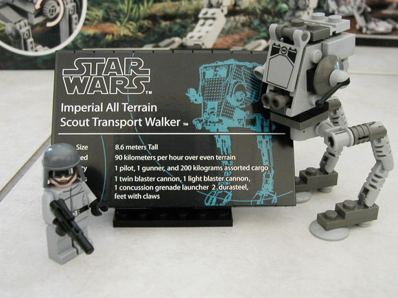
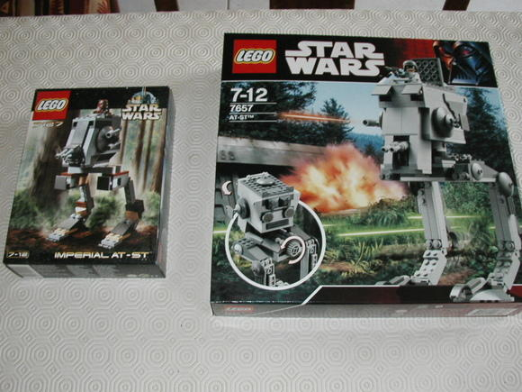
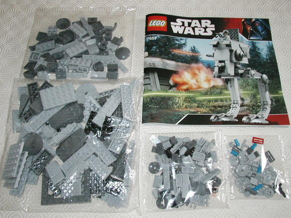
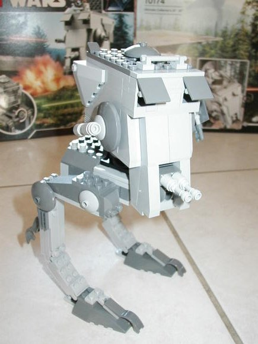
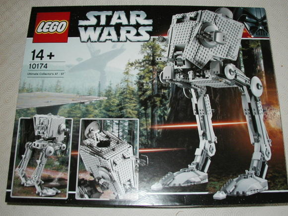
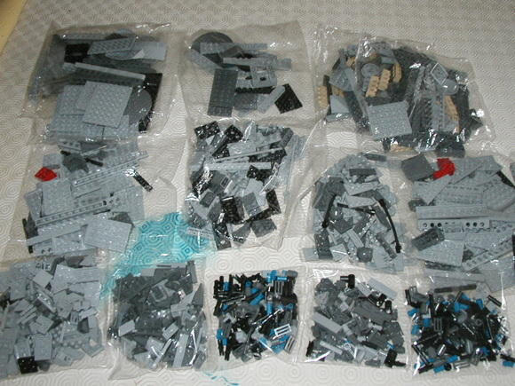
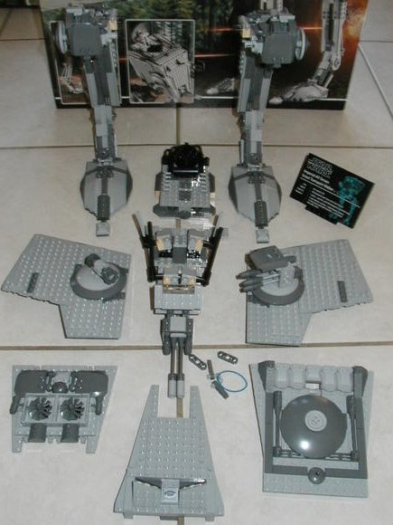
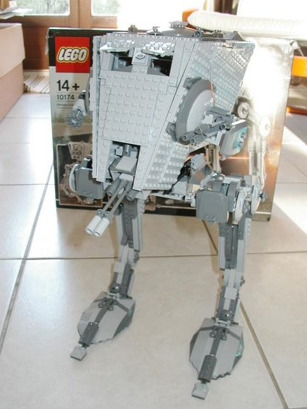
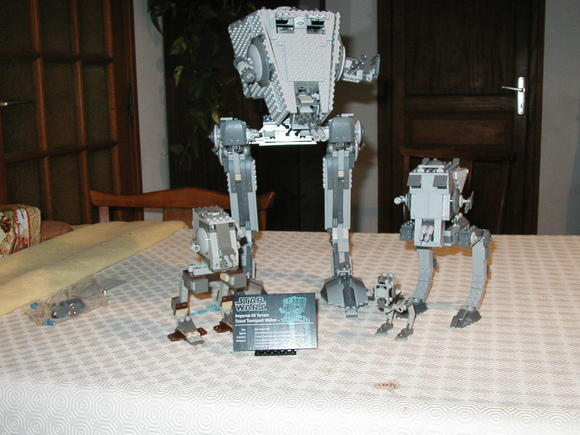

Dans la famille AT-ST, LEGO nous propose quatre versions : une version Mini, deux versions minifig, et une version UCS. Présentation des deux derniers modèles sortis.

## L’AT-ST minifig 7657

Résumé :  
**–** Réf. : [7657](http://guide.lugnet.com/set/7127)  
**–** Année : 2007  
**–** Prix : 29,99 euro  
**–** Nombre de pièces : 244

Comparée à [son ainée le 7127](http://guide.lugnet.com/set/7127), la boite est beaucoup plus grande, et annonce donc un modèle plus grand. A l’ouverture, le contenu déçoit un peu, mais nous avons l’habitude :)

La première chose qui frappe nos yeux sont les couleurs : à part la tête de la minifig couleur chair, quelques chevilles Technic bleues et une plaque lisse avec grille 1x2 rouge transparent, il n’y que du gris et du noir. L’époque des modèles StarWars avec des briques colorées cachées au milieu du modèle serait-elle révolue ?

Le montage, assez simple, nous amène effectivement à un engin bien plus grand que son ainé, tradition qui semble être règle dans les rééditions des modèles StarWars : c’est plus du double de pièces (244 contre 107) qui constitue ce marcheur.

Je reste toutefois un peu déçu de ce modèle : les jambes sont fixes (pas amovibles comme avec le 7127), le cockpit difficile d’accès et pauvre (absence d’ordinateur par exemple). Toutefois, la nouvelle figurine agrémente l’ensemble et le cockpit rotatif apporte un plus. Au final, pour le prix et la faible jouabilité, un enfant préfèrera sans doute un autre modèle, mais les collectionneurs se réjouiront de ce set.

## L’AT-ST UCS 10174

Résumé :  
**–** Réf. : [10174](http://guide.lugnet.com/set/10174)  
**–** Année : 2006  
**–** Prix : 84,99 euro  
**–** Nombre de pièces : 1068

Changement de taille, changement de prix, la version UCS de l’AT-ST s’adresse avant tout aux collectionneurs.

Parmi les sachets, on trouve de nombreux doublons. Cela est normal puisqu’il y a deux jambes symétriques. Comme son petit frère, à part quelques chevilles Technic bleues, des briques à trous 1x4 tan et 4 briques inclinées rouges, les couleurs se limitent aux gris et noir.

Le montage est relativement aisé, la faible présence de pièces noires évitent toute confusion de couleur lors de la construction. Les pattes sont relativement longues à construire : on croit avoir fini, on tourne la page et on découvre qu’il faut continuer :)

Comme on peut s’en douter, le montage se fait par modules : les jambes, l’entrejambe, le cockpit qui est en fait un assemblage d’une base et de plusieurs panneaux et le traditionnel présentoir propre aux UCS. Les instructions sont scindées en deux livrets (76 et 56 pages).

Le cockpit est lui aussi rotatif, mais sa construction à base de panneaux permet une grande ouverture. Bien qu’il soit stable, on évitera tout de même de trop le secouer ! C’est un beau modèle, et il ne reste plus qu’à l’imaginer dans la forêt d’Endor avec [quelques speeder bikes tournant autour](http://www.fbtb.net/gareth/UCSspeederbike/index.html).

Pour terminer cet article, une photo de la famille au complet !

