Les boîtes que j’ai choisi de vous présenter au travers de cet article sont les deux entrées de gamme de la collection 2007 Exoforce. Apparue en 2006, cette thématique inspirée des mangas (bandes dessinées japonaises) rencontre un beau succès auprès des enfants. C’est la traditionnelle lutte du Bien contre le Mal...

De part leur architecture et leur vocation, on peut considérer les modèles de cette gamme comme le chaînon manquant entre les sets « classiques » (composés de briques traditionnelles) et les Bionicle aux métapièces spécifiques tant décriées par les AFOLs.

Il est à noter que ces boîtes à petits prix contiennent plus de pièces et sont donc un peu plus onéreuses que leurs homologues de l’année précédente, les sets [7708](http://www.peeron.com/inv/sets/7708-1) et [7711](http://www.peeron.com/inv/sets/7711-1), toujours au catalogue par ailleurs.

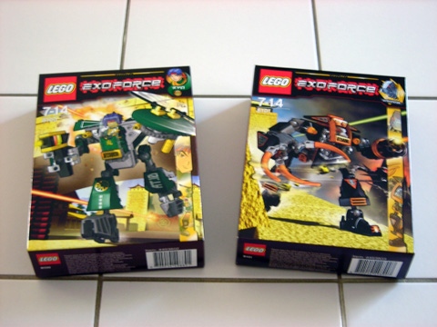

**Les boîtes**

## Set 8100 - Cyclone Defender... Le gentil

_92 pièces - 1 Minifig - Année 2007 - 7,99 € (prix moyen constaté)_

**La boîte**

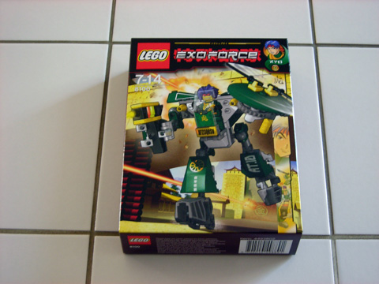

**Set 8100**

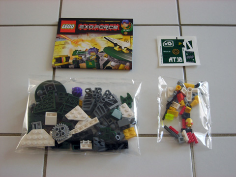

**Le contenu de la boîte 8100**

Je remarque tout d’abord que les boîtes Exoforce 2007 troquent leur gaufrage original (les sets 7708 et 7711 n’en possédaient pas toutefois) au profit d’une livrée métallique du plus bel effet.

L’ouverture révèle deux sachets, une planchette d’autocollants et la notice.

**Le montage**

En examinant les pièces de mon assiette, je constate la présence de métapièces Bionicle (rotules, pieds...).

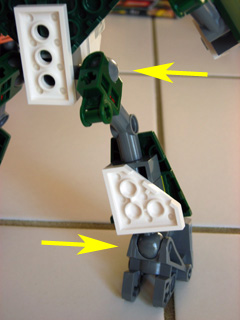

**Technologie Made In... Bionicle !**

Les mauvaises langues diront que c’est une manière comme une autre de recycler des moules largement amortis... Oui et non. LEGO puise dans sa banque d’organes Bionicle si détestés certes, mais principalement dans le but de rendre ses modèles plus « solides » et plus « stables ». Ils sont ainsi susceptibles de rivaliser en terme de jouabilité avec des figurines et des robots « classiques » (qui sont les concurrents de la gamme), tout en gardant la faculté propre aux briques d’être modifiables à volonté. Cet argument est d’ailleurs largement avancé dans le catalogue professionnel LEGO 2007, après les remontées d’informations quant à la friabilité de certains modèles Exoforce ! J’avoue que les sets 7708 et 7711 n’étaient pas tip top...

Ainsi, ces modèles Exoforce seraient un pont entre les Bionicle et les LEGO traditionnels.

Le montage est simple, très simple... La notice est clairement destinée à un jeune public. Parfois, les étapes ne décrivent que l’adjonction d’une seule brique !

Tout commence par l’assemblage de la minifig dont la chevelure souple tient convenablement en place pour un fois. Je remarque que la tête est un modèle à double expression, très ludique.

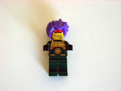

**La minifig**

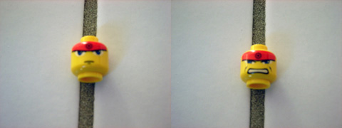

**Une tête à double expression**

Les étapes s’enchaînent, sans surprises.

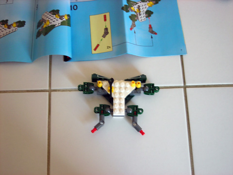

**Set 8100 à l’étape 10**

Progressivement, le modèle prend de l’ampleur et devient réellement impressionnant pour un set de ce prix, avec sa main droite enserrant un énorme pistolet mitrailleur et sa double faux rotative !

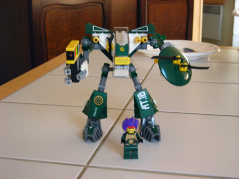

**Cyclone Defender prêt au combat !**

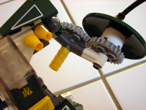

**Détail du mécanisme de la double faux rotative**

## Set 8101 - Claw Crusher... Le méchant

_99 pièces - 1 Minifig droïde - Année 2007 - 7,99 € (prix moyen constaté)_

A tout gentil, il convient d’opposer un méchant d’envergure, et _vice-versa_. Ce set est le pendant du précédent.

**La boîte**

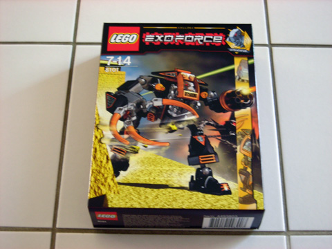

**Set 8101**

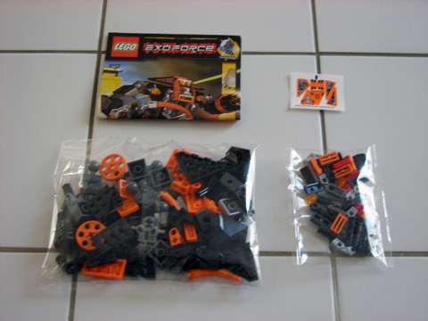

**Le contenu de la boîte 8101**

Son type et son contenu ne diffèrent pas de la précédente : deux sachets, une planchette d’autocollant et la notice.

**Le montage**

La « minifig droïde » pêche par un manque d’agressivité...

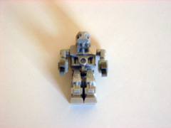

**La "minifig" robot**

Elle n’inspire ni crainte ni frayeur. Raté ! Je constate surtout que la tolérance de moulage de certaines pièces la composant est approximative...

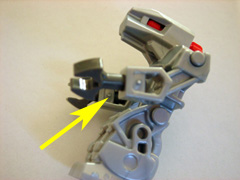

**Grrr... Trop de jeu...**

Jusqu’aux étapes 4/5, les deux modèles ont une structure commune, puis divergent sensiblement. La notice semble moins basique que la précédente. Sensation majorée, lorsqu’à l’étape 10, je m’aperçois que le modèle est plus avancé que son homologue.

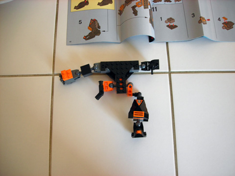

**Le set 8101 à l’étape 10**

Le modèle achevé est plus impressionnant encore que le précédent avec ses griffes et son méga canon rotatif (technologie très appréciée par LEGO que ce soit au sein de cette gamme ou de Batman !).

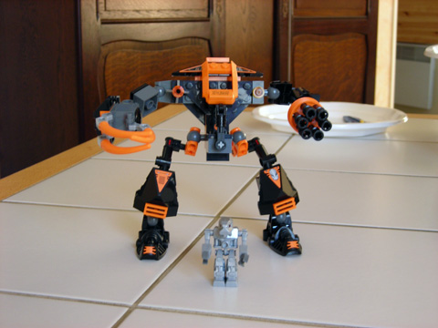

**Le redoutable Claw Crusher !**

Les couleurs accentuent cette impression de puissance. Le set devient enfin vraiment... méchant !

## Deux sets indissociables...

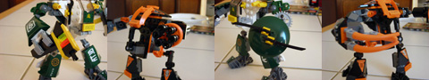

**Ca va saigner !!!**

Les deux modèles sont particulièrement réussis à mon goût.

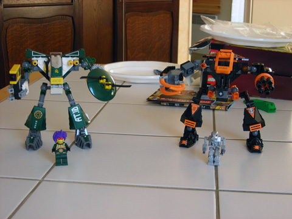

**Comparatif**

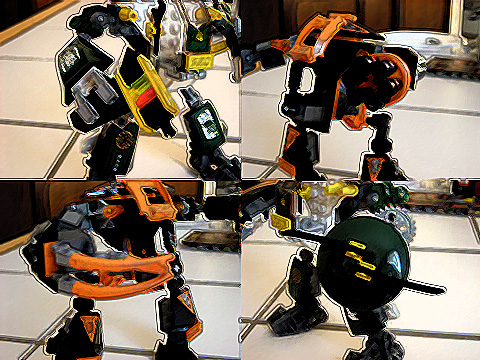

**L’exocode...**

Au travers d’une branche de son [site dédiée à la gamme Exoforce](http://www.exo-force.com/), LEGO vous propose de continuer l’aventure sur Internet. Des jeux, du multimédia... Mais la grande originalité réside ailleurs, sur les modèles eux-même ! En effet, après avoir créé un compte, il vous suffira de saisir les codes qui sont imprimés sur la tuile accrochée au cockpit de chaque robot.

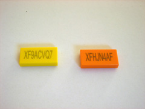

**Des codes... déjà actifs !!!**

Vous cumulerez ainsi divers avantages que je vous laisse découvrir...

## En conclusion

Deux sets peu onéreux, riches de détails et d’une grande jouabilité : carton plein pour les enfants... et les AFOLs, qui trouveront dans ces sets une jolie petite respiration entre deux MOCs faramineux, et accessoirement une petite banque de pièces sympas.
