Cette nouveauté 2007 d’une gamme Creator à succès est une petite révolution dans l’univers politiquement correct de la firme danoise. Pour la première fois, LEGO propose une réplique d’avion de chasse, certes ici en version "patrouille aérienne" dénuée de missiles et de bombes. Ce fait notable est à rapprocher de l’apparition de répliques d’armes à feu contemporaines (mitrailleuses, etc.) pour ses minifigs. Les temps changent, les moeurs évoluent...

Set 4953 - Les bolides aériens (fast flyers)

Année 2007

312 pièces

19.99 € (prix moyen constaté)

## La boîte et son contenu

Particulièrement compacte, la boîte à la livrée jaune typique des gammes Creator/Designer est particulièrement lumineuse et attrayante. Ça peps !

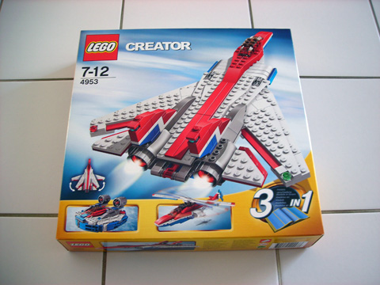

**La boîte**

Si le modèle principal - l’avion de chasse - se taille la part du lion, les modèles alternatifs du concept 3 en 1 sont néanmoins convenablement présentés.

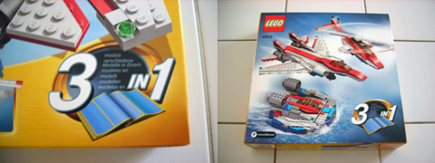

**Un set 3 en 1**

Notons que l’une de ses tranches affiche l’inventaire de pièces. Un simple coup d’œil suffit à estimer le potentiel du set. Une initiative très appréciée des AFOLs qui prédestinent souvent les sets de ces gammes « créatrices » à étoffer leur banque de pièces.

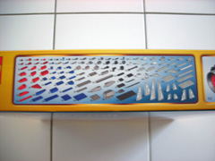

**L’inventaire est visible sur la boîte !**

L’ouverture de la boîte révèle 5 sachets non numérotés (pas de montage modulaire ici, la gamme étant clairement orientée « construction », cette facilité est superflue, voire « déplacée »...) et 2 notices dont une exclusivement consacrée à l’avion, ce qui donne le ton : LEGO mise tout sur le zingue !

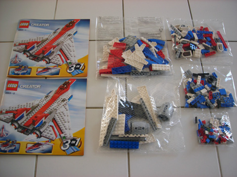

**Le contenu de la boîte**

LEGO vous invite sans détour à découvrir le reste d’une gamme Creator dont la qualité des modèles proposés ne cesse de me surprendre...plus qu’agréablement.

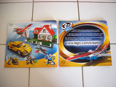

**Découvrez la gamme Creator**

_Remarques diverses :_

_En examinant les pièces avant de débuter le montage du modèle phare, je constate que la tendance s’accentue : on assemble soi-même les turntables._

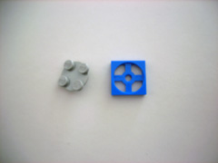

**Montez vos turntables, comme des grands !**

_Hummm, pas Grrrood ça ! C’est avec effroi que je m’aperçois qu’un axe Technic est cintré !_

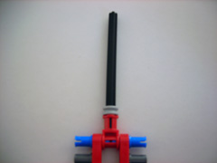

**Grrr ?!!! Mais c’est tordu !**

_Le montage du modèle principal nécessitera de constants renversements. Un coup par le haut, un coup par le bas, ça assemble dans tout les sens !_

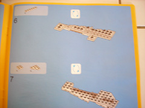

**De constants changements de vue**

## **1er modèle : L’avion de chasse !**

Le premier bolide aérien se dévoilera au bout de 43 étapes de montage, soit une bonne heure. Toute l’attention des concepteurs du set s’est bien évidemment portée sur ce qui fait l’essence même du modèle : la géométrie variable des ailes !

Tout s’opère grâce à une structure coulissante qu’il suffit de tirer ou de pousser depuis la queue de l’appareil pour modifier l’angle de la voilure. La translation imprimée est répercutée de manière synchrone (parfaite symétrie du mouvement) par des biellettes et convertit en rotation par le biais de turntables. C’est d’une simplicité et d’une efficacité désarmante !

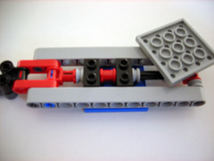

**Finalement, ça sert... à coulisser !**

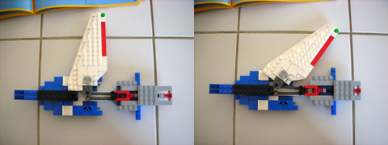

**Détails de la variation synchrone de la géométrie des ailes**

Notons qu’une fois l’assemblage terminé, il faudra toutefois quelques mouvements pour libérer complètement le mécanisme et obtenir une onctuosité satisfaisante. La fluidité étant grandement facilitée par l’usage massif de plaques lisses afin de limiter les frottements sur les zones sensibles.

Le montage est rythmé et agréable. Un plaisir majoré par les briques neuves et les coloris très lumineux.

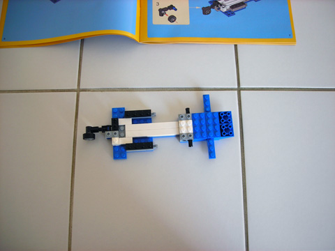

**Etape 10**

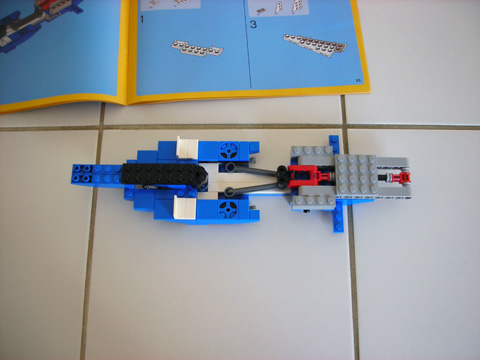

**Etape 20**

Le modèle se révèle peu à peu.

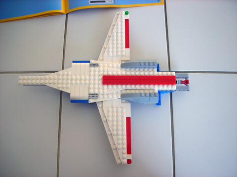

**Etape 30**

Tiens une métapièce ! J’en connais qui ne vont pô aimer...

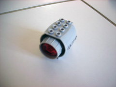

**La métapièce réacteur**

On approche de la fin.

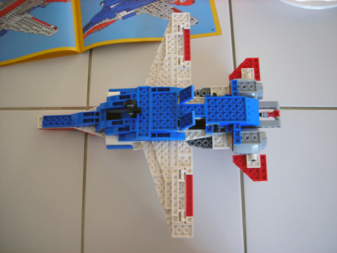

**Etape 40**

_Deux bémols :_

_La technique d’assemblage des ailes ne m’a pas convaincu. Assembler une structure aussi lourde avec autant de porte-à-faux en « encliquant » les deux parties de la turntable est une méthode à risque pour les enfants... Ça sent la casse !_

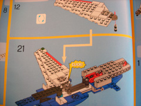

**Ca doit faire "click" et non pas "kaput" !**

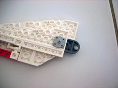

**Cette solution d’assemblage rend le téton de la turnable fragile...**

_Le choix du coude Technic à 90° dans la conception des trains d’atterrissage n’est pas tip-top. Si son utilisation coule de source pour le train arrière (commodité de déploiement d’une pichenette de l’index), son emploi sur le train avant au niveau de la roue est inutile. Grrrouh ! C’est moche..._

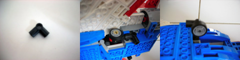

**L’élève LEGO peut mieux faire...**

**Quel zingue !**

L’avion est absolument magnifique ! On en vient à rêver d’en constituer une escadrille entière !

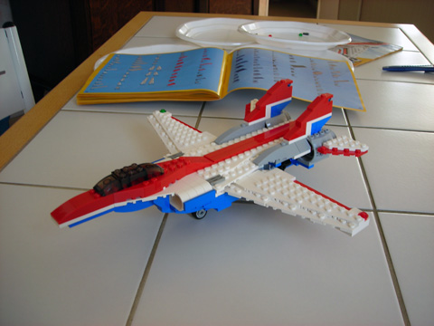

**Le modèle achevé...**

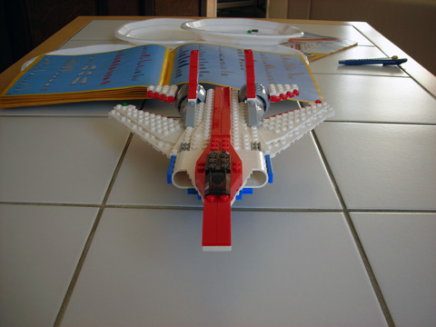

**... Prêt à prendre l’air !**

**Des ailes qui bougent !**

La géométrie variable est une technologie complexe, qui permet de modifier la voilure de l’avion en fonction de ses diverses phases de vol afin d’optimiser ses capacités. Ailes "déployées" au décollage et à l’atterrissage pour plus de portance, "rabattues" en vol pour conférer à l’appareil un profil typé aile delta (tel le Dassault Mirage 2000) à grande manoeuvrabilité.

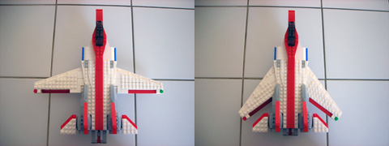

**Argh ! La géométrie variable, j’adore !**

**Et quoi d’autres ?**

Le modèle étant d’une rare stabilité et solidité, on ne se lasse pas d’actionner le mécanisme de géométrie variable et de jouer avec les diverses autres fonctionnalités : volets, trappes, ailerons...

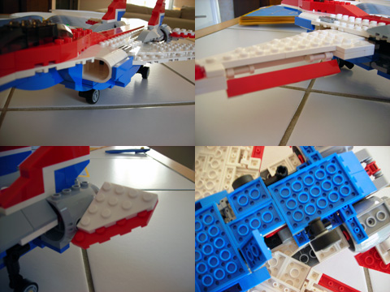

**Détails et fonctionnalités divers**

_Comme il est de coutume avec les sets "X en 1", l’assiette de montage contient encore quelques pièces, probablement indispensables à la construction des modèles alternatifs_

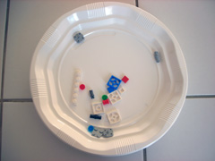

**Il reste quelques pièces dans l’assiette...**

Allez zouh ! On file vers le second bolide.

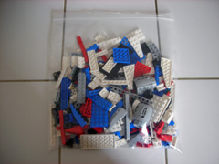

**Sac congélo entre deux modèles !**

## 2ème modèle : L’hydroglisseur

Euh, un hydroglisseur ? Un bolide aérien ?!  
Ma foi, pour LEGO c’est le cas... Le choix de ce modèle alternatif me laisse coi. De même que sa conception qui fleure bon la bricole (2 plates 1 x 2 pour appairer une 1 x 4, etc.)

"X en 1"... Nous savons pertinemment ce qu’il en est : on réalise un modèle phare, puis pour justifier ce concept marketing, on bricole des engins à partir des briques initiales, au pire en rajoutant quelques-unes, ce qui n’est pas le cas ici.

Seule la structure qui fait office de boudin présente un intérêt.

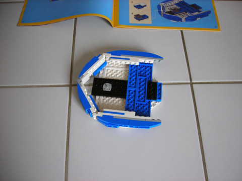

**En cours de montage**

Avouons-le, ce modèle est anecdotique et décevant en comparaison de l’avion.

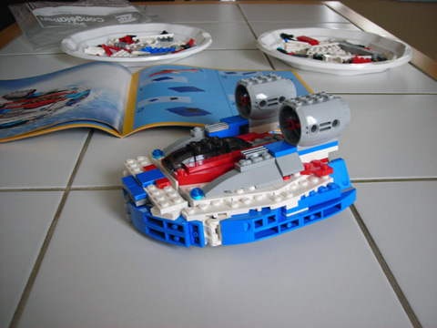

**Euh... ça vole ça ?**

De plus, il s’avère particulièrement friable et instable. La roulette avant est une véritable catastrophe ! Elle rend l’engin plus ou moins bancal en fonction de son orientation !!!

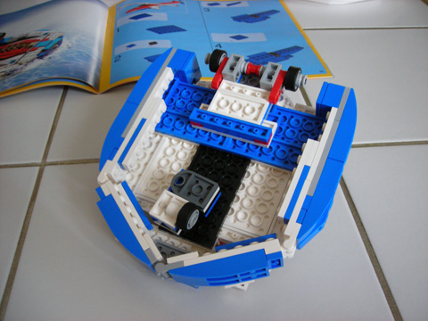

**Vue de dessous**

## 3ème modèle : L’hélicoptère

C’est mieux ! Voici un modèle qui colle mieux à la thématique et à la qualité de l’avion. Mieux conçu, plus solide, on retrouve le sourire, même si les masterbuilders ne se sont pas foulés le stud...

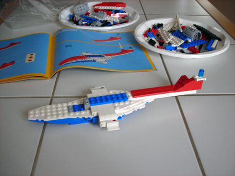

**En cours de montage**

L’hélicoptère achevé à belle allure, même si le train d’atterrissage est aux abonnés absents !

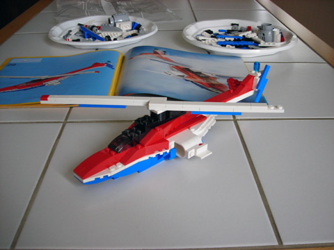

**Ah ! Voilà un engin qui vole !**

**En conclusion**

Un joli set, plein de bonnes idées mais à la dénomination 3 en 1 un brin abusive tant seul le l’avion - un vrai bijou ! - est susceptible de capter l’attention de l’acheteur potentiel. LEGO ne s’y est pas trompé, en le mettant clairement en avant !
