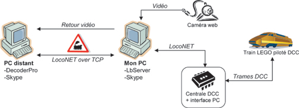

Au départ l’idée était farfelue. En voyant les possibilités de la commande des [trains en DCC](http://www.brickshelf.com/cgi-bin/gallery.cgi?i=2131691), je me suis pris à rêver de piloter mon train LEGO avec un ordinateur. Puis, comme cet ordinateur est connecté à internet, je me suis demandé comment faire pour le piloter à distance au travers le réseau internet. Enfin, devant ce comble de l’inutilité, j’ai réalisé qu’on pouvait jouer encore mieux en laissant à un autre humain le moyen de piloter à distance le train qu’on a construit.

Et voilà comment on arrive à imaginer jouer en réseau avec un copain, en mettant à disposition le train LEGO piloté par l’ordinateur aux commandes transmises via internet. Allumé non ? Lisez bien la recette et imaginez un peu tous les développements possible, j’en ai perdu le sommeil hier soir ! C’est vous dire :)

## Les ingrédients

_Le matériel que j’indique entre parenthèses est celui dont je dispose. Ce n’est pas le top, mais ça marche déjà très bien. Quand je sais, je vous indique les autres possibilités compatibles._

1.  Une connexion internet rapide (ADSL 512K entrant/128K sortant). La connexion internet se trouve chez tout bon marchand de salade du coin, moi c’est mamadou, mais le choix ne manque pas.
2.  Un ordinateur de puissance moyenne (vieux PC âgé de 7 ans). C’est pareil que pour ci-dessus : à vous de choisir.
3.  Un circuit de train LEGO (minimum une boucle), donc 16 rails courbes. Je vous conseille le système 9V à rails métalliques, ou alors du vieux 12V ferait aussi l’affaire avec quelques adaptations.
4.  Une locomotive compatible DCC (j’ai équipé la 4564). Le moteur de la locomotive doit être équipé d’un décodeur DCC, [comme dans cet exemple](/articles/491/).

1.  Une centrale de commande DCC, pour piloter les trains en DCC. Cette centrale constitue le gros morceau dans le budget. Faut évidemment avoir envie de passer en commande DCC pour de bon. Ca se trouve chez tout bon revendeur de matériel pour modéliste. J’utilise une [Intellibox](http://www.commerce.cdfinformatique.com/acatalog/ULHENBROCK.pdf).
2.  Une interface Centrale-PC (Intellibox en est équipé en standard) pour que la centrale DCC puisse recevoir des ordres de l’ordinateur. Cette interface est directement intégrée dans les centrales DCC haut de gamme mais on peut aussi en trouver qui relient LocoNET et DCC pour quelques dizaines de dollars sur le web. [Voici un lien qui décrit bien les différentes possibilités techniques](http://loconetovertcp.sourceforge.net/Interface/index.html).
3.  Un logiciel parlant le protocole LocoNET, langage qui permettra à l’ordinateur de se faire comprendre par la centrale DCC. Ce logiciel est développé en "Open Source Software (OSS)", il s’agit de [DecoderPro](http://jmri.sourceforge.net/apps/DecoderPro/). Il est programmé en Java, ce qui implique d’installer l’[environnement d’exécution de ce langage](http://java.com/fr/download/index.jsp?cid=jdp74834) avant de pouvoir utiliser DecoderPro. Vous pouvez aussi trouver des logiciels concurrents et payants. C’est vous qui voyez :)
4.  Un serveur passerelle qui permet de recevoir le langage LocoNET lorsqu’il est transporté par internet (TCP). Ce serveur est développé par la même communauté OSS, il s’agit de [LbServer](http://jmri.sourceforge.net/hardware/LbServer.html).
5.  Une caméra vidéo pour le web. Faut bien que le pilote distant voit un peu les conséquences de ses actions. La caméra vidéo que j’utilise est la LEGO Cam qu’on trouvait dans les boites [Mindstorm Vision Command (9731)](http://www.brickset.com/detail.aspx?Set=9731-1) il y a quelques années. Voilà une bonne réutilisation de ce matériel qui était tombé en désuétude (au moins à la maison). Pour information, cette caméra est en réalité de marque Logitech et les pilotes sont disponibles publiquement. Cependant, la qualité de l’image est à la hauteur de la valeur actuelle de l’équipement, c’est à dire nulle. :)
6.  Un logiciel de diffusion vidéo sur internet. Celui que j’utilise est [Skype](http://www.skype.com/intl/fr/), mais ça aurait pu être autre chose.
    
    J’allais oublier...  
    
7.  Un copain patient prêt à essuyer les plâtres :) Pour trouver cette perle rare, j’ai pioché dans les potes de FreeLUG. Quel bonheur cette association ! :) Il y en a plein.

## La mise en oeuvre

Globalement, il vaut mieux ne pas être effrayé par l’informatique, mais à y bien regarder il faut surtout mettre de la méthode, car installer et lancer un programme est un jeu d’enfant (demandez aux vôtres vous verrez...). Essayez de suivre ces étapes dans l’ordre et ça se passera bien.

-   Installez sur votre PC les logiciels requis, le pilote de la caméra vidéo, Skype, DecoderPro et LbServer.
-   Vérifiez que la locomotive DCC et la centrale DCC fonctionnent bien ensemble.
-   Connectez la centrale au PC. Dans le cas présent l’Intellibox se connecte avec un câble RS232C.
-   Lancez Skype en réglant ses options vidéo sur la caméra installée (ici LEGO Cam). Etablissez le lien avec le joueur distant. Voilà déjà le retour image qui fonctionne.
-   Lancez le serveur LocoNET (LbServer) et n’oubliez pas d’ouvrir le port de communication sur votre parefeu, le cas échéant. Configurez LbServer et le PC pour qu’ils se connectent à la centrale DCC avec les bons paramètres (port COM, 19200 bauds, 8 bits de donnée, pas de parité, 1 bit de stop, handshake matériel, dans le cas de l’Intellibox).
-   Transmettez l’adresse IP de votre ordinateur au joueur distant pour la suite (Skype sert aussi de messagerie instantanée...). Et indiquez lui aussi le numéro de port que vous utiliserez (c’est vous qui le décidez ensemble, par défaut LbServer propose 1234).
-   Assurez-vous que le joueur distant a bien installé et lancé DecoderPro de son côté en le configurant sur l’option "LocoNET overTCP LbServer" avec le numéro IP et le numéro de port que vous lui avez passés. Dès qu’il saura ouvrir un régulateur (suffit de lire le manuel de DecoderPro...) et valider l’adresse DCC de la locomotive que vous lui aurez indiquée, la partie commencera.

Allez... un petit dessin pour schématiser ce que j’essaie d’expliquer et vous pourrez ensuite vous jeter dans le vide.

Et c’est parti ! Regardez votre locomotive allumer seule ses phares à l’arrêt (eh oui le DCC permet ça) et se déplacer sur le réseau sans contrôle local. Le mieux est ensuite de prendre le contrôle d’une autre locomotive équipée DCC de votre côté (avec DecoderPro installé sur votre PC), et alors commence l’amusement total. On peut gérer le trafic avec sa(ses) locomotive(s) pilotées localement en fonction des mouvements de(s) (l’)autre(s) locomotive(s) gérée(s) par le joueur distant. Pour vous faire rêver un peu plus, imaginez qu’on peut aussi jouer avec plusieurs joueurs distants, chacun pilotant sa locomotive sur votre circuit de train.

## Quel est l’avantage de ce système de jeu ?

  
Quand vous avez gouté aux expositions de train, vous réalisez qu’on y construit collectivement des réseaux tellement grands qu’on ne pourrait même pas en rêver pour chez soi. Ce système de jeu permet de retrouver un peu cette ambiance du jeu collectif où [chacun conduit sa locomotive sur le réseau commun](http://www.brickshelf.com/cgi-bin/gallery.cgi?i=2132074) en se prenant un peu pour un vrai conducteur (faut bien le dire...). Ne pas savoir ce que va faire la locomotive qui s’approche fait partie du piment dans cette façon de jouer.

En complément j’ai mis en place une solution de diffusion d’image webcam sur le web et visualisable sur un navigateur de base. Ca remplace Skype quand on veut jouer avec plus d’une personne distante à la fois. Mon choix final s’est porté vers un logiciel shareware ([webcam123](http://www.webcamsoft.com/en/ezcast.html)) qu’il faut acheter pour obtenir la pleine fonctionnalité. Je n’en fais pas particulièrement la publicité, car j’aurai préféré trouver une solution gratuite, mais ça reste abordable au cours de l’Euro actuel. Ensuite j’ai augmenté un peu le débit adsl pour envisager de jouer à plusieurs en même temps... mais c’est une autre histoire avec de la redirection de port, de la gestion de numéro IP dynamique et la prise en compte du serveur derrière un routeur (j’en ai encore des ampoules au cerveau).

Allez voir sur mon site [Chezfilou](http://perso.orange.fr/chezfilou/) le lien en haut sous le "Bienvenue" est le point d’entrée. Un petit truc visuel : si le fond du bandeau sous ce lien est coloré alors la salle est allumée et le serveur est actif. Si il est sombre alors la salle est éteinte et le serveur aussi. Si vous avez des idées pour améliorer encore ce système de jeu, je partagerai volontiers votre inspiration.  
En pratique, il me reste à rendre les aiguillages télécommandables _via_ la centrale DCC (c’est possible, mais je n’ai pas encore fait ce pas) et on pourra alors voir qui sera le chef de gare ! :)

Jouez bien !

Philippe "frogleap" Label
