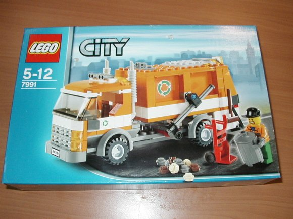
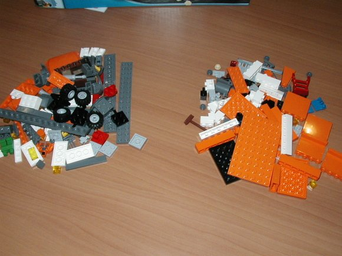
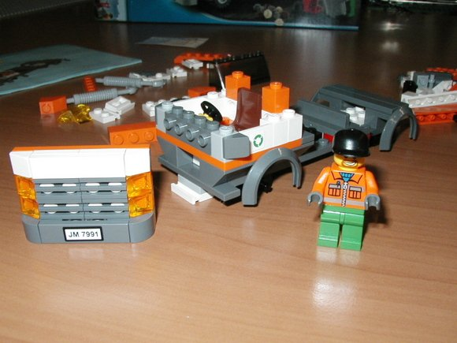
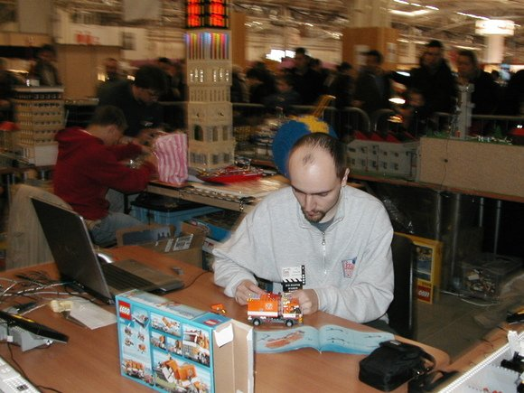
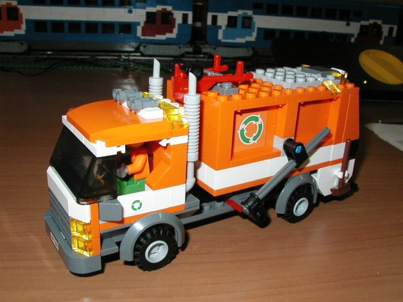
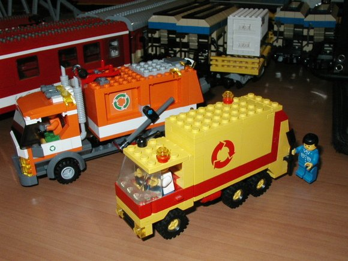
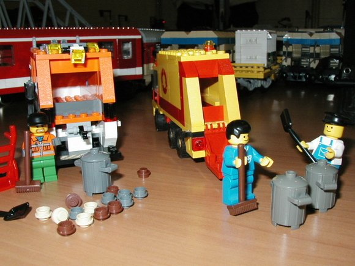
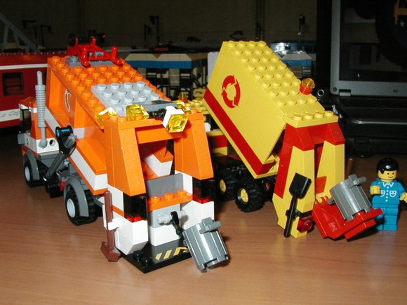
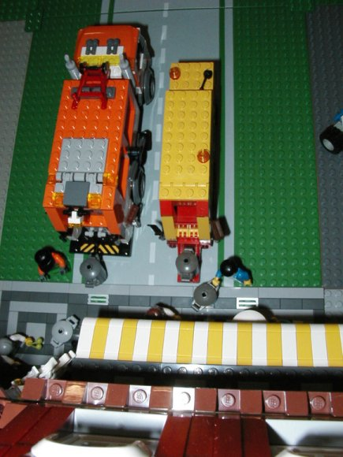

Tout comme pour le [camion benne 7998](/articles/594/), cette étude porte sur la reconstruction du nouveau camion poubelle 7991. Son étude a été suspendue afin de me permettre de ramener au salon du Mondial de la Maquette son ancêtre 6693 et faire un comparatif.

Complétant sa gamme à succès City, LEGO nous propose dès Juin un nouveau camion-poubelle. Ce véhicule s’inscrit dans la parfaite lignée des précédents véhicules produits depuis deux ans comme [le camion pompier](/articles/353/).

La boite contient deux sachets dont le contenu orangé excite notre oeil :)

Le montage se fait encore une fois sans difficulté et ressemble dans sa base aux autres modèles de la gamme.

**En pleine construction :)**

Le set vient avec de nombreux détritus représentés par des plates rondes 1x1 de couleur marron, sable et gris. Attention à ne pas basculer le camion en arrière, sinon vous êtes bon pour ramasser les petites pièces (entre les nombreuses caisses du Mondial, c’est fort pratique :) )

## Et 20 ans avant, il y avait quoi ?
{: id="20ans"}

Voila, cela faisait 20 ans que l’on avait pas eu de vrais camions poubelle pour la gamme City, exception faite du [6668](http://guide.lugnet.com/set/6668) qui n’est pas un véritable camion-éboueur ou du [6564](http://guide.lugnet.com/set/6564) issu d’une période que de nombreux AFOLs essayent d’oublier.

Son véritable ancêtre est le [6693](http://guide.lugnet.com/set/6693) de 1987.

**Le 7991 et son grand frère le 6693**

Alors évidemment, le nouveau camion est plus large (6 contre 4), plus long, mais aussi plus haut. Notons l’harmonie du logo de recyclage, et la couleur orange qui n’est pas très loin du mélange du jaune et rouge.

Côté équipement, les deux sont équipés de balais et pelle, mais le 6693 avait deux minifigs et deux poubelles, contre un dans chaque cas pour le 7991. Le 7991 possède par contre un chariot qui se fixe sur le toit et quelques ordures...

**Je n’ai pas deux poubelles, et en plus je suis seul pour ramasser les détritus !**

Les deux camions ont le même mécanisme d’ouverture.

Et voici nos deux camions en situation en train de vider les poubelles du [Corner Café](http://guide.lugnet.com/set/10182).

**Qui pourra en prendre le plus ?**

## Conclusion

Et bien voilà un très beau set qui viendra enrichir la flotte de véhicules de nos villes, et lui redonner un coup de jeune.

A part ce souci de plates rondes qui se perdent facilement si on manipule un peu brusquement le camion, il n’y a rien à redire, et il fait attendre de façon encore plus intense la sortie du camion toupie 7990 attendu pour la même période.
