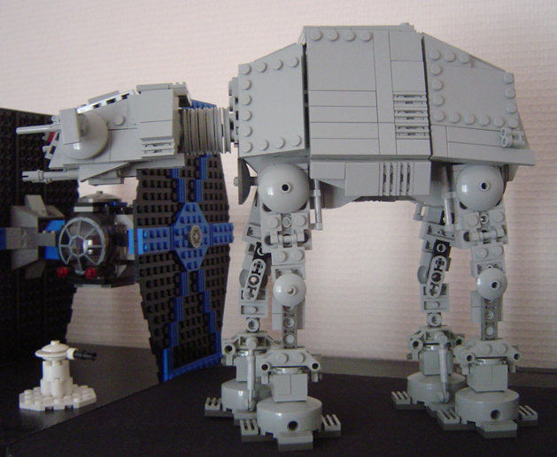
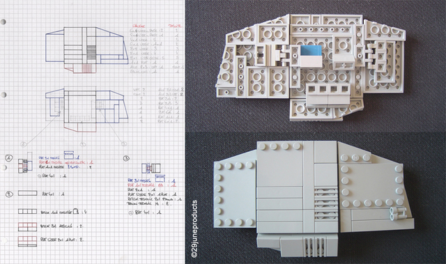
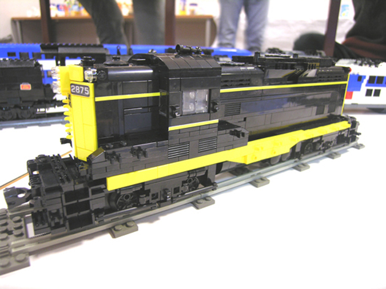
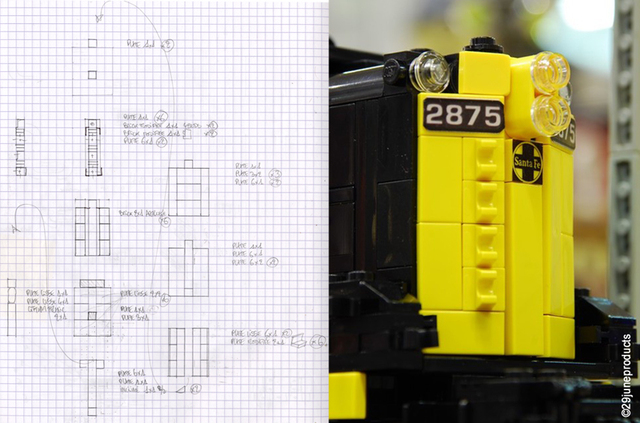
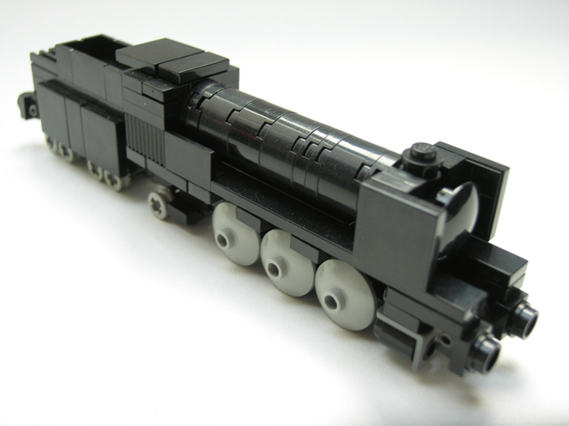
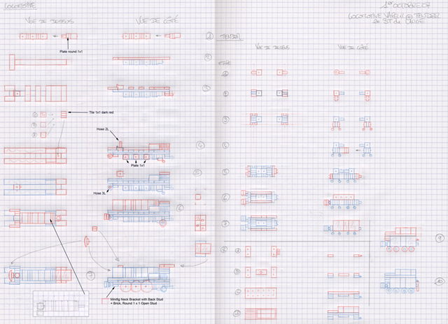

Pour faire écho aux articles faits par Erik Amzallag : [Echelles et unités de mesure](/articles/547/) & [Pré-concevoir ses MOCs sur MLCad](/articles/492/), voici présentée dans cet article, une autre façon de pré-concevoir des MOCs mettant en avant une technique de dessin utilisant une autre échelle de représentation.

Qui n’a pas été tenté, lorsqu’il a un projet de construction LEGO en tête, vouloir griffonner sur un bout de papier une possibilité d’assemblage qui vient de lui traverser l’esprit pour ne pas l’oublier. Ou lors d’une réunion de travail ennuyeuse commencer à dessiner sur son bloc-notes une nouvelle idée, ou enfin en vacances lorsque les caisses de pièces n’ont pas pu rentrer dans le coffre de la voiture, ni même l’ordinateur, continuer à construire « virtuellement ».

## Une façon économique de pré-concevoir des MOCs

Cet article décrit une façon simple de concevoir des MOCs par le dessin mais sans l’ordinateur. Donc pas de vues 3D mais la possibilité de représenter des assemblages en plan ou en élévation rapidement et à l’échelle (nécessaire pour les assemblages). Cela demande une bonne connaissance des pièces, un crayon, une gomme et du papier petits carreaux.

Cette technique de dessin a été éprouvée pour la conception de MOCs alliant briques classiques et Technic, de taille « raisonnable ». Mais elle a certainement ses limites notamment pour les assemblages complexes en Technic...

## Une technique de dessin simple

Muni de papier petits carreaux, le plus rapide et simple, est d’utiliser l’échelle 10/16 , c’est à dire : 1 Tenon = 5 mm, 1 Plate = 2 mm, 1 Brique = 6 mm,...

1 Plate de 1x1 sera donc représentée sur papier par un carreau de 5mm sur 5mm en plan et d’une épaisseur de 2 mm en élévation... et la simplicité de la représentation est là !

Il s’agit de s’appuyer sur la trame quadrillée du papier petits carreaux pour bâtir un projet et le tour est joué ! La formule 5P=2T prend alors tout son sens avec cette technique de dessin.

Une représentation en plan, une de face et une de côté et voilà les trois vues pour se donner l’idée de la 3D. Pour dessiner une succession d’étapes pour le montage d’un MOC, on peut s’inspirer de ce qui se fait en architecture : dessiner niveau par niveau en utilisant une couleur pour ce qui est déjà construit et une autre pour ce qui est à rajouter.

## Quelques exemples d’application de cette technique de dessin

**ATAT de 20 cm de haut - Largeur du pied = 4tenons**

**ATAT vue générale**

**ATAT construction du côté**

**EMD GP7 lors de l’AG FreeLUG 2007**

**EMD GP7 vue générale**

**EMD GP7 construction de l’avant**

**Locomotive vapeur en 3 Tenons de large**

**Vapeur 3WIDE vue générale**

**Vapeur 3WIDE notice de montage**

Retrouvez la notice et la liste des pièces de cette petite loco vapeur en 3 tenons de large en meilleure définition sur la [galerie FreeLUG](http://photos.freelug.org/main.php/v/Charlie/ATAT/Vapeur/)

Maintenant à vous de jouer et à vos crayons !!!!
