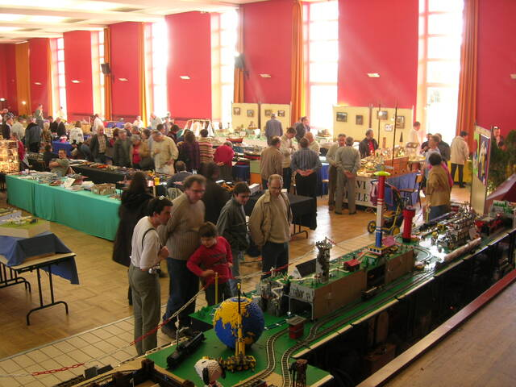
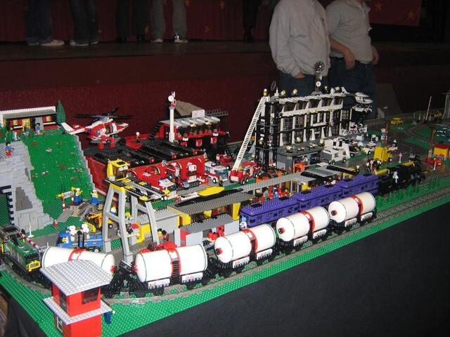
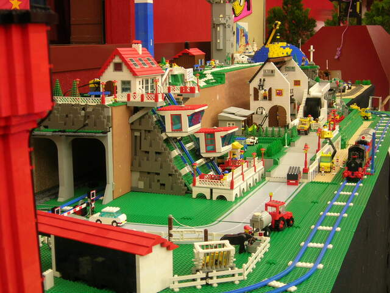
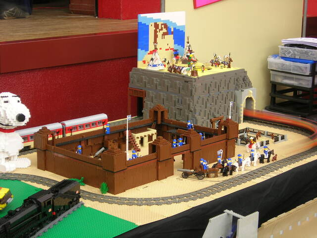
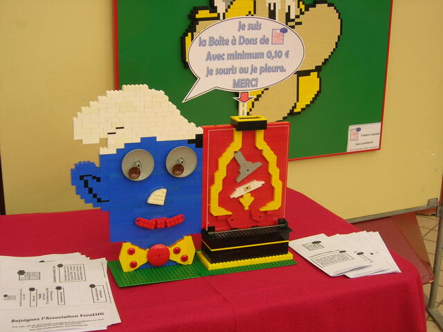

Pithiviers-loisirs-passions a invité FreeLUG pour son exposition Modélisme les 10 et 11 mars 2007.

Invités par l’association Pithiviers-loisirs-passions (suite à une rencontre lors du salon des passionnés de La Ville Du Bois en 2005), trois membres de FreeLUG ont donné le spectacle les 10 et 11 mars 2007 dans la salle des fêtes de Pithiviers(45).

**Vue d’ensemble**

Parmi de nombreux exposants de maquettes (trains, camion, voitures, maisons, avions, ...) les petites briques n’ont pas faillis à leur réputation.

Un diorama de 8m par 1,5m a été offert aux yeux ébahis des visiteurs. Le module de Jérémy mettait en scène la gare, la caserne de pompier et le quartier général de la police

**Module de Thaaz**

tandis que le rappel des métiers anciens (fabrication du papier) était assuré par Denis avec son moulin à papier animé.

**Module de DenisL**

Enfin le campement indien et le fort de Gilles terminaient de donner un aperçu de ce que peut réaliser une poignée de passionnés.

**Module de Gmi**

Une petite boîte à dons animée a retenu l’intérêt de quelques visiteurs curieux.

**Boîte à Dons**

Bénéficiant d’une excellente organisation de la part de Pithiviers-loisirs-passions et d’une très grande qualité des prestations des autres exposants, notre séjour à Pithiviers restera un très bon moment de rencontres et de convivialité.

Merci à Frogleap et Qdm pour leur participation.

Merci aux visiteurs Freelugiens qui ont fait le déplacement pour nous encourager et/ou nous aider au rangement final.

Plus de photos :  
**–** [Galerie Qdm](http://gallery.freelug.org/main.php/v/La-Gallerie-de-qdm/Expositions/2007-Pithiviers/)  
**–** [Galerie DenisL](http://gallery.freelug.org/main.php/v/dlaurencon/pithiviers/)
