Quelques 187 Afols se sont réunis à Oregon Convention Center pour participer au Brickfest 2007

Le Brickfest s’est déroulé du 30 mars 2007 au 1er avril au Oregon Convention Center.

[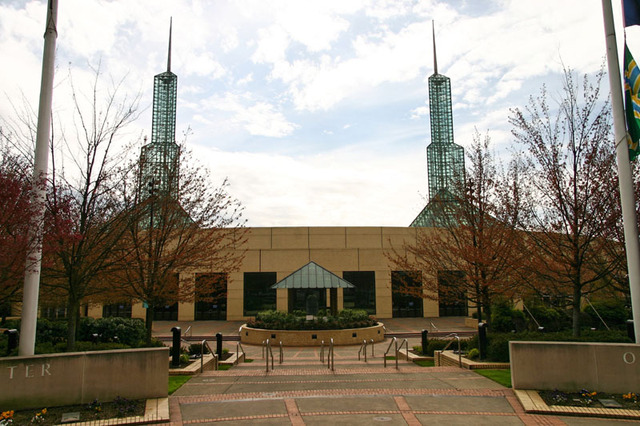](https://www.freelug.org/IMG/jpg/BF06.jpg)

**Oregon Convention Center**

Cette année encore, plein de choses au programme, le vendredi matin a été consacré à l’accueil des AFOLs, chaque AFOL se voit recevoir un Badge.

Le premier concours de la matinée était axé robotique.  
Le but était d’amasser le plus d’oeufs (en chocolat) et de les faire sortir de la zone, les angles étaient plus valorisés que les cotés de la piste puisque plus difficiles à atteindre.

[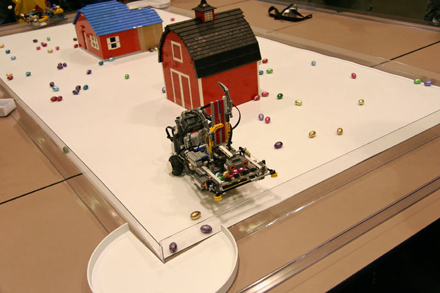](https://www.freelug.org/IMG/jpg/BF01.jpg)

**Coucours de Pâques**

Le robot doit ramasser le plus d’oeufs en chocolat

Sans même avoir le temps de grignoter quelque chose un autre concours a suivi, il s’agit là de construire un petit modèle Racer sans ouvrir le sac.  
Les meilleurs ont mis moins de 15 minutes pour parvenir à assembler le modèle.

[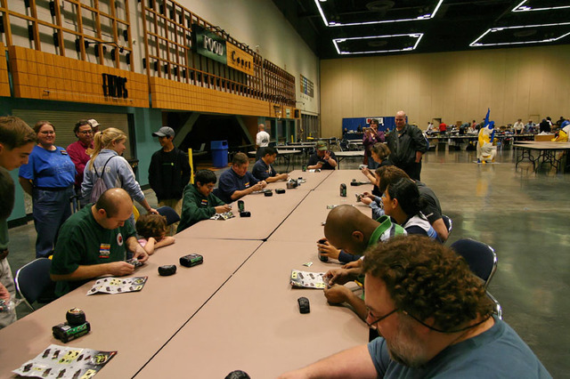](https://www.freelug.org/IMG/jpg/BF02.jpg)

[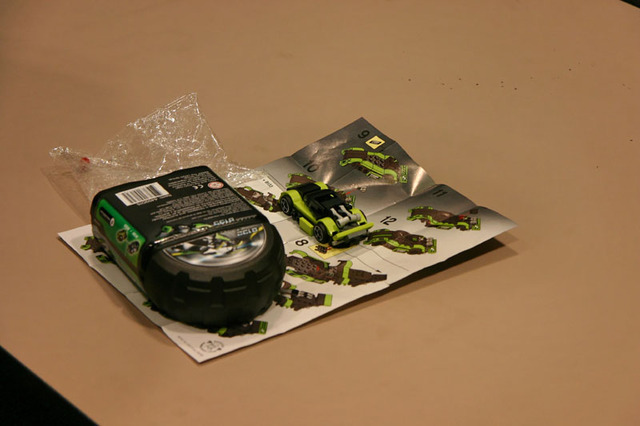](https://www.freelug.org/IMG/jpg/BF03.jpg)

**Le modèle une fois fini**

Pendant ce temps se tenaient des discussions dans les salles de réunions mises à disposition, les sujets toujours aussi intéressants que Ldraw, LPUB, les techniques du SNOT, Mindstorm, l’évolution du gris et bien sûr le Train.

[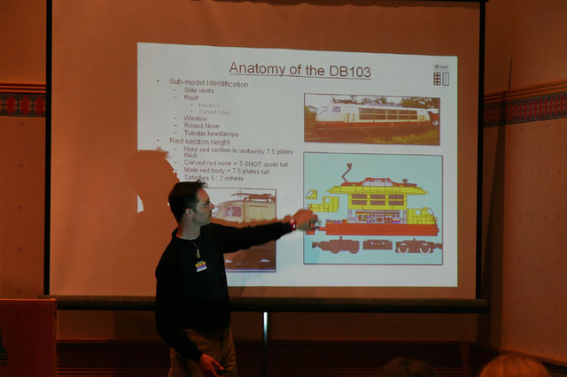](https://www.freelug.org/IMG/jpg/BF07.jpg)

**Une présentation très très trains**

Un peu plus tard dans l’après midi Larry Pieniazek a animé une vente aux enchères, on pouvait y trouver un "Spirit of St Louis" encore dans la boite, des briques couleur Or, des plaques de bases 48x48 jaunes et rouges, les sachets de pièces argentées, et beaucoup d’autres choses exotiques comme les Mini SW vendus exclusivement au Japon.

[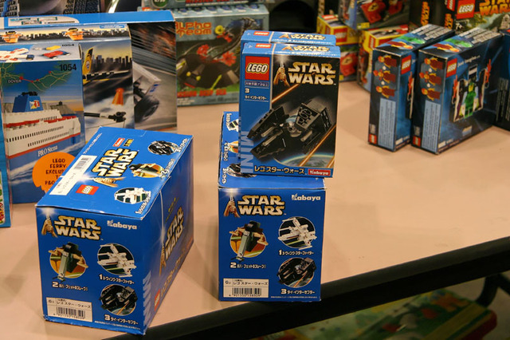](https://www.freelug.org/IMG/jpg/BF05.jpg)

**Des boîtes très rares venues du Japon**

La soirée a continué par la cérémonie d’ouverture et les tirages aux sorts des lots, (des tickets sont donnés à tous les participants qui s’inscrivent à Brickfest, il suffit ensuite de déposer un ticket dans les boites que l’on désire).

Peu après ce fut le départ pour le magasin LEGO qui se trouvait à 15km du centre ville de Portland.  
Et là il faut le vivre pour le croire mais les chiffres donnent le tournis : environ 150 personnes dans un magasin de 60m², il fallait à peu près 3 minutes pour aller d’un bout à l’autre du magasin.

Des réduction de 50% était appliquées sur des boîtes abimées, même un café Corner se trouvait là.  
Les immenses bacs du Pick-A-Brick se vidaient plus vite que les employés n’avaient le temps de les remplir.  
Et pendant ce temps la file aux caisses commençait à prendre de la longueur.

Le magasin offrait des rabais très importants et a ouvert spécialement de 10 heures du soir à 1 heure du matin, et il fallait bien 3 bonnes heures pour faire ses emplettes et surtout faire la queue qui à minuit sortait du magasin et longeait les vitrines des magasins voisins sur une vingtaine de mètres (heureusement le centre commercial ne comptait plus qu’une seule boutique ouverte).

Le Samedi la journée a commencé par le concours de Mosaïques, 25 plaques 48x48 composaient la mosaïque, les plus rapides ont quand même mis deux bonnes heures pour achever les 2304 tenons, chacun ayant des techniques différentes pour terminer sa plaque.

[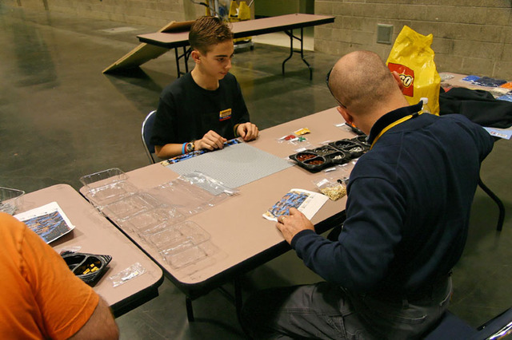](https://www.freelug.org/IMG/jpg/BF09.jpg)

**Concours de mosaique**

[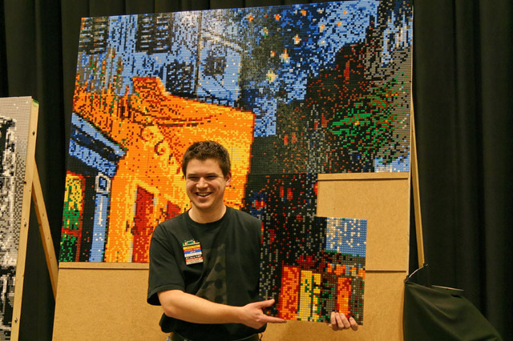](https://www.freelug.org/IMG/jpg/BF13.jpg)

[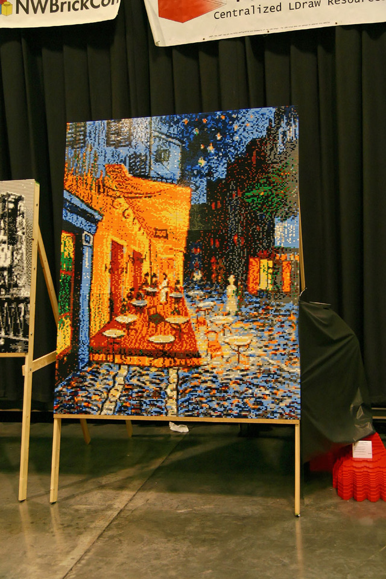](https://www.freelug.org/IMG/jpg/BF14.jpg)

**La mosaïque une fois terminée**

Un peu après le déjeuner nous avons pu assister à un combat de sumos sur une base NXT. 10 sumos uniquement assemblés avec la boite de NXT s’affrontaient. A noter que ce sont les deux plus jeunes qui ont gagné le concours. A la fin de l’épreuve tous les sumos furent mis sur la piste pour un ultime combat.

[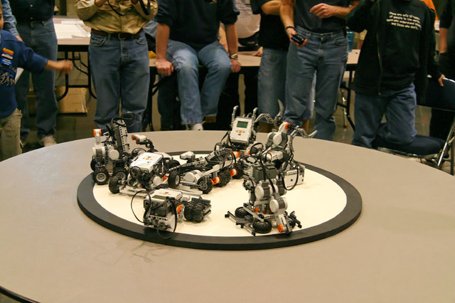](https://www.freelug.org/IMG/jpg/BF12.jpg)

Dans l’après midi une réunion très attendue par les fans de trains : la présentation de la boite LEGO Hobby Train, par leur créateurs.  
Une longue séance de questions réponses s’en est suivie.  
Les participants se sont vus à la fin de la réunion offrir le poster officiel dédicacé.

[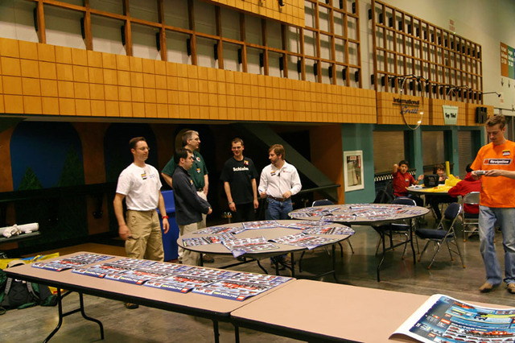](https://www.freelug.org/IMG/jpg/BF10.jpg)

**Les créateurs du "Hobby Train"**

La soirée a continué par une remise de prix et une présentation par des officiels de LEGO qui avaient fait le déplacement. Le sujet Top Secret a été très brièvement (même trop) présenté laissant planer une très grosse incertitude sur le sujet réel. On n’en dira pas plus parce qu’on n’en sait pas plus.

Pour terminer la soirée, un jeu a été prévu ; Le Bricktionary, sur le même thème que le Pictionary les candidats devaient deviner un mot à l’aide d’un MOC construit en temps réel avec des briques LEGO.  
Tout les candidats disposaient d’un vrac de briques très basique, les constructions étaient parfois aléatoires dues au peu de briques fournies.

La journée de dimanche était consacrée au public. Mille cinq cent visiteurs sont venus admirer les créations, acheter quelques vieux sets ou trouver la brique qui leur manque.

[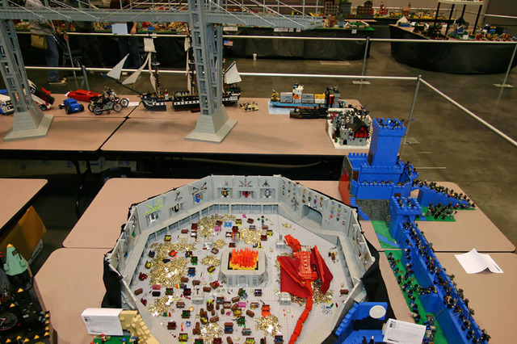](https://www.freelug.org/IMG/jpg/BF16.jpg)

La journée la plus bruyante s’est terminée par (encore) une remise de prix et la cérémonie de clôture.

[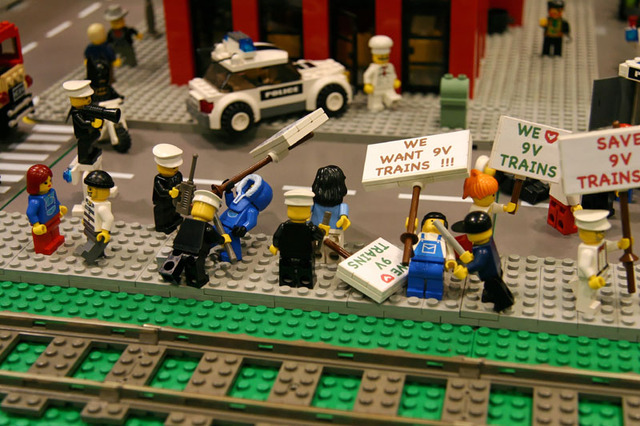](https://www.freelug.org/IMG/jpg/BF15.jpg)

**Une manifestation très écourtée par les forces de l’ordre**

Une manifestation très écourtée par les forces de l’ordre

[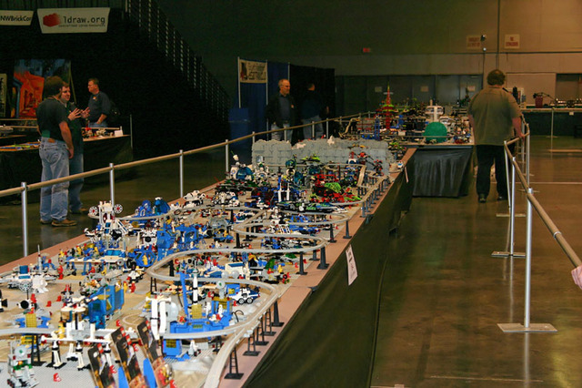](https://www.freelug.org/IMG/jpg/BF18.jpg)

**Une table très Space**

[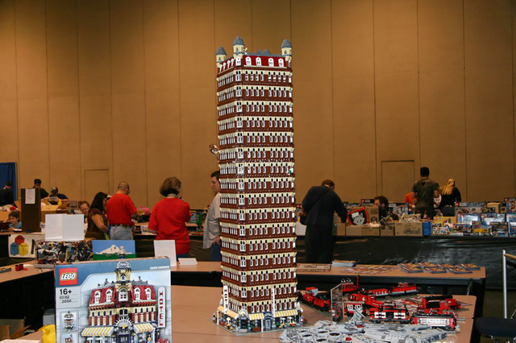](https://www.freelug.org/IMG/jpg/BF19.jpg)

**Le café Corneeeeeeeeeeeeeeeeeeeeeeer**

En conclusion, ce sont 3 jours intenses qui ne laissent pas indifférent, c’est l’occasion de discuter, de voir de très près tout les détails des différents MOCs et aussi l’occasion d’apprécier des thèmes variés comme l’espace, les châteaux ou les Bionicles.

[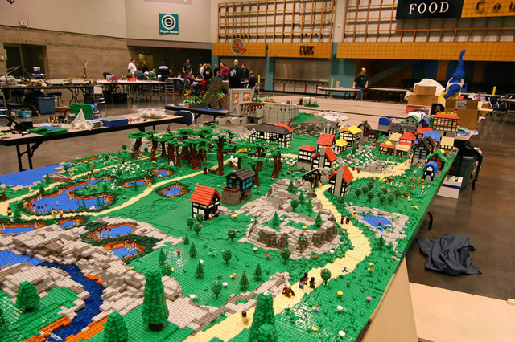](https://www.freelug.org/IMG/jpg/BF04.jpg)

**Une belle région médiévale**

[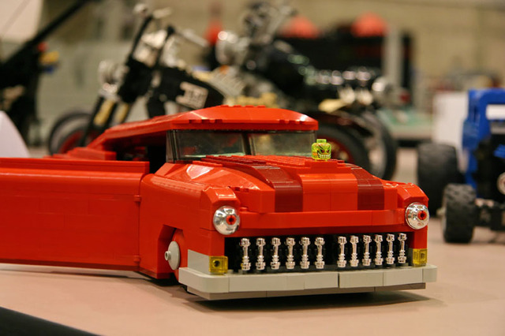](https://www.freelug.org/IMG/jpg/BF11.jpg)

[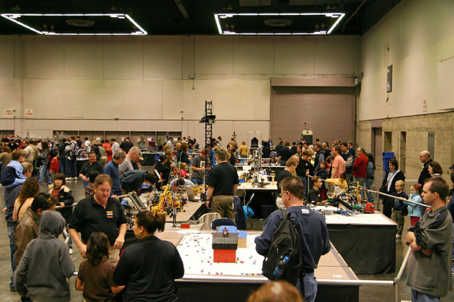](https://www.freelug.org/IMG/jpg/BF20.jpg)

**La journée publique**
