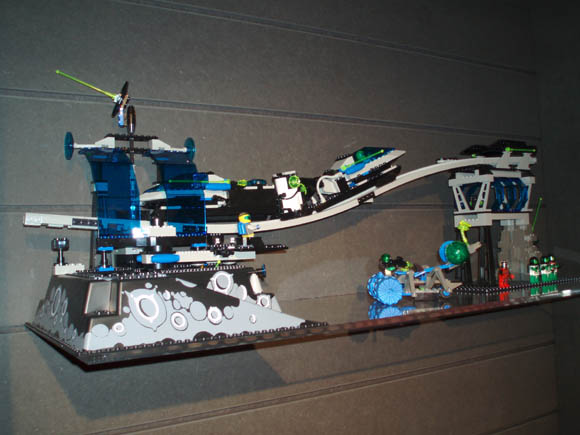
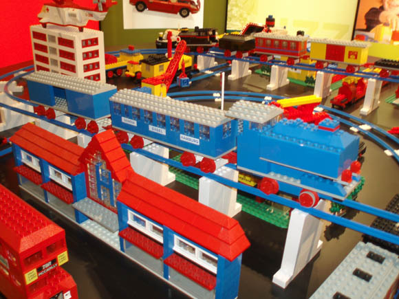
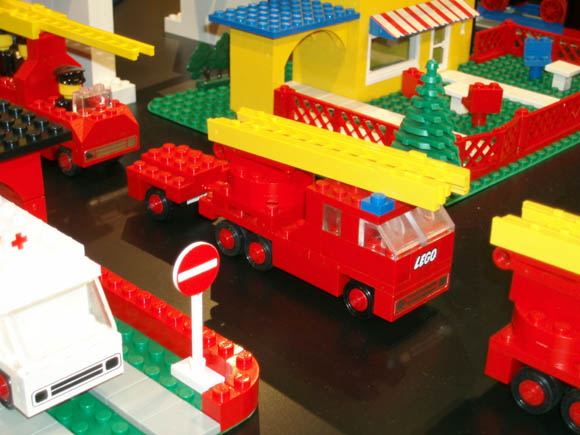
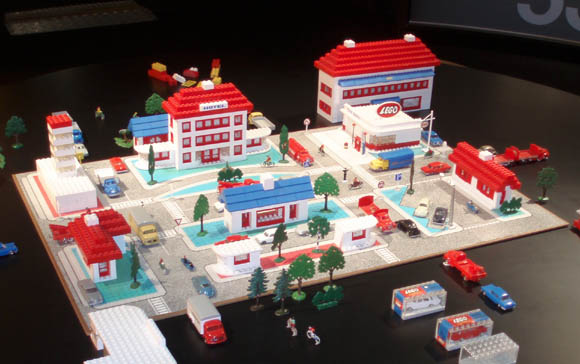
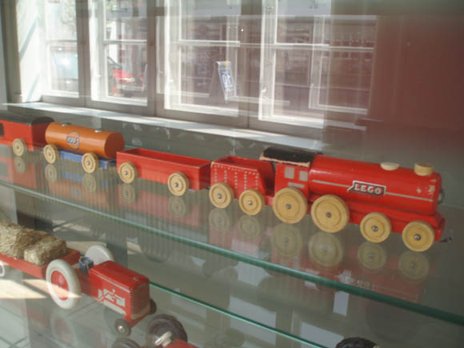
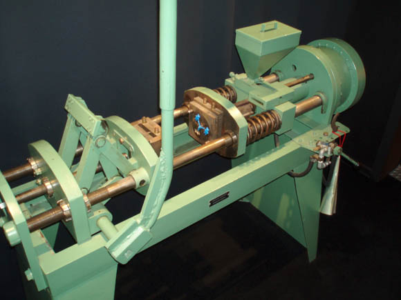
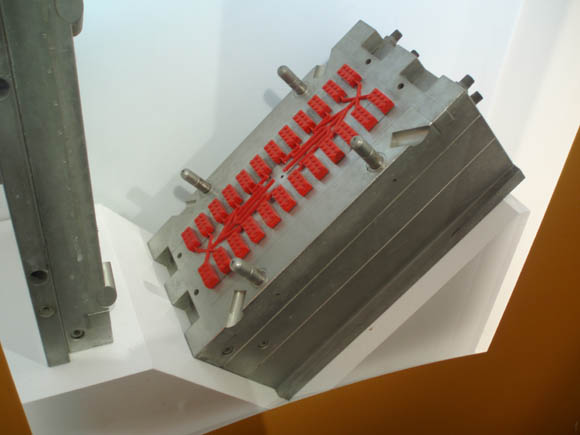
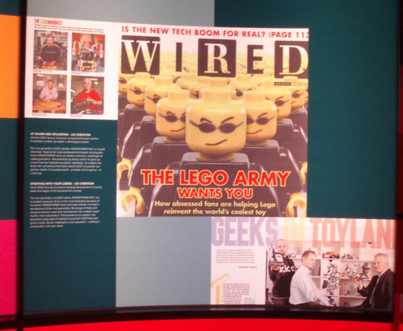
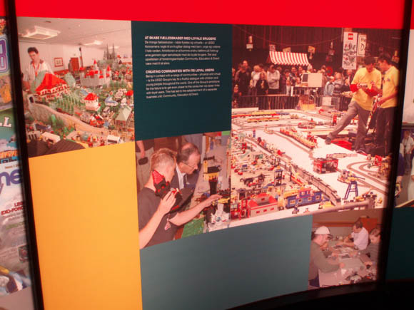
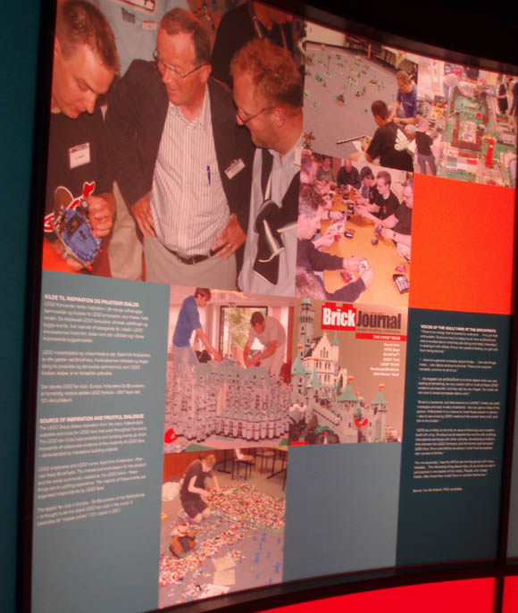

Le musée se visite de manière chronologique, comme un voyage dans le temps.

Le musée se situe tout comme le parc LEGOLAND, à Billund, petite ville danoise berceau de la firme à la petite brique. Il a trouvé place au sein d’un bâtiment que l’on remarque à peine, extension de la maison même où le petit fils du fondateur de la société a passé son enfance.

A l’intérieur, l’ambiance générale est intimiste. Peut être à cause du fait que nous étions seulement 4 personnes lors de cette visite privée. D’ailleurs le musée ne semble pas être destiné à recevoir autant de visiteurs que le parc d’attraction \[[^1]\].

Les salles, en enfilade, sont plongées dans une semi- obscurité. L’éclairage présent est uniquement destiné à mettre en valeur les modèles présentés sur des tablettes fixées aux murs à hauteur d’homme ou sur des estrades à hauteur de genoux. Un rétro-éclairage placé dans les murs illumine des panneaux de présentation où se mêlent textes et images.

La visite commence par les sets les plus récents. Bionicle et StarWars ont la part belle. On remarque toutefois que le musée n’est pas tout à fait achevé, certains produits très récents comme le NXT ont leur place mais sont encore absent.

La chronologie des produits est parfois présentée dans une même pièce du plus ancien en bas, vers le plus récent, en hauteur et dans une vision thématique : train, TECHNIC, bateau, etc.

En poursuivant un peu plus loin, on remonte le temps progressivement dans les années 90, pour arriver sur l’exposition de sets mythiques de notre enfance (années 80 et 70... ça dépend de votre âge ;-) ) comme le Monorail

ou le train 4,5V est bien présent.

Ce n’est pas sans émotion que j’ai pu voir un set "cuisine" et un camion pompier de ma plus tendre enfance présentés ici dans un état neuf.

Plus loin encore, les plus anciens ou les plus connaisseurs seront même étonnés de trouver dans un état parfait des sets "ville" sur plaque cartonnée datant des années 1955-1965.

Mais quelle surprise nous attend dans la salle suivante ? Tout simplement les jouets en bois mythiques que fabriquait la firme avant de passer au plastique. Leur état est exceptionnel quand on sait qu’ils ont pour certains plus de 70 ans. Et c’est là d’ailleurs que l’on se rend compte que LEGO "fait du train" depuis toujours.

La visite n’est pas seulement chronologique mais aussi thématique. Ainsi, au hasard des couloirs on trouve exposées les premières machines servant à la confection des jouets plastiques

ou bien des moules modernes.

On découvre une section assez grande réservée à la présentation de l’implication des fans dans la vie de l’entreprise LEGO. Nous nous y sommes bien sûr attardés pour découvrir des présentations :

**–** de la First LEGO League,  
**–** du BrickJournal,  
**–** du magazine Wired traitant de l’implication des fans dans le développement du produit NXT,  
**–** du développement par des fans du set LEGO Hobby Train,  
**–** du programme LEGO Ambassador à travers une vidéo,  
**–** des rencontres de fans comme le LEGOWORLD,

**–** une borne internet permet de surfer sur les sites de la communauté : Lugnet, brickshelf, 1000steine...

Comme n’importe quel musée, cette visite ne pourrait réserver que de la frustration à des enfants - on ne touche pas !!. Mais les adultes, et plus particulièrement ceux qui ont joué étant jeunes avec ce jouet, trouveront ici beaucoup de plaisir mêlé de nostalgie.

Photographies publiées avec l’aimable autorisation de la société LEGO.

[^1]: Nous n’avons à l’heure actuelle aucun renseignement concernant la date de l’ouverture officielle de ce musée et les conditions de visite
