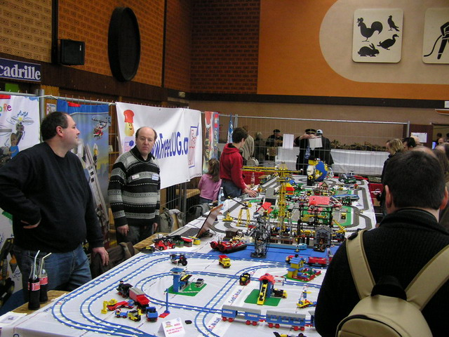
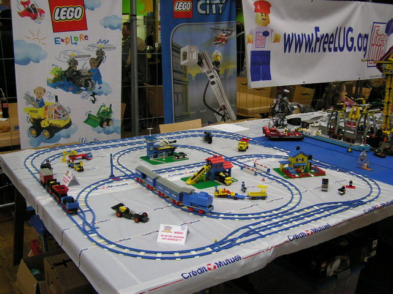
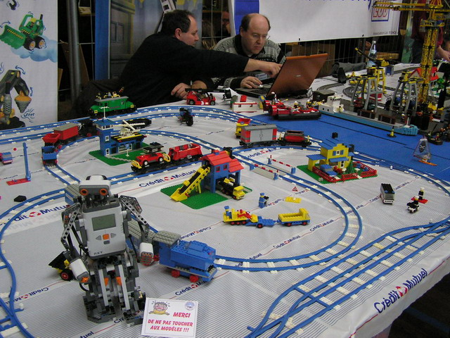
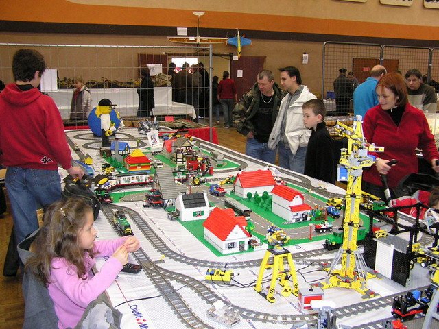
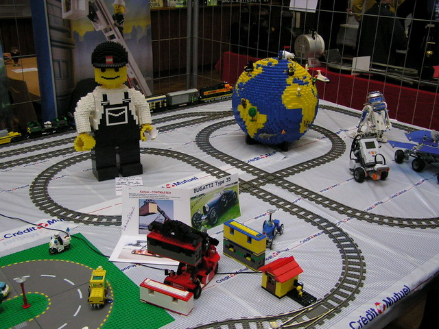
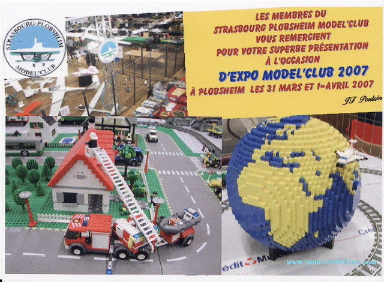

## Fast and Furious : Sueurs froides en perspectives :)

Comme toujours, nous sommes accueillis à bras ouverts.

**1er Défi : Le débarquement.**

Comme toujours, mon layout passe à la trappe, et nous nous adaptons à la disposition des tables. Comme toujours nous avons plus de place que notre demande initiale. Nous relevons ce défi sans encombre. Nous disposons de grilles murales pour nos posters ainsi que pour notre banderole. Merci aux organisateurs.

**2ème Défi : L’animation.**

Sur notre stand, Thierry Meyer s’occupe de son réseau de trains anciens qui attirent tant les nostalgiques que les jeunes.

Marc Klein fait quelques démonstrations avec son robot NXT en épatant le public.

Mes enfants et moi, nous nous donnons des sueurs froides ainsi qu’au public avec notre réseau 9V (DCC free, je précise). Oui, Oui, les trains 9V sont capables de prouesses, surtout les automotrices de Nico.

Cascades, dérapages, drift, collisions, etc. Pour l’occasion, j’ai installé une double boucle de la mort qui tue :) autour des modèles de Nico.

9V, Fast and Furious !!! Y a qu’à voir les vidéos ([format Quicktime](http://www.apple.com/fr/quicktime/download/win.html)) pour s’en convaincre.

Dans l’ordre :

-   1er essai avec les 2 automotrices à Nico, ça passe :) [vidéo1](http://photos.freelug.org/main.php/v/samrotule/plosheim2007/P4010053-1er_essai.MOV.html)

-   2ème essai on rajoute une draisine et on y va doucement, quelques réglages ! voilà ! [vidéo2](http://photos.freelug.org/main.php/v/samrotule/plosheim2007/P4010054-2eme_essai.MOV.html)

-   Maintenant qu’on est chaud, on passe à l’action, attachez vos ceintures ! [vidéo3](http://photos.freelug.org/main.php/v/samrotule/plosheim2007/P4010063-fast_and_furious1.MOV.html)

-   Nous avons inventé les dérapages de trains, si ! si ! ça existe. Epoustouflant, de quoi scotcher le public !!! et de 1 et de 2. [vidéo4](http://photos.freelug.org/main.php/v/samrotule/plosheim2007/P4010071-derapage_controle.MOV.html), [vidéo5](http://photos.freelug.org/main.php/v/samrotule/plosheim2007/P4010056-double_drift.MOV.html)

-   Voici un sujet qui peut intéresser la SNCF. Comment retourner une automotrice en ligne droite. Chez nous ça marche comme ça !! Observez bien la rouge ! [vidéo6](http://photos.freelug.org/main.php/v/samrotule/plosheim2007/P4010082-180.MOV.html)

-   Un long convoi de marchandises dans une double boucle,... çaaa paasssse ?? serrez les fesses !!! [vidéo7](http://photos.freelug.org/main.php/v/samrotule/plosheim2007/P4010069-fast_and_furious2.MOV.html)

Le public était ébahi devant les délires de nos trains, les collègues des réseaux HO se sont amusés devant de telles prouesses...

[La galerie des photos](http://photos.freelug.org/main.php/v/samrotule/plosheim2007/).

Voilà, c’est déjà fini.. Heu, j’allais oublier le 3ème défi :(

**3ème défi : Non sans mal.**

Ecrire cet article 1 mois et demi après l’exposition, là j’ai fait fort. La prochaine fois je serai plus rapide.

**Remerciements :**

