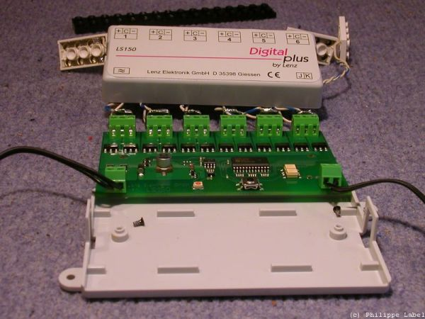
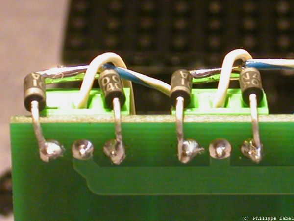
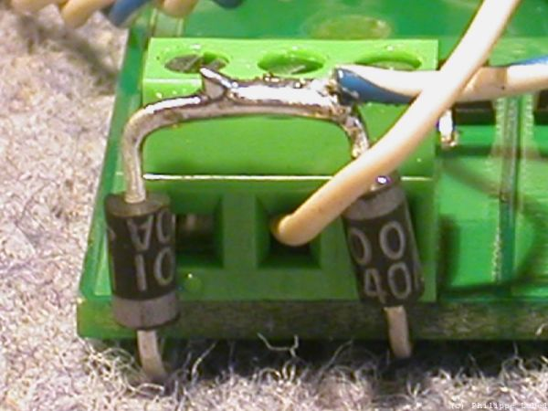
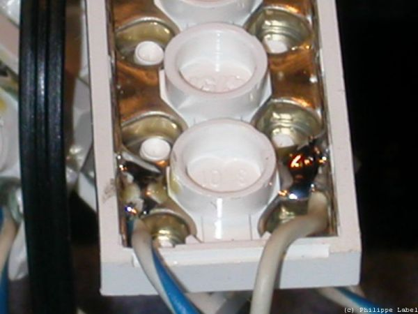
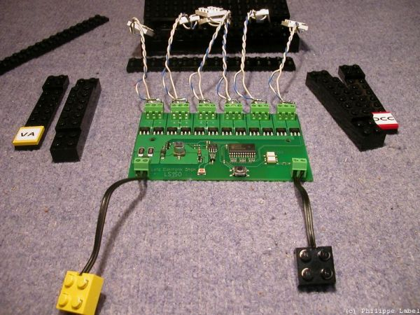
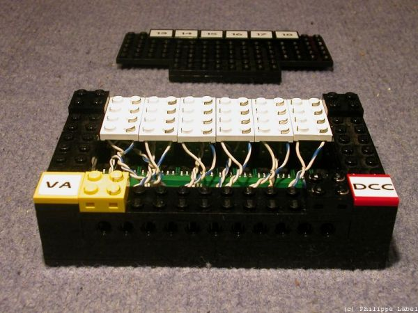
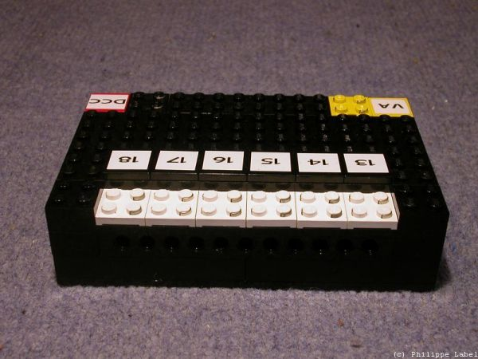
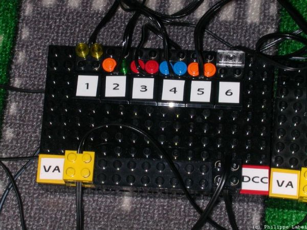

Après, la motorisation en 9V des aiguillages LEGO, puis la commande DCC des moteurs 9V de locomotive, voici logiquement le moyen de commander en DCC les aiguillages 9V LEGO ainsi motorisés.

Souvenez-vous. Nous avons d’abord tenté la motorisation des aiguillages 9V LEGO ([partie1](/articles/175/) et [partie2](/articles/187/)) pour actionner les aiguillages à distance. Pour ne pas vous perdre dans les différentes versions, ici se trouvent les deux solutions ([minimoteur Technic](https://chezfilou.pagesperso-orange.fr/montages-lego/Mark%20Riley%20Evolution/MoteurEvolution.html) et [ancien moteur Technic](https://chezfilou.pagesperso-orange.fr/montages-lego/table-montage-bloc-2838/Bloc-P-Label-2838_table.html)) les plus abouties. Je passe rapidement sur quelques étapes pratiques (le [levier de commande manuelle](/articles/269/) et le [module simple DCC](/articles/424/)) pour souligner l’intégration de la [commande DCC dans les moteurs de locomotive 9V LEGO](/articles/491/).

Faisant suite à cette "DCCisation" du train 9V LEGO, voici donc la réalisation d’un module de commande DCC pour aiguillages motorisés 9V LEGO permettant l’intégration au pilotage DCC des locomotives de la commande de six aiguillages avec ce module. Bien sûr, autant de modules et autant de fois 6 aiguillages commandables.

Pourquoi avoir choisi le décodeur d’accessoires [Lenz LS150](http://www.lenz.com/products/decoders/accessory/ls150.html) ?  
Ce choix n’a pas été simple et je dois bien dire que c’est ce qui m’a retardé pendant presque 2 ans. Je ne trouvais pas de quoi satisfaire toutes les contraintes imposées par le système LEGO et par mon budget. En résumé, il fallait un système qui permette la commande d’aiguillages avec moteur lent, avec une durée d’impulsion réglable, sortant du 9V courant continu et avec deux fils dont la polarité s’inversera pour inverser la commande. Le moteur "lent", c’est comme ça que les modélistes appellent un moteur électrique quand il s’agit d’actionner un aiguillage. C’est par opposition aux solénoïdes qui agissent presque instantanément. La durée d’impulsion réglable est importante car le moteur LEGO qui actionne l’aiguillage ne possède pas de contact de fin de course et il bloque quand il arrive en butée. Mieux vaut ne pas envoyer trop longtemps du 9V dans un moteur LEGO bloqué, car il chaufferait et risquerait la panne. Le circuit Lenz LS150 commercialisé récemment (Mars 2007) regroupe tous ces avantages et permet la commande de six aiguillages, là où les concurrents se limitent à quatre. On peut l’acheter partout en Europe et les meilleurs tarifs portent le prix à environ 7 € par aiguillage. Enfin, il est à la norme NMRA, ce qui garantit son intégration dans n’importe quel système DCC concurrent, ce qui n’est pas toujours le cas des circuits d’amateurs dont on peut trouver les schémas sur le web.

Pour rester fidèle à la jouabilité LEGO et accessible au néophyte, j’ai décidé de retirer le circuit LS150 du boitier en plastique léger fourni par Lenz et de lui fabriquer un boitier en briques LEGO avec des connexions électriques LEGO, ce qui le rend très robuste à l’usage et discret dans une ville LEGO. Nous allons voir ensemble comment intégrer tout cela.

**Sortir le circuit LS150 de son boitier plastique**

Commencez par vous procurer les briques nécessaires et dont la liste figure dans le fichier MLCAD ci-joint. Les étapes d’assemblage y sont précisées. C’est un assemblage très simple. N’appelons pas ça un MOC :) Si vous n’utilisez pas MLCAD, [voici des instructions de montage imprimables](https://chezfilou.pagesperso-orange.fr/montages-lego/BoitierLS150/BoitierLS150.htm).

**Modèle de boitier en LEGO**

La [notice du décodeur LS150](http://www.lenz.com/manuals/accessorydecoders/LS150.pdf) explique très clairement pourquoi et comment rajouter deux diodes 1N4001 aux sorties en courant alternatif pour obtenir du courant continu à inversion de polarité suivant l’inversion de commande. Comme le DCC marche à base de 18V alternatif, après redressement en demi-alternance on obtient du 9V mono-alternance qui est assimilable à du 9V continu pour notre application. Le tour est joué, le moteur LEGO ne sera pas en surtension et changera de sens avec l’inversion de commande.

**Souder les diodes 1N4001 aux sorties du LS150**

C’est vrai il faut jouer un peu du fer à souder (attention, ce n’est pas pour les enfants parce que ça brûle), mais le DCC se mérite un peu quand même. J’ai choisi de souder les diodes sur le circuit et de ne pas les visser dans les borniers pour une raison de fiabilité du contact électrique et aussi pour le fait que je n’ai pas l’intention de réutiliser ce LS150 pour autre chose en modélisme.

**Souder les fils de sortie**

Ensuite il faut souder des fils entre la sortie du décodeur LS150 et les briques électriques qui serviront de connecteur sur le boitier terminé.

**souder les fils sur les briques de sortie**

L’opération répétée six fois, pour chaque voie de sortie, vous obtenez alors un circuit LS150 équipé pour le LEGO. Ajoutez deux fils, l’un pour le signal DCC (prise noire), qui se prend sur la voie de train, et l’autre pour le 18V alternatif de commande des aiguillages (prise jaune). C’est pour ça que je l’ai mise en jaune, pour ne pas confondre avec le 9V classique.

**Le circuit assemblé avec tous ses fils**

Il suffit alors de placer le circuit dans son boitier en LEGO, en positionnant bien les briques électriques blanches dans l’ordre des numéros de voie, ce sera plus facile à l’usage... Quelques étiquettes faciliteront le repérage des six voies (sur l’exemple photographié 13 à 18) et des deux entrées électriques (DCC pour le... DCC et VA pour le 18 Volt Alternatif).

**Le LS150 dans son boitier LEGO**

Le module est terminé. Il est en place dans son boitier qui reste entièrement démontable. En observant le fichier MLCAD, vous remarquerez que sur les côtés du boitier sont placées des briques-à-trous Technic offrant deux avantages : une ventilation passive du circuit (ça ne chauffe vraiment pas beaucoup, mais c’est quand même électrique) et la possibilité d’assembler plusieurs boitiers côte-à-côte à l’aide de chevilles Technic noires.

**Voilà l’ensemble terminé et assemblé**

En pratique, j’ai réglé la durée d’impulsion à 0.1s (voir la notice du LS150). On pourrait augmenter cette valeur si on utilise des moteurs très lents avec démultiplication pour actionner les aiguillages. Pour terminer, sachez que ce module LS150, permet aussi le pilotage des aiguillages à partir d’un ordinateur moyennant une interface PC-DCC et fera l’objet d’un prochain article.

**Un boitier contenant un LS150 en situation de jeu**

Si vous passez jouer à distance avec le [train LEGO de mon grenier](https://chezfilou.pagesperso-orange.fr/), c’est à travers ce type de module que vous actionnerez les aiguillages du Réseau Ferré Frogleap (le RFF...).

Jouez bien,

Philippe "frogleap" Label
