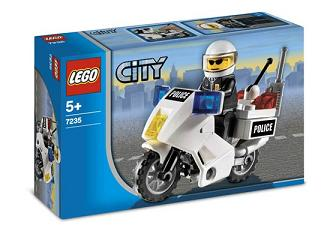
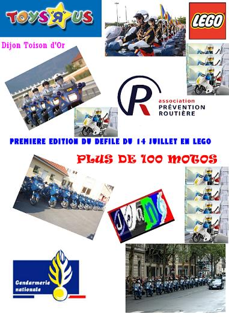

Pour la première fois en Bourgogne, l’association FreeLUG expose au pays des escargots et de la moutarde !  
Une exposition mettant en valeur le fameux défilé du 14 juillet !

Pour cette grande première, l’exposition se déroulera le 14 juillet 2007 de 9h à 20h dans le magasin Toys"R"Us de Dijon (Centre Commercial de la Toison d’Or - Avenue de Langres Les Quartiers de Pouilly).

Sur l’évènement en lui-même, par passion de la brique et du monde militaire JeanG (Jean-Gérald Villari) a décidé de construire au fur et à mesure des années l’ensemble du défilé du 14 juillet des Champs Elysée.

Pour cette première édition 120 motos

seront exposées représentant la garde républicaine motorisée de la gendarmerie nationale.

Depuis mon exposition à Ceyrat en mars 2007, j’ai trouvé qu’une exposition telle que les nôtres devrait essayer de défendre certaines valeurs nobles. C’est pourquoi seront associées à cet évènement la gendarmerie nationale ainsi que la prévention routière.

En principe deux membres de la gendarmerie nationale seront présents dans le magasin à l’exposition avec une vraie moto de gendarmerie. De même des affiches de la prévention routière seront présentes à l’exposition.

Information générale :  
**–** Organisateur/participant : Jean-Gérald Villari (JeanG)  
**–** Objectif de la manifestation : première exposition de FreeLUG en Côte d’Or (21)  
**–** Thème : city / militaire  
**–** Horaires : 9h-20h  
**–** Surface disponible : 1m par 3m  
**–** Divers : Toutes les personnes travaillant sur des mocs militaires ou voulant participer à cet évènement peut contacter l’organisateur ici : legodefile@yahoo.fr

