AFOL amateur de belle mécanique italienne souvent rouge, quand j’ai découvert ce futur set en avant première sur le site de FreeLUG, j’en ai rêvé. Sitôt commercialisée sous la référence 8145, la voila déjà prête à rejoindre ma Scuderia Ferrari en LEGO.

[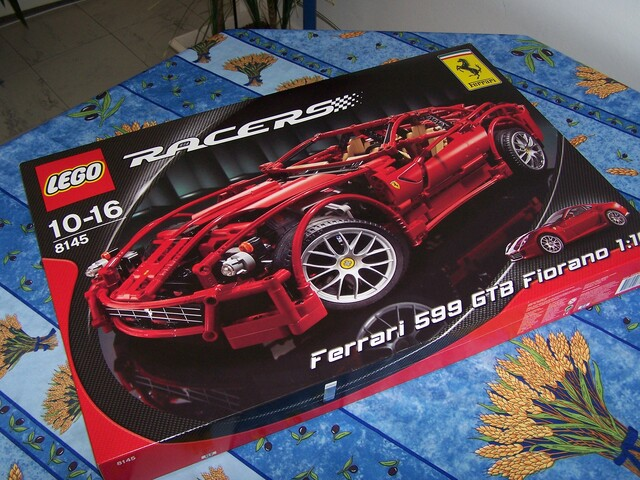](https://www.freelug.org/IMG/jpg/101_6240.jpg)

La boîte est de très grande taille, et un peu lourde, laissant penser qu’il y a pas mal de pièces dedans (1327 pièces), et beaucoup de temps pour monter ce modèle. Effectivement après ouverture, il y a près de vingt sachets, deux livrets et une planche d’autocollants.

[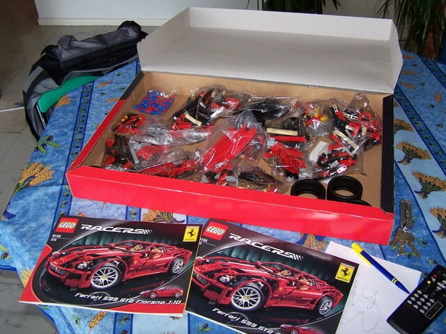](https://www.freelug.org/IMG/jpg/101_6241.jpg)

Pour m’y retrouver et faire face au nombre important de sachets, je sors les anciennes boites compartimentées en plastique qui étaient vendues autrefois avec les boites en cartons LEGO. J’utilise la boite du set 8458 (Silver Champion) et du set 5510 (4x4 off road) et une boite curver pour ranger les roues, pneus, autocollants et autres éléments peu nombreux.

[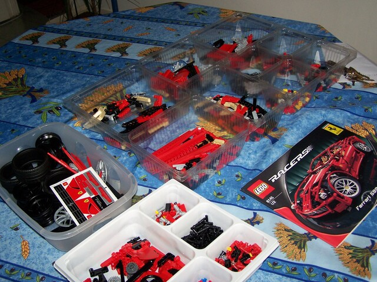](https://www.freelug.org/IMG/jpg/101_6243.jpg)

Dès le début, il est recommandé de trier les pièces, je n’en ai pas tenu compte je vais le comprendre à mes dépends.

[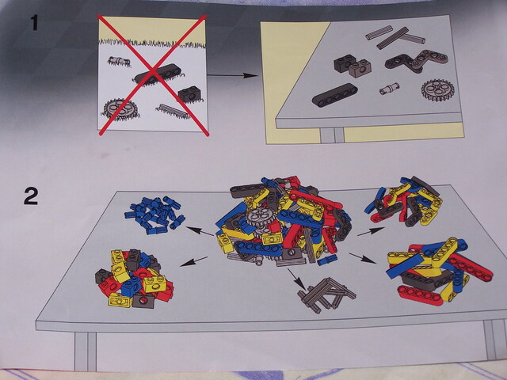](https://www.freelug.org/IMG/jpg/100_6507.jpg)

Après ce moment de préparation, le montage peut commencer, en feuilletant les livrets, je me dit que j’aurai du  
boulot.

Le montage se fait par l’assemblage de plusieurs modules, que l’on fixe au fur et à mesure pour former un ensemble, d’abord la partie avant du châssis sur lequel on fixe le moteur, le train avant, les éléments composant le pare-choc avant puis la partie arrière regroupant le train arrière et la transmission.

[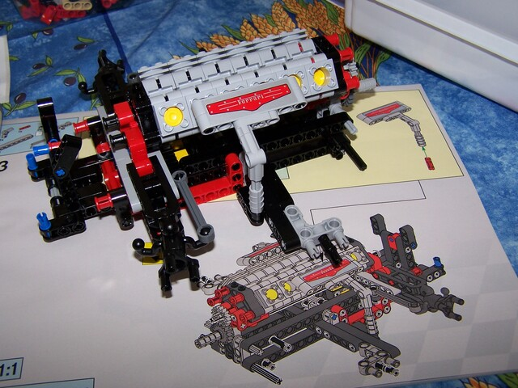](https://www.freelug.org/IMG/jpg/101_6245.jpg)

Le tout est relié par de grandes barres Technic lisses. A cet instant du montage, on a un aperçu de la taille du modèle qu’on devine de plus de 40cm. Il faut suivre attentivement la notice car on peut vite se tromper, ou oublier de placer une goupille Technic noire.

[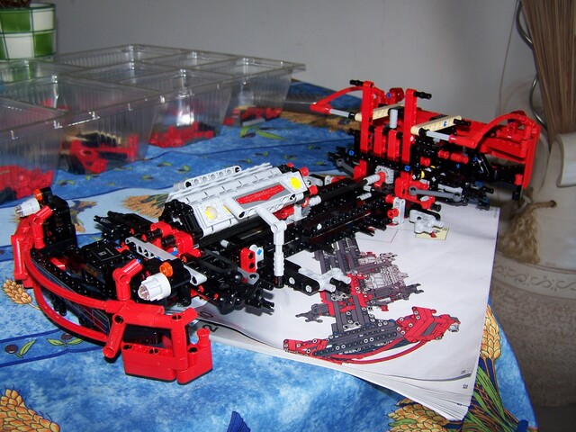](https://www.freelug.org/IMG/jpg/101_6269.jpg)

Le montage se fait avec minutie car certaines pièces sont difficiles à mettre en place, soit on monte directement sur le modèle, ou par assemblage de sous éléments, montés ensuite sur le châssis mais en prenant son temps le modèle définitif apparaît petit à petit.

Mais un gros point noir lors de la construction, on s’aperçoit que certaine pièces identiques sont réparties dans plusieurs sachets.

Quand à chaque fois on prend une pièce dans un compartiment, puis une autre pièce identique dans un autre compartiment, alors que l’on se souvient avoir pris cette même pièce dans un premier compartiment, d’où une impression de manquer de pièces, ça devient un peu agaçant à la longue.

Exemple : les deux pièces destinées à former les cardans des roues arrières étaient situées dans deux compartiments différents. Et c’est de même pour beaucoup de pièces.

[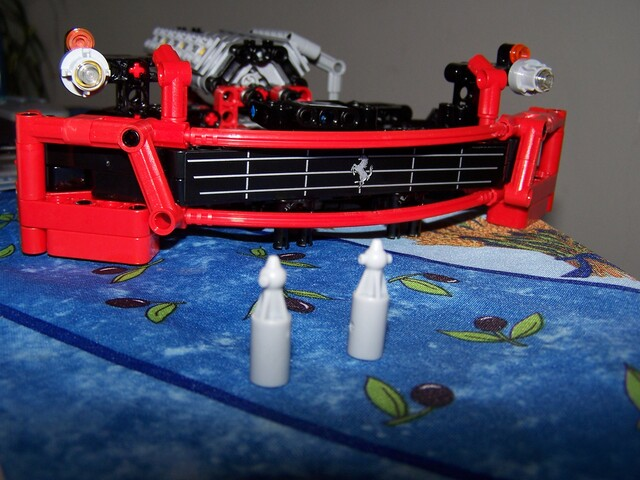](https://www.freelug.org/IMG/jpg/101_6246.jpg)

Je comprends pourquoi c’était précisé de trier, dès le début avant le montage.

Le montage se continue au fil des pages du second livret avec l’installation du tableau de bord assez pauvre à mon goût, avec un volant fictif, car la direction est rejetée vers l’arrière, derrière les sièges.

Après la pose des éléments suggérant la carrosserie composée d’éléments de carrosserie Technic communs à bon nombre de modèles, notamment utilisés dans la gamme Racers Ferrari (set 8386 ou 8653 par exemple) et d’axes flexibles de couleur rouge formant les contours de la carrosserie, on devine la ligne générale du vrai modèle Ferrari 599 GTB Fiorano.

[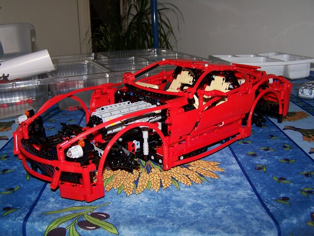](https://www.freelug.org/IMG/jpg/101_6273.jpg)

Et, après quelque heures de montage, et deux ou trois petites erreurs de montage, finalement c’est un joli modèle qui se forme. On peut actionner les portières, capot et coffre.

[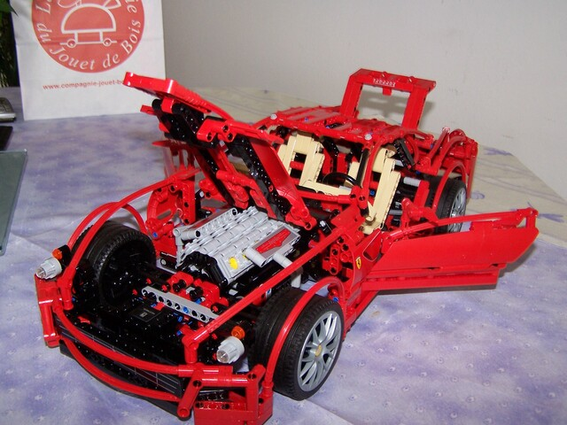](https://www.freelug.org/IMG/jpg/100_6508.jpg)

Mais surtout, toute l’identité du modèle se fait à mon avis sur l’un des éléments de carrosserie sur lequel on pose l’autocollant imitant les sorties d’air sur le coté, comme sur le vrai modele.

[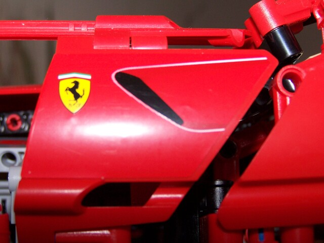](https://www.freelug.org/IMG/jpg/000_0159.jpg)

Finalement après quelque heures de montage (et de démontage du à quelque erreurs), on a une Fiorano sympa et fonctionnelle.

[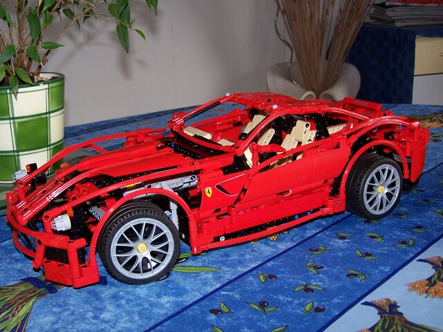](https://www.freelug.org/IMG/jpg/101_6279.jpg)

Une fois de plus, LEGO réussit un modèle Racer élégant qui avant de rejoindre une étagère où elle sera exposée, s’offre une pause photo à coté de la Ferrari Enzo (set 8653 ).

[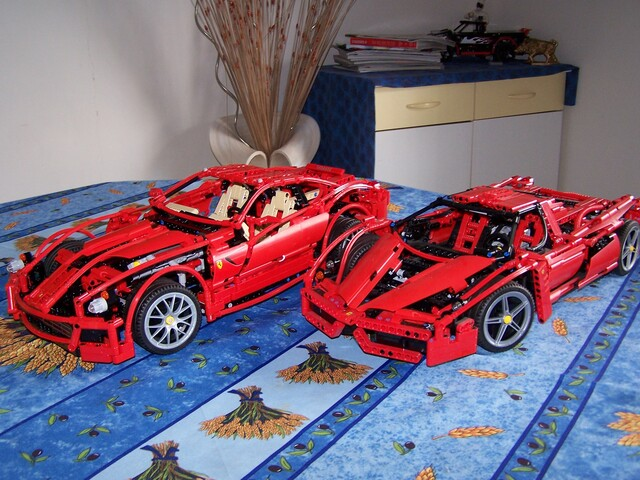](https://www.freelug.org/IMG/jpg/101_6278.jpg)

Je trouve la gamme Racers Ferrari très sympa et variée car elle regroupe plusieurs types de construction, maquette avec minifig (set 8654, 8672) Technic (set 8674, 8653,8386) ou System (set 8142, 8143, 8671).
