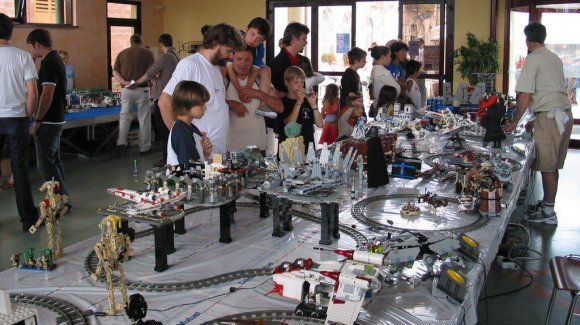
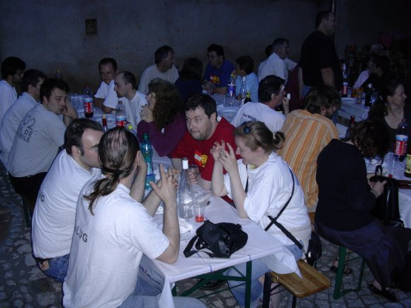
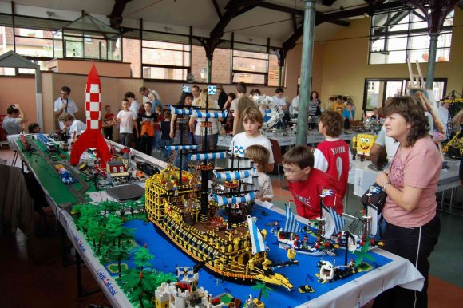
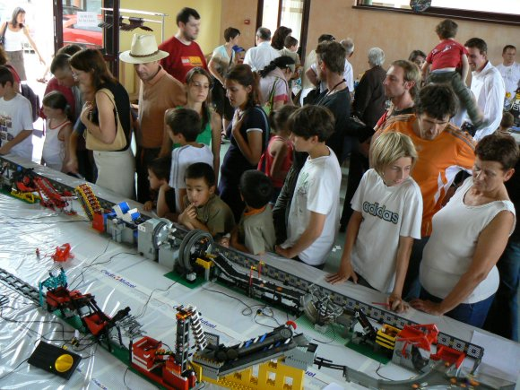
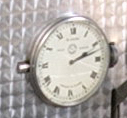
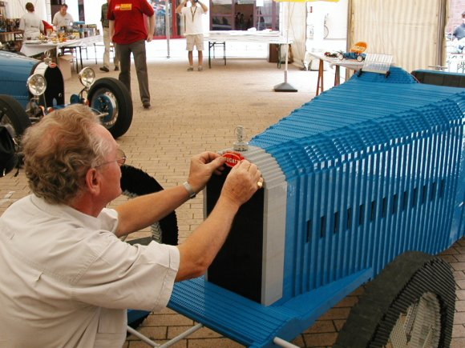
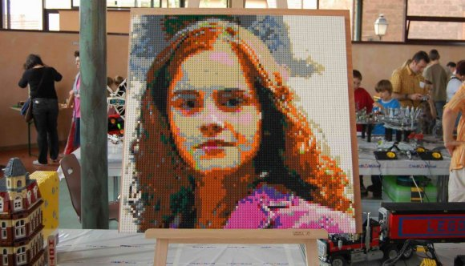

Pour la deuxième année consécutive, l’exposition Fana’Briques de Rosheim est revenue avec cette année une Bugatti à l’échelle 1:1 , une pléthore de nouveaux exposants venus d’Allemagne, de Belgique et de France !

La logistique a été assurée par l’association Ritte Ritte Ross et toute l’équipe des Freelugiens Alsaciens ! Un week-end de rêve s’est déroulé pour les petits et grands qui ont fait le déplacement !

## Fana’briques - Quelle aventure !

A l’issue de [Fana’briques 2006](/articles/518/) (1ère édition), nous souhaitions renouveler l’opération sans savoir si les 750 spectateurs étaient venus pour l’exposition LEGO ou pour le Tour de France qui passait devant notre salle, mais nous savions que nous avions réussi le principal, à savoir vivre notre passion, se faire plaisir entre exposants et faire plaisir au public.

A l’issue de Fana’briques 2007 (2ème édition), nous savons maintenant que c’est pour l’exposition LEGO que les gens se sont déplacés. 1583 personnes ont pu admirer des réalisations magnifiques, grandioses, ingénieuses et audacieuses.

Les parents venus "accompagner" leurs enfants en sont restés bouche bée. Un collègue de boulot m’a glissé à l’oreille "maintenant je comprend pourquoi tu fais du LEGO".

Cette exposition, c’est aussi la force de passionnés qui n’hésitent pas à faire des kilomètres pour partager avec le public leur passion. Je leur exprime ici ma gratitude.  
Ma priorité est que ces exposants soient accueillis du mieux possible. Nous assurons les repas et l’hébergement (dans la limite du possible) afin que notre seule préoccupation soit le partage de notre passion.  
Un de mes souhaits est que ce nombre d’exposants augmente et que de nouvelles nationalités nous rejoignent.  
Un autre est de faire de cette exposition, un évèvement annuel reconnu au niveau de notre région.

_Une Bugatti en LEGO, T’es fou ????_

C’est vrai, l’idée était folle, mais on l’a fait.  
On, c’est l’équipe qui s’est constituée autour de ce projet.

Même si ce n’est pas simple, et si il y a eu quelques prises de tête, nous avons vécu des moments de vraie équipe à partager des idées, des savoir-faire et des... repas.  
Seul je ne serai arrivé à rien.

C’est aussi le cas pour l’organisation de l’exposition.  
Ritte Ritte Ross s’est investie par le biais de ses membres dans tous les aspects qui ont fait de cette exposition une réussite.

Et pour 2008, OUI, nous (Ritte Ritte Ross et les Alsaciens de FreeLUG) avons envie de renouveler l’opération.  
Je souhaite bénéficier de plus de surface d’exposition pour la prochaine édition. Je verrais l’adjoint au maire courant Septembre afin de définir une date en 2008.  
Je souhaite également voir "pétiller" beaucoup d’autres yeux pour atteindre le seuil des 3000 spectateurs.

Et en 2008, serons-nous assez fous pour tenter une nouvelle folie ? Je crois que oui, d’ailleurs j’ai déjà une idée...

Merci à tous pour ce grand moment de bonheur...

Merci à Eliane (mon petit canard) pour son investissement et son soutien.

Thierry

## Le mot de Jean-Marc

Mission accomplie de la part des exposants Français, Belges, Allemands...

En effet, le public des deux cotés du Rhin a répondu en masse (le record est battu !!!) au programme alléchant de notre Thierry alsacien aidé dans sa tâche par ses potes du coin.

Le beau temps fut également de la partie pendant tout le week-end, y compris lors du repas entre exposants et RRR du samedi soir en plein air (tartes flambées et vin du pays).  
L’organisation fut impeccable.

A la demande de Thierry, et pour le bien des petits enfants, les tables métalliques supportant mon réseau ont été posées au plus bas niveau, une première dans ce genre !  
Tout le monde a pu voir les petits détails de mon réseau.  
Beaucoup d’enfants dont Félix, pas Felix the cat, ont joué avec mes trains sous mon autorité ainsi que quelques Freelugiens.

J’ai donc passé un très agréable séjour malgré la distance Morlaix-Rosheim-Morlaix. La perspective d’exposer mon réseau en Allemagne m’intéresse beaucoup.

Je remercie Thierry, Eliane pour leur hospitalité, disponibilité, RRR (l’association) pour le tee-shirt et les Alsaciens.

A l’année prochaine, peut-être !

Jean-Marc, qui n’a pris aucune photo (appareil trop gourmand en pile...) GRRRRRRRR !!!

## Le mot de Eric Létang

Un grand merci à tous ceux qui ont permis cette exposition, une organisation impressionnante, une mobilisation exemplaire de tous les acteurs ! Bravo ! Merci à Thierry et à toute sa famille !

A notre arrivée avec Erik, déjà les première pancartes à l’entrée de la ville, cela motive, après un voyage qui fut long et un peu encombré lors des derniers kilomètres !

L’installation peut se faire sans encombres, plan et places sont bien définis et prêts ! Petit-à-petit tout se monte se construit, les tables se garnissent ... :)

La fin de journée approchant la petite collation de bienvenue se fait chez Thierry, avec tous ceux qui sont venus le vendredi.

L’installation de la tente faite et une petite nuit de repos méritée, le samedi matin est de nouveau réservé à l’installation, les derniers arrivants s’activent.  
Puis commence l’acheminement de la Bugatti sur le lieu de l’exposition, une arrivée triomphale avec un défilé dans les rues de Rosheim à 2 Km/h ! :)

Quelque chose de grand se prépare !

Début après-midi : ouverture !  
Les visiteurs affluent le succès se confirme, les allées de l’exposition se remplissent ! Un public varié : petits enfants, grandes personnes, tous sont émerveillés !  
La première journée se termine à la belle étoile dans une maison typiquement alsacienne où va se dérouler un repas fait de flammeküeche salées et sucrées, tous ensemble !

Le dimanche va confirmer la première journée, encore plus de monde, que des yeux et des visages émerveillés devant nous, un vrai plaisir !

Je ne peux que dire une nouvelle fois un Grand Bravo à Thierry et à toute l’équipe qui l’a soutenu dans cette sublime exposition !

A très bientôt, Ich würde zurückkommen, I’ll come back ! :)

## Le mot de Didier (qdm)

En liaison avec Thierry depuis l’assemblée générale où nous avions eu l’occasion de discuter un peu, j’avais décidé d’inscrire dans mon programme réduit d’activité de cette année une visite à Rosheim.

Bien m’en a pris car cette exposition est à mon sens une réelle démonstration de ce que l’on peut faire pour faire partager la passion des LEGO au plus grand nombre.

D’abord dans l’organisation, le fait de s’associer avec une association locale (merci Ritte Ritte Ross pour l’accueil et l’efficacité), offre de mettre en place un solide partenariat, qui grâce aux relations des uns et des autres permet d’avoir à disposition un local pour l’exposition, la logistique et le personnel pour faire tout fonctionner.

En second lieu, Thierry a eu l’excellente initiative d’inviter nos collègues Allemands et Belges, ce qui nous permet d’avoir un évènement d’ampleur internationale et non uniquement locale. La proximité de la frontière aide, mais sans l’accueil et la convivialité de nos amis Alsaciens ça n’aurait sans doute pas suffit à inciter nos amis à braver les kilomètres.

Ensuite, il a fallu créer l’évènement, et s’appuyer sur la culture locale pour le faire, ce qui permet de faire retomber la portée de l’évènement sur toute la région. L’idée de la Bugatti, venue en voisine de Molsheim, nous a également permis de rencontrer d’autres passionnés (voir encadré) que nous saluons également à l’occasion.

N’oublions pas non plus les ateliers mettant à disposition quelques briques (15 Kgs !) pour que les enfants soient aussi de la fête et que la passion puisse être réellement partagée.

Et puis en dernier lieu, saluons également les efforts de nos membres Alsaciens pour avoir réussi dans les temps à mener à bien leur beau projet et pour leur investissement. Rendons également hommage à leurs familles et à tous ceux et celles qui se sont mobilisés pour faire de cet évènement une réussite unanimement reconnue.

## “Echelle 1 ? T’es fou...” (Marc Schickelé)

J’ai été le premier à dire à Thierry, "Une Bugatti à l’échelle 1, t’es fou", mais connaissant l’obstiné, j’ai obtempéré. Quelle aventure formidable !

Le véritable défi était de partir de quelques photos, de croquis, des relevés de mesure, une idée folle, pour finir sur un chef d’oeuvre. Le projet démarra donc en octobre 2006, par une séance photos chez Monsieur Weiss. La construction proprement dite débuta vraiment qu’en mars 2007, avec pour objectif de finir à temps pour Fana’briques.

Pour l’équipe c’était un pari, car réaliser un si grand modèle, imposait des moyens techniques hors du commun pour les constructeurs habituels que nous sommes. Il a fallu créer les plans, un châssis rigide pour soutenir les milliers de briques, coller certaines briques pour satisfaire à la rigidité de l’ensemble, car toute la voiture devait être transportable.

Merci à toute l’équipe des constructeurs : Pierre, Nico, Daniel et son fils, Philippe Chatin, Marc Klein, les quelques amis de RRR de passage à l’atelier de construction, le père et le voisin de Thierry, Thierry bien sûr :) et j’en oublie sûrement...

Merci surtout à Eliane, pour nous avoir tous supportés pendant de longs mois, ainsi qu’à nos épouses qu’on a dû abandonner pour nos chères briques... bleues :)

_Anecdote :_ Le dimanche soir en ramenant la Bugatti au bercail, sur un petit coup de frein de la voiture du père de Thierry, les deux voitures sont entrées en collision. Bilan : 4-5 briques défoncées, une bosse (avec une trace bleue) sur la voiture (verte) du père. Une belle preuve de la solidité de notre construction.

Thierry quand tu veux ! On recommence !!!

* * *

## 10 Ans pour un tour d’horloge !

Au travers de cet encadré, je souhaite rendre hommage à la passion et au travail de M. Germain Weiss, qui nous a mis à disposition sa belle BUGATTI.

Beaucoup de nos membres et visiteurs seront curieux, je pense, d’en savoir un peu plus sur ce véhicule et M. Weiss a eu la gentillesse de bien vouloir répondre à mes questions.

Tout d’abord un peu d’histoire. La société [BUGATTI](http://fr.wikipedia.org/wiki/Bugatti) installée à Molsheim a cessé son activité de production automobile en 1947. Un atelier a continué à fonctionner jusqu’en 1955 afin d’assurer la maintenance des anciennes voitures. Pour la famille Weiss, l’aventure BUGATTI a commencé avec le grand-père de Germain, suivi par le père et par Germain lui-même qui a débuté sa carrière de tourneur à l’usine BUGATTI.

**Horloge BUGATTI**

Toute l’histoire de sa BUGATTI gravite autour de l’horloge du tableau de bord. Prélevée par le grand père à cause d’une vitre brisée, elle est restée longtemps sur son bureau à l’usine, en attendant qu’un beau jour son fils la rapporte à la maison pour la réparer et en faire l’horloge de la maison. Puis rangée dans un coin, Germain l’a retrouvée et l’a faite restaurer chez un horloger qui a pu apprécier toute la qualité de construction. La naissance de la BUGATTI de Germain a été marquée par cette horloge, qui a été en fait la pièce de départ (et seule pièce d’origine) de sa BUGATTI.

Et oui la BUGATTI de Germain est en fait une recréation à partir de pièces détachées en grande partie fabriquées par Germain et qui lui ont pris 10 années pour usiner, rassembler, monter, ajuster et faire fonctionner cet extraordinaire témoignage de l’art automobile.

La Bugatti de Germain est une réplique du modèle T37 datant de 1927. La T37 était en fait une extrapolation de la [T35](http://fr.wikipedia.org/wiki/Bugatti_Type_35), qui avait été réalisée en 1924 pour le grand Prix de Lyon. La T35 était équipée d’un moteur de 8 cylindres de 2l de cylindrée, alors que la T37 était équipée d’un simple 4 cylindres de 1,5l.

Certains composants de la voiture de Germain ont pu être trouvés en Angleterre où quelques artisans se spécialisent dans la fabrication de pièces de modèles de collection. L’essieu du train avant a été forgé là-bas, par contre Germain a refait toute la visserie, au standard BUGATTI de l’époque, avant de se rendre compte que là-aussi "le réseau des passionnés" avait ses propres sources.

Mais Germain a pour lui le fait d’avoir réalisé sa BUGATTI à Molsheim et il est donc fier d’être le fabricant de la dernière BUGATTI d’origine !

Germain fait partie de l’association des [Enthousiastes BUGATTI Alsace](http://fr.groups.yahoo.com/group/EBABUGATTIwebclub/), dont les initiales sont EBA, comme celles de l’usine. Elle regroupe environ 230 membres et organise chaque année aux alentours du 15 Septembre (date de naissance d’Ettore BUGATTI), un grand rassemblement de BUGATTI à Molsheim, lieu de leur naissance. Si vous avez l’occasion de passer dans le coin, faites le détour, la BUGATTI en LEGO sera également de la fête m’a-t-on dit.

**Pose du logo**

Germain Weiss en train d’apposer le logo Bugatti sur la T35 LEGO

* * *

## Galeries de photos

Galeries de photos :  
**–** [http://www.brickshelf.com/cgi-bin/g...](http://www.brickshelf.com/cgi-bin/gallery.cgi?f=263109)  
**–** [http://www.brickshelf.com/cgi-bin/g...](http://www.brickshelf.com/cgi-bin/gallery.cgi?f=263593)  
**–** [http://www.brickshelf.com/cgi-bin/g...](http://www.brickshelf.com/cgi-bin/gallery.cgi?f=263393)  
**–** [http://www.brickshelf.com/cgi-bin/g...](http://www.brickshelf.com/cgi-bin/gallery.cgi?f=263370)  
**–** [http://www.brickshelf.com/cgi-bin/g...](http://www.brickshelf.com/cgi-bin/gallery.cgi?f=264393)  
**–** [http://photos.freelug.org/main.php/...](http://photos.freelug.org/main.php/v/La-Gallerie-de-qdm/Expositions/2007-Fanabriques/)  
**–** [http://photos.freelug.org/main.php/...](http://photos.freelug.org/main.php/v/legophil/Fanabriques2007/)  
**–** [http://photos.freelug.org/main.php/...](http://photos.freelug.org/main.php/v/T_MEYER/FANA+BRIQUES+2007/)
