Nous allons essayer de vous faire partager tout ce qui fait la magie de ces rencontres entre membres de l’association.

Cette année, c’est Jérôme "JAC" et Annie qui avaient pris en main l’organisation de la rencontre.

Un paysage magnifique (l’Auvergne), un endroit calme et reposant (la forêt d’altitude), de la convivialité (des spécialités locales), du beau temps (mais pas chaud à l’excès non plus) et une organisation de main de maître : tout ce qui fait une REF réussie.

[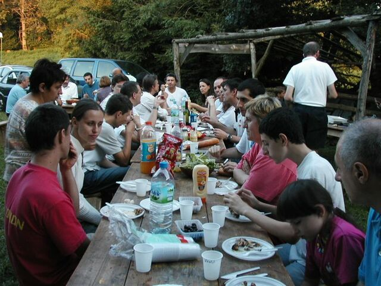](https://www.freelug.org/IMG/jpg/P7140017.jpg)

**Convivialité : A table**

## Les rencontres

Des rencontres sympas :  
**–** Luca avec sa famille sont venus en direct d’Italie avec leur camping car ;  
**–** les "Alsaciens" à peine remis de Fana’briques nous ont fait partager leur enthousiasme ;  
**–** Philippe "DCC" Frogleap n’a pas décroché de son réseau ;  
**–** quelques "nouveaux" : Johan qui a apporté un bout du réseau de train impressionnant, Emmanuel avec ses belles locomotives, Pierre venu modifier ses rails, Sylvain de 1001bricks qui a fait un gros effort pour quitter son stock, et Xavier lecteur assidu du site venu nous rencontrer. Tous ont gouté aux joies d’une réunion de fans ;  
**–** des modifieurs acharnés équipés de cutters et de colles ;  
**–** et plein d’autres avec leurs petites balles.

[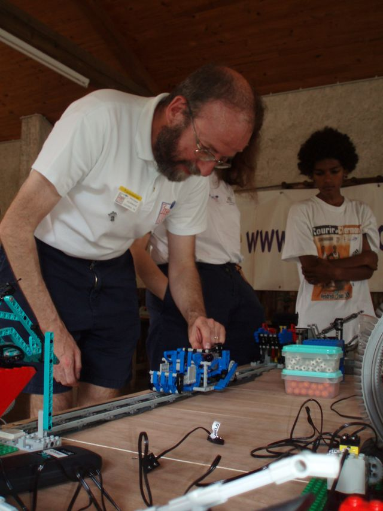](https://www.freelug.org/IMG/jpg/P7140081.jpg)

**Philo et le GBB**

Philo concentré sur un spybotics récalcitrant

## Les constructions

**–** des MOCs tous plus enthousiasmant les uns que les autres : beaucoup de trains mais aussi de la ville, du GBB, de la mosaïque, j’en oublie...

[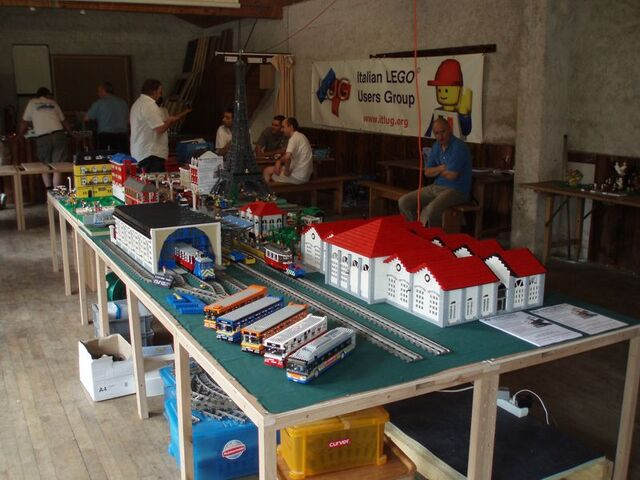](https://www.freelug.org/IMG/jpg/P7140059.jpg)

**Diorama par Luca**

**–** des sets officiels (Tour Eiffel) offerts par LEGO dont un en avant première (le bulldozer Technic motorisé Power Functions).

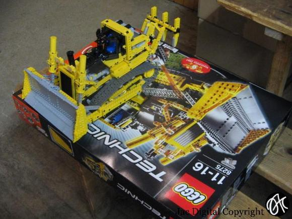

## Les drafts

Des drafts, des drafts et un p’tit dernier draft pour la route (que ceux qui ne savent toujours pas ce qu’est un draft lèvent la main ;-) )

Les premiers drafts du samedi ont portés sur des boites Exo-Force. Le second a eu lieu dimanche et a fédéré des débutants du draft autour du poisson Creator.

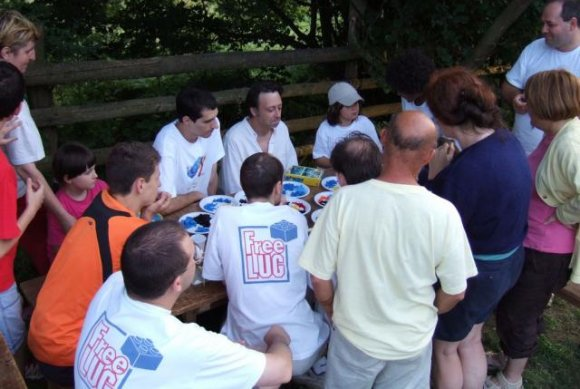

**Draft**

Le draft attire toujours les curieux

## Les présentations

Deux présentations ont été proposées aux participants durant le week-end.

Philo et Didier ont présenté le nouveau système électrique Power Function avec notamment en avant première le bulldozer Technic.

Erik a quant à lui proposé un cours de géométrie le dimanche matin pour réaliser des constructions angulaires.

## Les repas

Le top départ de la REF fut donné dès le vendredi 13 juillet au soir où 13 participants (nous ne sommes pas superstitieux à FreeLUG) se retrouvèrent sur le bord du lac de St Rémy-sur-Durolle pour partager un kebab en attendant le feu d’artifice.

[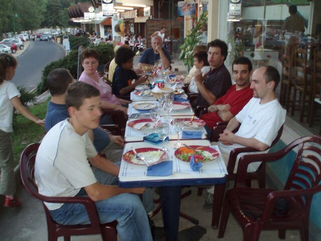](https://www.freelug.org/IMG/jpg/KEBAB1.jpg)

Le samedi soir, un barbecue était offert aux participants. Presque tous étaient présents pour cet instant de partage.

Dimanche soir, Jac nous avait réservé un repas surprise, une raclette auvergnate à base de fromage de chèvre.

Le midi, un buffet froid préparé avec grand soin par Annie nous permettait de retrouver des forces pour continuer à jouer toute l’après midi.

## Les visiteurs

La rencontre avait été annoncée dans le journal La Montagne, et un petit encart précisait que le public était le bienvenu le dimanche après-midi. Plus de quarante visiteurs se sont déplacés dans la salle des fêtes reculée de Pitelet.

[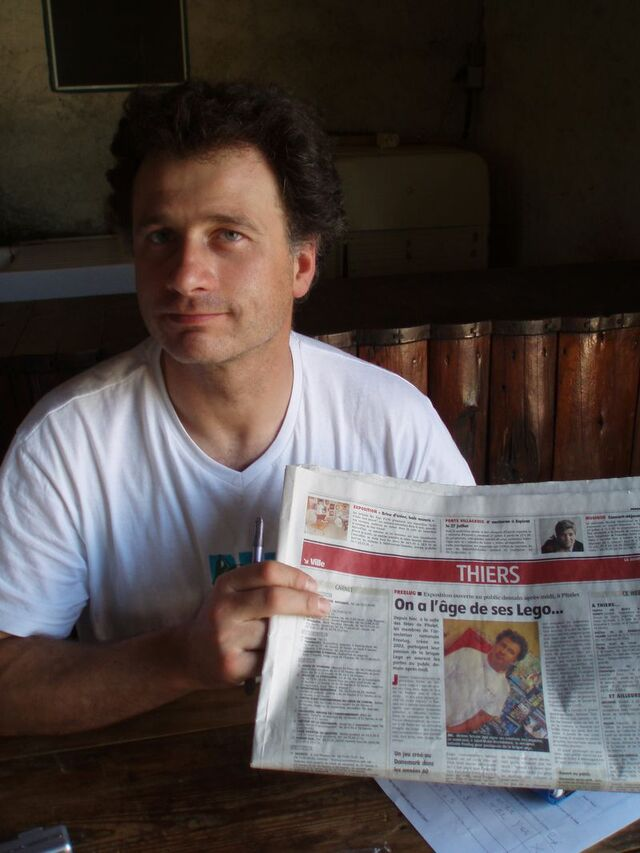](https://www.freelug.org/IMG/jpg/P7150029.jpg)

**Jérôme dans le journal !**

## Le concours de l’arbre

La rencontre prenant place en pleine forêt, Jac avait organisé un concours de Moc sur le thème de l’arbre.

De nombreuses entrées ont réalisées par les participants :  
**–** l’Arbre-en-Ciel de Caroline, 7 ans,  
**–** la pierre qui bouge,  
**–** l’arbre-maison de Marc  
**–** etc.

Il fut remporté haut la main par Marc notre estimé trésorier avec son arbre-maison.

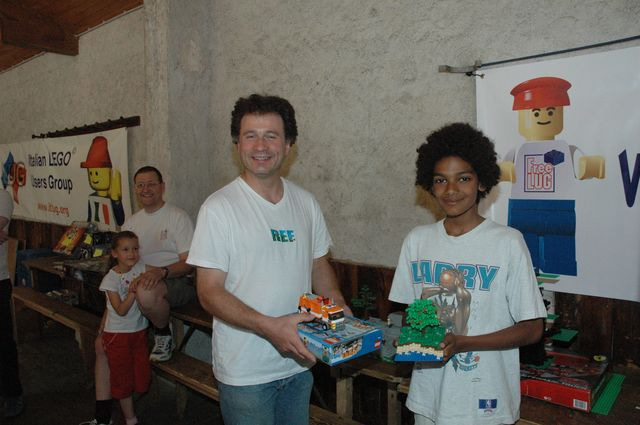

**Remise des prix**

Johan remporte le nouveau camion poubelle.

## Les animations

_Atelier de modification des rails_  
Samedi matin, Xavier notre bricoleur de LEGO proposait un atelier de modification de rails.

[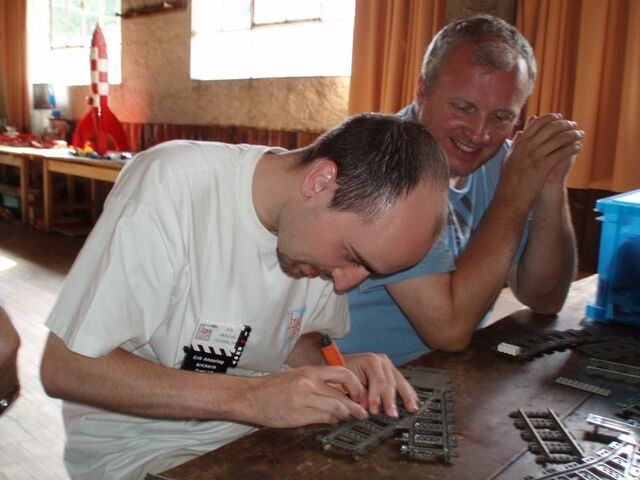](https://www.freelug.org/IMG/jpg/P7140040.jpg)

**Atelier Mod Rails**

_Illumination de la Tour Eiffel_  
Luca avait amené sa Tour Eiffel aux couleurs de l’Italie. En ce 14 juillet, quoi de plus normal que de proposer une animation autour de la Tour Eiffel ! Erik équipa la tour de deux douzaines de lampes 9V et programma rapidement sur ordinateur le scintillement de la tour pour quelques secondes de spectacle le samedi soir.

[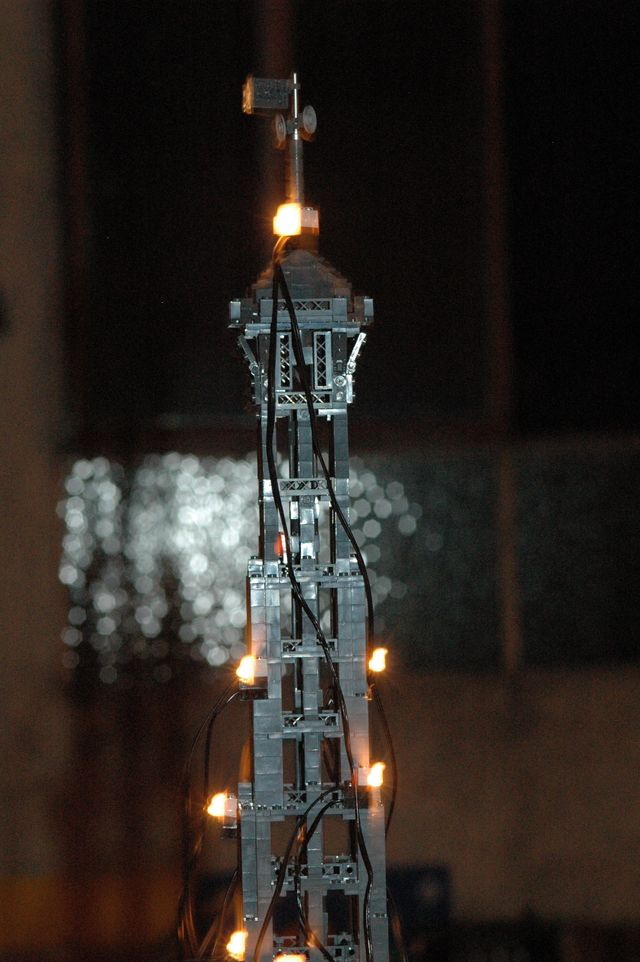](https://www.freelug.org/IMG/jpg/from_Xavier_124.jpg)

**La Tour Eiffel illuminée**

Dimanche ce fût le tour de plusieurs personnes de construire la seconde Tour Eiffel.

[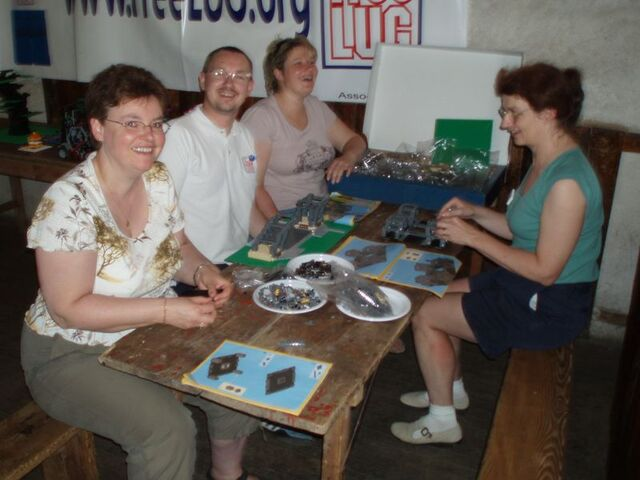](https://www.freelug.org/IMG/jpg/P7150009.jpg)

**Construction de la Tour Eiffel Tower**

_Spectacle improvisé des enfants_  
Le dimanche soir, après le repas, les enfants se sont illustrés par un spectacle improvisé sur la scène de la salle des fêtes. De nombreuses cascades au programme !

* * *

Mon résumé ne saurait être différent des précédents, aussi je fais court et n’y laisserais que des impressions personnelles.

J’ai emmené femmes et enfant, pardon, femme et enfants et nous avons été très contents de ce week-end LEGO. Des rencontres très intéressantes, des découvertes et pas une seconde de temps long.

Le DCC de Philippe m’a impressionné. Les créations des uns et des autres m’ont amusé ou étonné. Y’avait des idées !  
Le cadre enchanteur et la verdure n’ont fait qu’accroitre notre bien être.

Nous étions assez nombreux mais dommage que nous n’étions pas plus.  
La majorité des participants étaient de la région de Lyon. Logique me direz-vous, mais la REF est faite pour que tous les Freelugiens puissent se rencontrer.

Deux points à privilégier pour la prochaine REF : que le lieu ne soit pas trop éloigné d’une gare, et proposer trois dates et lieux puis par sondage auprès des adhérents, choisir la date et lieu convenant au plus grand nombre.  
Pour conclure, merci à Jac pour l’organisation et vivement la prochaine.

Thierry

* * *

Voilà, vous avez eu le résumé de ces 3 jours passés à la salle de St Victor-Montvianeix. A mon tour de vous faire connaître la joie de la préparation...

Tout d’abord, il a fallut préparer un dossier de candidature, à remettre aux membres de notre CA, et répondre à quelques questions précises, comme la recherche de la salle, la date de la REF... Tous cela constituant un dossier complet à présenter lors de l’Assemblée Générale.

Comme vous vous en souvenez, ce 18 février a été mémorable, euh, surtout pour moi !! Sursaut de l’assemblée, lors de la présentation des photos, et, finalement, le vote a été en faveur de la montagne, pour le lieu de la REF 2007.

Ce fut le début d’une longue préparation, pour être sûr que tout se passe bien. Faire en sorte de donner très vite les lieux d’hébergement, de préparer un concours de créations, et puis de trouver les activités possibles dans la région, pour pouvoir occuper tout le monde. Penser aussi aux repas, et celui que j’avais bien en tête et qui est resté secret jusqu’au dimanche soir.

Je ne dirais pas que c’est tout, car le cerveau fonctionne beaucoup, plein de questions viennent en tête avec pas toujours les réponses immédiates. Mais, ce n’est pas la première REF organisée, et la liste de discussion consacrée à la REF a été bien utile. Tous les anciens "préparateurs" y sont inscrits ainsi que les AFOLs proches. C’était une banque de donnée virtuelle très pratique et vivante, surtout quand la date a approché !!

Enfin, ça n’est pas de tout repos, comme vous pouvez vous en douter mais le résultat en vaut vraiment le coup. La joie des AFOLs se lit sur les visages. Les remerciements, lors des départs vont droit au poumon gauche...

JAC

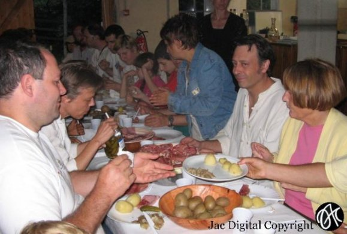

* * *

## Photos de la rencontre

Photos :  
**–** [Galerie de Philo](http://photos.freelug.org/main.php/v/philo/album/)  
**–** [Galerie de Loys](http://photos.freelug.org/main.php/v/Chimere/REF2007/)  
**–** [Galerie d’Erik](http://photos.freelug.org/main.php/v/brickerik/expositions/2007/REF2007/)  
**–** [Galerie de Jac](http://photos.freelug.org/main.php/v/JAC/Exposition/REF-2007/)
