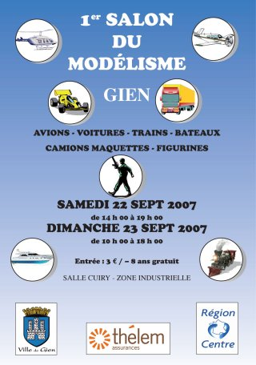

FreeLUG sera présent au premier salon de modèles réduits de Gien les 22 et 23 septembre 2007.

Jean-Marc y exposera son réseau avec ferries.

L’exposition, organisée par l’Association Giennoise de Modèles Réduits, se déroule à la salle Cuiry, zone industrielle, à Gien dans le Loiret.

Horaires d’ouverture :  
**–** samedi 22 : de 14h00 à 19h00  
**–** dimanche 23 : de 10h00 à 18h00

Entrées :  
**–** adulte : 3 euro  
**–** gratuit pour les moins de 8 ans

