La Bourgogne tend les bras à FreeLUG ! Pour la première fois dans cette région une exposition a eu lieu le 14 juillet 2007 à Dijon dans le magasin Toys’R’Us ! Le thème est tout un symbole : le début du défilé du 14 juillet des Champs Elysées en LEGO... en résumé c’était la fête !

La première question que l’on peut se poser c’est : pourquoi ? Cela amène plusieurs réponses.

Tout d’abord et bien évidemment, c’est dû par une envie d’exposition qui ne fait que croître de plus en plus et qui est dû aux autres AFOLs : je tiens d’ailleurs à remercier les AFOLs présents à Claix en 2005 et à Ceyrat en mars 2007 pour avoir su me donner le goût à continuer et à amplifier l’envie d’exposer. C’est une très belle aventure humaine que je conseille à tous les passionnés LEGO, car quand vous en faite une puis deux... et bien c’est tout naturellement que cette envie reste.

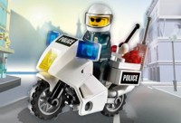

**set N°7235**

Ensuite, il faut se tourner vers le LEGO lui-même : bien que vilipendé au départ dû à sa forme playmobilienne le set 7235 fut pour moi une véritable révélation, et je le trouve très réaliste et beau après l’avoir monté pour la première fois.

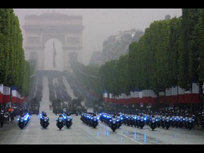

**défilé du 14 juillet 2006**

Enfin, l’idée de faire le défilé du 14 juillet n’est pas un hasard non plus... car avec mon père depuis les années 90 chaque 14 juillet nous faisions une scène du défilé du 14 juillet avec la police et les pompiers dans mon atelier LEGO... De plus le choix de mettre en avant la gendarmerie n’est pas non plus un hasard puisque dans ma famille on est gendarme de père en fils... j’ai donc rendu hommage à ma famille et à cette armée qui m’a toujours plu.

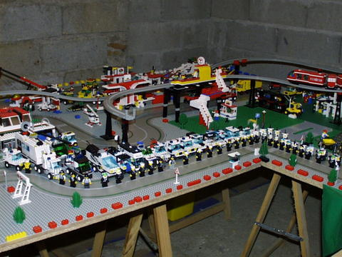

**défilé de 2002 dans mon atelier LEGO**

Ensuite la question du comment est là, plus délicate !  
La Bourgogne étant désertique en membres, l’organisation sera donc en solo.  
Quant à l’exposition malgré un appel aux Mocers militaires, personne ne s’est manifesté... et je n’en connais aucun en France. (Sauf un, Fred d’Auxerre qui visiblement a été inspiré par mon exposition puisqu’il a construit 3 tanks il n’y a pas longtemps).

Cette idée est donc née en 2005 avec la sortie du set 7235 et depuis 2 ans je n’ai pas arrêté d’acheter quelques boites de moto chaque mois pour arriver à 121 motos le jour J.

Le lieu était fort incertain au départ.  
J’ai commencé par faire une visite aux magasins de Jouets de Chalon-Sur-Saone et ce fut un demi échec car aucun n’avait la place mais d’un autre coté cela m’a permis d’avoir les coordonnés du commercial de ma région. En discutant avec ce dernier, il a trouvé mon projet formidable, il m’a conseillé d’aller voir à Toys’R’us Dijon et il a appuyé mon dossier auprès du responsable du magasin. Rien que pour avoir un lieu sûr à 100% il a fallu 9 mois, à la fois pour montrer le sérieux de ma démarche mais aussi la crédibilité et l’utilité de faire une exposition LEGO dans un magasin.

Le choix de faire une exposition dans un magasin de jouet me semblait être le mieux adapté pour voir du monde pour cette première en Bourgogne.

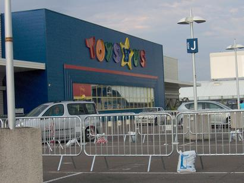

**le magasin Toy’s R Us de Dijon**

Ensuite suivant mes convictions d’associer nos expositions freelugiennes à une bonne cause, j’avais décidé de faire de la gendarmerie et de l’association de la prévention routière les partenaires de cette exposition.

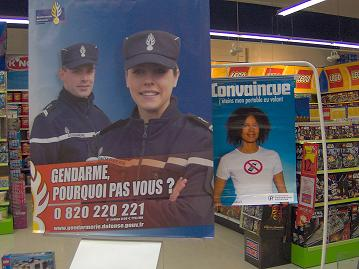

**présentoir gendarmerie / prévention routière**

Beaucoup de voyages vers Dijon pour défendre mon projet auprès d’eux. Pour la gendarmerie j’ai eu toutes les autorisations nécessaires de même pour la prévention routière. Cependant faute de moyens humains ce jour là, la moto de gendarmerie qui devait être exposée a été annulée quelques semaines avant l’exposition et la prévention routière avait le même jour sur Dijon une autre manifestation. Malgré cela leur panneau respectif a été très remarqué dans le magasin par le public ce qui déjà est une bonne chose.

Il a fallu par la suite contacter les 3 médias : presse, radio et télévision... la radio avec Europe 2 a été très vite, ensuite Le Bien public (journal papier) et la grande surprise France 3 qui s’est manifestée 48h avant l’exposition. Bref un très grand succès niveau de la communication.

Audio Player

[Audio de la publication d’origine](https://www.freelug.org/IMG/mp3/BG_LEGO_VILLARI.mp3)

**Europe 2**

**Le Bien Public**

C’est donc avec impatience que j’attendais ce moment de pouvoir enfin construire mes 121 motos et je dois dire que je me suis régalé.

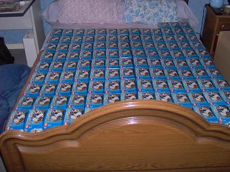

**couverture 7235 ;)**

Malheureusement le set 7235 est fait pour la police en blanc, je l’ai donc modifié (notez une grande première pour un collectionneur) avec de la peinture voiture couleur gendarmerie et le résultat est incroyable !

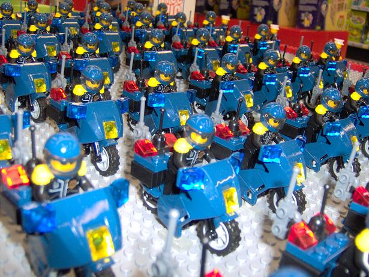

**Quelle belle couleur !**

Le montage s’est effectué une semaine avant l’exposition.

L’exposition elle-même s’est très bien déroulée, l’accueil du magasin fut très chaleureux avec un bel emplacement d’exposition près du rayon LEGO.

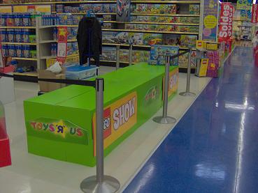

**le LEGOshow !!!**

Après 2 heures de montage avec l’aide vers la fin du chef du magasin et du caméraman de France 3 qui visiblement voulaient toucher du LEGO !!!

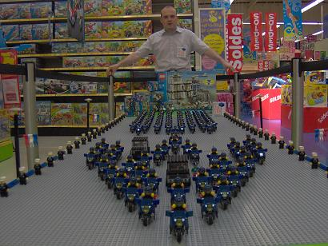

**Le défilé LEGO et moi**

La journée s’est très bien passé beaucoup de personnes m’ont félicité et j’ai pas mal discuté avec les gens. J’ai souvent donner notre site internet et mes coordonnées personnelles. D’ailleurs pour ceux qui m’ont rencontré et qui me lisent n’hésitez pas à me contacter au 06.85.39.94.13 afin de préparer une seconde rencontre.

## Le bilan de l’exposition

**les points négatifs**  
**–** La date du 14 juillet les gens croient que le centre commercial est fermé, la meilleure solution est d’appuyer par le système du dépot de flyers en ville ou de changer de date. Du coup j’estime à 300 visiteurs seulement sur 10h d’exposition.  
**–** Sur les trois médias, seulement un a parlé de FreeLUG et j’ai du mal à comprendre le découpage d’Europe 2. On ne maitrise pas le contenu des médias.  
**–** Manque de visibilité de FreeLUG : pas de dépliants ni de banderole FreeLUG.

**Les points positifs**  
**–** Très bon contact avec le magasin qui me demande de faire une exposition pour début octobre 2007  
(je lui présenterai mon layout de 1m par 10m représentant un grand aéroport + si d’autres sont intéressés courant septembre). Je ferai très prochainement un appel d’exposants (avec une préférence régionale) car visiblement il m’offre une plus grande place. Avec 1.50m de largeur et en longueur, je peux me lacher.  
**–** Deux nouveaux contacts d’AFOL et beaucoup de contacts KFOL. (D’ailleurs j’aimerai que le fan de Technic me contacte je sais que tu lis FreeLUG, tu m’avais donné ta carte mais elle a été détruite au lavage, envoies moi un mail ici : legodefile@yahoo.fr ou par téléphone ci dessus merci d’avance).  
**–** Le public très émerveillé.  
**–** J’ai réussi à avoir les trois principaux médias qui ont été eux aussi émerveillés par notre passion.  
**–** La présence de FreeLUG : je me suis toujours présenté dans mes divers démarches comme étant membre de l’association FreeLUG, ce qui m’a permis d’avoir une meilleure crédibilité surtout auprès du commercial de chez LEGO.

J’ai pris un grand plaisir à organiser et réaliser cette exposition. C’était une grande première et c’était ma volonté de comprendre ce que c’est que d’organiser une manifestation LEGO. Tout ceci ne s’improvise pas et demande quelques mois de préparation.

Je tiens à remercier spécialement le Freelugien de Fanabriques : Thierry, qui a fait un petit détour (60km quand même) pour venir me voir en exposition avant d’aller à la REF. Cela m’a beaucoup touché, je te remercie de ton amitié et merci pour la conversation que l’on a eu ensemble. C’est souvent les simples gestes qui font de notre club un groupe solidaire et soudé.

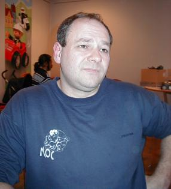

**Thierry**

Je fais un grand merci général à tous ceux qui m’ont aidé de près ou de loin à la réalisation de ce projet.

La Bourgogne s’éveille... naissance d’une nouvelle région Freelugienne.

Reste maintenant à savoir si le défilé se poursuivra l’année prochaine, en tout cas sur ce projet le prochain objectif est l’arc de triomphe en bleu blanc rouge à l’échelle minifig... réalisation à suivre...

JeanG

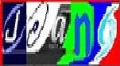

## Photos

Galerie : [http://www.brickshelf.com/cgi-bin/g...](http://www.brickshelf.com/cgi-bin/gallery.cgi?f=263028)
