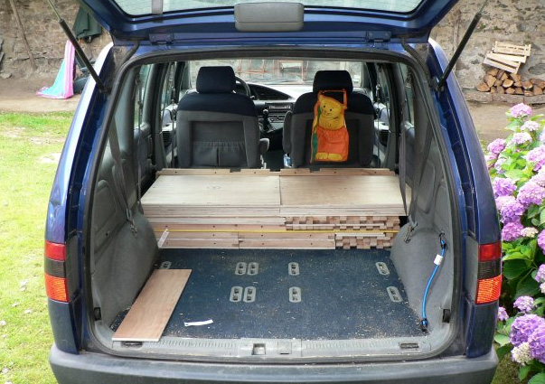
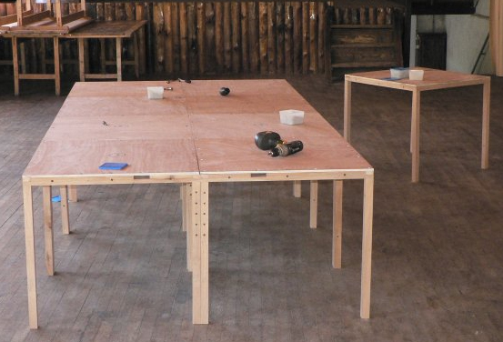
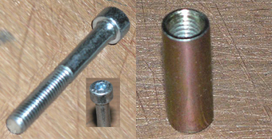
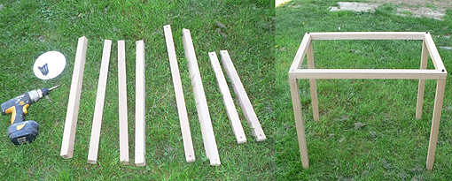
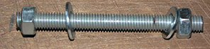
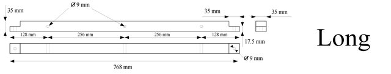
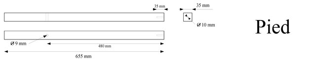
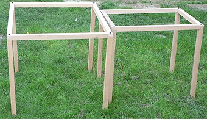
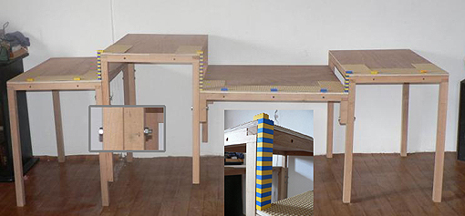

Le but de cet article est de raconter la genèse et le pourquoi de ce modèle de table modulaire pour les expositions.

Certes, un projet FreeLUG avait été lancé il y a deux ou trois ans, mais nous voulions en affiner le cahier des charges avant de construire un prototype, puis des tables en série.

## Le cahier des charges

**La critique de l’existant**

Nous sommes partis de ce que d’autres avaient fait, afin d’essayer d’en trouver les défauts pour ensuite tenter d’y remédier :  
**–** beaucoup de pièces différentes pour faire une table ;  
**–** encombrantes à stocker plus problèmes de logistique pour en transporter 15 ou 20 dans une simple voiture (si 10 tables ou plus, alors il n’y à plus de place pour les LEGO ...)

**Notre cahier des charges**

**–** Minimiser le nombre de pièces : en fait, trouver un système où quelques pièces doivent permettre le maximum de combinaisons possibles de tables pour répondre aux différents configurations utiles en exposition :

-   variation en surface
-   variation en hauteur de plan.

**–** Réduire au maximum l’encombrement de stockage : en fait, les tables d’exposition passent plus de temps stockées démontées que montées...  
**–** Faciliter la logistique du transport (tout le monde n’a pas une remorque de 3m cube) : une voiture doit pouvoir transporter facilement 8 tables de base (ce qui correspond à 1,5 m \* 3 m de surface) en laissant assez de place pour le reste (la Smart ne compte pas...). Si l’on trouve un système peu encombrant, plus de personnes vont pouvoir avoir chez elles quelques tables utilisables en expo.

**En voiture**

20 tables xBaB chargées

**–** Avoir un montage simple et rapide : un seul outil et un à deux types de visserie maximum.  
**–** Pourvoir répartir la logistique : nous sommes partis du principe que les personnes qui font des expositions peuvent avoir chez elles des plateaux et que le système doit permettre de mettre très facilement ces plateaux  
sur des pieds lors des expositions. Dit autrement, cela peut permettre :

-   de mutualiser facilement (le club) ce qui sert le moins souvent et qui est le plus difficile à fabriquer : les pieds
-   chacun apportant juste les plateaux de ses modules, plateaux on ne peut plus simple à fabriquer ! De plus, pour des MOC plus complexes, il est plus facile de découper juste un plateau qu’une vraie table.
-   faire en sorte que ce qui est mutualisable (les pieds) prenne le moins de place possible (faciliter le stockage centralisé et le transport vers une exposition).

**–** Le système de pieds doit donc aussi assurer un positionnement correct du plateau mais sans complexifier le plateau.  
**–** Pour les dimensions nous avons repris les grands principes :

-   Hauteur de la table de référence : 700 mm (entre le sol et le dessus du plateaux)
-   Dimensions du plateau de la table de référence : l’unité de comptage est la plaque 32\*32 tenons et la table de base fait 3 plaques 32 \* 3 plaques 32 soit une surface de 9 plaques de 32 tenons (ou de 4 plaques de 48 tenons).
-   Epaisseur du plateau : 10 mm. Cela peut paraître beaucoup mais l’expérience montre que c’est ce qu’il faut si l’on ne veux pas avoir de mauvaises surprises.
    
    
    
    **REF 2007 : prêt à recevoir ITLUG**
    
    Et voila une jolie surface d’expo faite de 8 tables modulaires de base (3\*3)
    

## La réalisation

Un premier prototype a été fait par Xavier (Brikolego), avec ses petites mains, pour valider la faisabilité globale de ce à quoi conduisait notre cahier des charges.

Ce prototype a été présenté à [Toulouse](https://www.freelug.org/spip.php?article520). Après discussions, certaines modifications ont été faites (pieds et montants plus larges, système de renfort latéral si besoin...).

Cela validé, une première série de 18 tables 3\*3 et 4 tables 2\*3 a été fabriquée sous le contrôle de Xavier.

**La visserie utilisée**

Pour assembler le cadre (pieds et montants) :  
**–** Vis (BTR) cylindrique tête creuse six pans Diamètre 8mm, Longueur 60 mm ( La tête ronde des 4 vis BTR sert aussi à positionner précisément le plateau en venant se loger dans les perçages du plateau prévus pour cela)  
**–** Insert diamètre intérieur 8 mm extérieur 10mm (qui sont collés dans les pieds)

**La visserie d’assemblage**

**Une table 2\*3**

A gauches, les éléments, et à droite, hop, monté avec 4 vis.

Des boulons peuvent êtres utilisés pour assembler les pieds en utilisant les perçages de pied. Les écrous peuvent êtres remplacés par des écrous papillons (un peu plus chers mais ce qui évite d’avoir une clef plate).

**Boulon de pieds**

**Les plans**

**pied**

**Le prix**  
**–** Cadre et pieds en hêtre pour 24 modules (0.3 m cube de bois) : Prix de revient : 8.13 euro par table  
**–** Visserie 4 inserts, 4 btr, 3 tiges d’assemblages : 1.5 euro  
**–** Plateau contreplaqué 10mm : 4.80 euro

Soit pour une table : 14.43 euro

**La modularité**

Des montants de différentes longueurs (associés aux plateaux ad-hoc) permettent de faire des tables de 3\*3, 3\*2, 3\*1 très facilement sans changer les pieds eux même ou la visserie.

**Table de 3\*3 et de 3\*2**

Des perçages (distants de 5 briques) dans les pieds permettent avec les boulons de pieds de faire varier facilement la hauteur.

**Des tables comme des LEGO...**

**Quelques conseils**

Pour les plateaux, il faut les découper de 2 à 3 mm de moins que la côte théorique (76.8 cm pour la côte exacte, 76.5 suffit largement) car sinon cela peut poser des problèmes lors de l’assemblage des tables entre elles.  
Par contre le cadre doit être exactement à la côte.

Le point stratégique est la connexion pied/montant : le parallélisme des surfaces doit être parfait sinon il y aura des déformations dans tous les sens.  
De la même façon, l’insert métallique femelle du pied doit être monté parfaitement, sinon le pied sera de travers.

Choisir un "bon bois" (éviter le sapin et autres bois tendres) pour faire les pieds, en particulier pour la partie où va être mise l’insert.  
Si vous avez un budget limité, faites une table de moins, mais utilisez des bons matériaux.

Améliorations possibles :  
**–** ajout d’un 2ème insert coté sol pour permettre l’utilisation d’un pied à vis quand le sol est inégal.  
**–** peindre les tables en vert LEGO  
**–** vos suggestions...

## Conclusion à ce jour

La première sortie officielle de ces tables s’est faite à l’occasion de la [REF 2007](https://www.freelug.org/spip.php?article631).  
Premier constat : elles ont bien répondu au cahier des charges fixé et elles supportent bien la charge.  
Le montage et le démontage est assez rapide (avec une visseuse) et n’est pas compliqué.  
Une deuxième série va être lancé coté Rhône-Alpes en espérant que d’autres fassent de même, y compris notre club bien aimé.

Toutes les photos sont de Xavier, pour en voir plus :  
[http://www.brickshelf.com/cgi-bin/g...](http://www.brickshelf.com/cgi-bin/gallery.cgi?f=270773)
