_Power Functions_ est le nouveau système électrique par la compagnie LEGO apparaissant cette année dans les modèles Technic et Creator.

## Présentation des éléments _Power Functions_

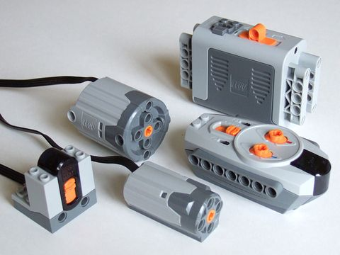

La famille _Power Functions_ est composée d’un boîtier de piles, d’une télécommande, d’un récepteur, de moteurs et d’un nouveau système de prises électriques et de fils. Faisons ensemble le tour de ces éléments.

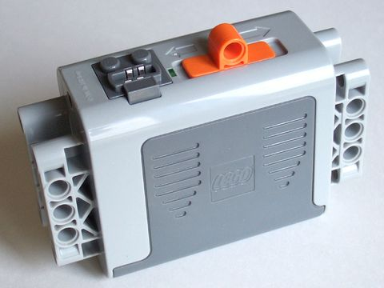

Le boîtier de piles fournit l’alimentation électrique au système. Un indicateur lumineux vert indique l’état de marche. L’interrupteur orange à trois positions permet de faire fonctionner un moteur dans un sens ou dans un autre. En position centrale, rien n’est alimenté. La prise est de type femelle et dans tout le système, les prises femelles fournissent le courant de la même façon que les prises de courant alternatif domestiques. Le boîtier de piles nécessite 6 piles AA.

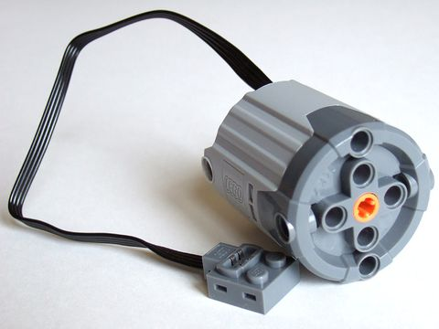

Les moteurs ont une grande réduction interne, tournant doucement et délivrant une grande puissance. Référez-vous aux mesures techniques à la fin de l’article. Ils sont alimentés par un câble intégré. Il y a deux types de moteurs : un "normal" et un XL.

Le petit moteur possède des tenons mais également des fixations Technic comme illustré sur l’image ci-dessous. Il fait 6 tenons de long et 3 tenons de large.

Le moteur XL est seulement "studless" (pas de tenon) et son diamètre de 5 tenons.

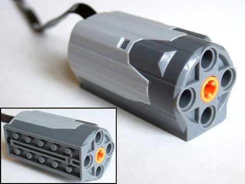

La télécommande et le récepteur fonctionnent ensemble : la télécommande envoie des signaux infrarouge au récepteur. Le système possède quatre canaux, et un sélecteur de canal se trouve sur la télécommande ainsi que sur le récepteur. Pour communiquer ensemble, les éléments doivent être sur le même canal.

Le récepteur possède deux sorties, codées en rouge et bleu, correspondant aux deux boutons de la télécommande. De cette façon, vous pouvez contrôler jusqu’à huit fonctions dans vos modèles.

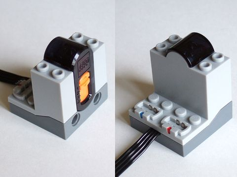

Tout comme les moteurs, le récepteur est alimenté par un câble attaché. Comme pour le boîtier de piles, les sorties sont de type femelle.

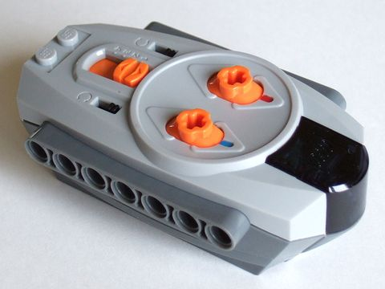

La télécommande inclut également deux petits inverseurs de chaque coté du sélecteur de canal, chacun contrôlant un bouton. Ils permettent d’inverser la direction de chaque sortie. La télécommande nécessite 3 piles AAA.

Les prises _Power Functions_ sont d’un nouveau type. Il y a quatre contacts offrant de nouvelles possibilités pour le futur. Un câble d’extension permet une compatibilité avec le système 9V existant et le NXT.

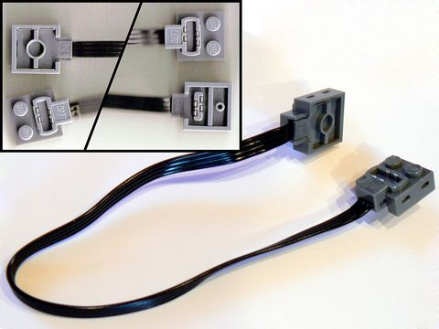

## Le fonctionnement du système _Power Functions_

_Power Functions_ est une gamme de motorisation et d’accessoires de contrôle introduits à l’automne 2007. _Power Functions_ va remplacer progressivement le système 9V actuel tout en maintenant la compatibilité.

Le câble est composé de quatre fils et terminé par un nouveau connecteur empilable. Ce connecteur est asymétrique, ainsi il permet toujours un branchement dans le bon sens.

Deux des fils (ce sont les fils d’alimentation) transmettent le courant depuis le boîtier de piles vers tous les accessoires qui en ont besoin, tel que le récepteur infrarouge. Comme tous les éléments ont des entrées et des sorties, les éléments peuvent être facilement chaînés.

Les deux autres fils servent à des signaux de contrôles. Ceux-ci peuvent être employés dans les sorties (le récepteur crée les commandes C1/C2 selon les commandes IR) ou les entrées (le moteur est alimenté par C1/C2 et tourne selon leur état).

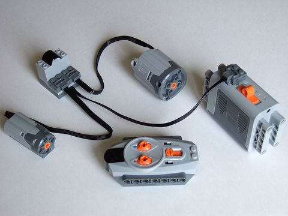

Les tables et le diagramme ci-dessous expliquent comment le système fonctionne.

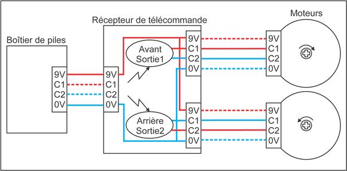

| Nom du signal | Description |
| --- | --- |
| +9V | Alimentation électrique |
| 0V (masse) | Alimentation électrique |
| C1 | Signal de contrôle |
| C2 | Signal de contrôle |

| Commande IR | C1 | C2 | Moteur |
| --- | --- | --- | --- |
| Avant | 9V | 0V | Sens des aiguilles d’une montre |
| Arrière | 0V | 9V | Sens inverse du sens des aiguilles |
| Stop | 0V | 0V | Arrêt |

Et vous, qu’allez-vous créer avec cette nouvelle gamme ?

## Etude comparative des moteurs, par Philo

Nous allons comparer ici les moteurs PF avec les deux versions du micro-moteur : la version 71427 produite entre 1997 et 2002 et la version 43362 produite entre 2002 et 2006. Extérieurement, ces deux versions sont identiques mais ils diffèrent notamment par leur poids, le 43362 étant nettement plus léger.

_Toutes les mesures ci-dessous ont été effectuées à l’aide d’une alimentation de laboratoire._

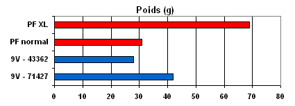

Le moteur PF normal a un poids comparable aux moteurs 9V. Le moteur PF XL est plus lourd, sans surprise pour un moteur si puissant.

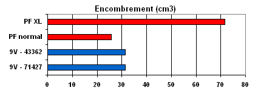

Volume de l’enveloppe du moteur.

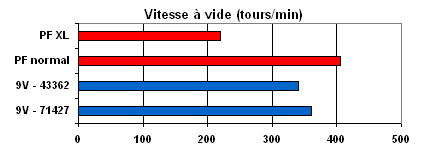

Le moteur PF XL tourne doucement, fournissant un couple impressionnant. Encore une fois, le PF normal est similaire aux moteurs 9V.

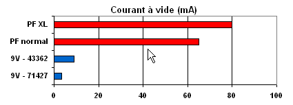

Un point faible des moteurs PF : leur courant à vide est élevé, trahissant un frottement interne élevé. Ils ne sont pas adaptés à des emplois "basse puissance" comme par exemple l’alimentation par panneau solaire. Le 71427 est exceptionnellement adapté à cet usage.

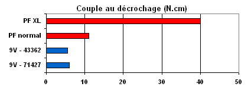

Le couple maximum délivré par le moteur (moteur bloqué). Le moteur PF normal délivre deux fois plus de couple que les 9V, alors que le XL les surpasse tous allant jusqu’à pouvoir tordre un axe Technic.

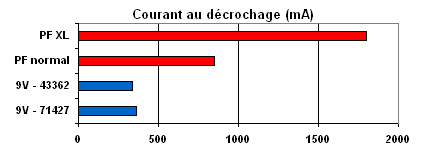

Le couple élevé a un prix : la consommation électrique. Notez que le courant de décrochage dépasse le courant maximum délivré par le récepteur infrarouge PowerFunctions (800mA) ainsi que celui de sa protection interne. Le couple maximum n’est obtenu qu’en branchant le moteur directement sur le boitier de pile et pour un court instant.

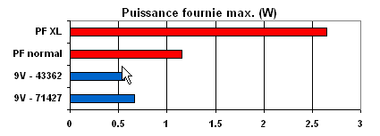

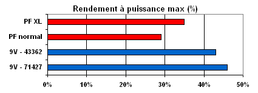

La puissance mécanique maximale est atteinte pour une charge et une vitesse de rotation correspondant à la moitié de la vitesse de rotation à vide. Les moteurs PF dépassent leurs aînés mais avec une perte d’efficacité. L’efficacité est le rapport entre la puissance mécanique délivrée et la puissance électrique fournie. Notez que la meilleure efficacité est obtenue lorsque la charge cause une réduction de la vitesse de un quart.

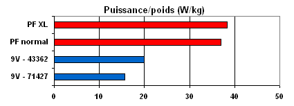

Rapport de la puissance mécanique au poids du moteur.

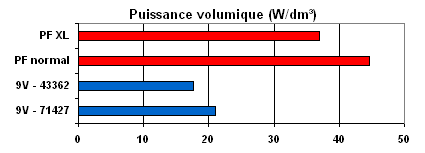

Rapport de la puissance mécanique au volume du moteur.

Les conclusions sont claires. Les moteurs PF surpassent leur aînés dans tous les domaines sauf en ce qui concerne l’efficacité énergétique, et ce parfois de manière très importante.

**Courbes de puissance des moteurs PF connectés au récepteur IR.  
**

Les diagrammes ci-dessus ne disent pas tout. En effet, les moteurs sont alimentés par les récepteurs IR qui ont leurs limitations. Les courbes ci-dessous montrent l’évolution de la puissance mécanique des moteurs alimentés par un récepteur IR. Ces valeurs ont été mesurées à 9V (piles alcalines) et à 7,2V (piles rechargeables NiMH).

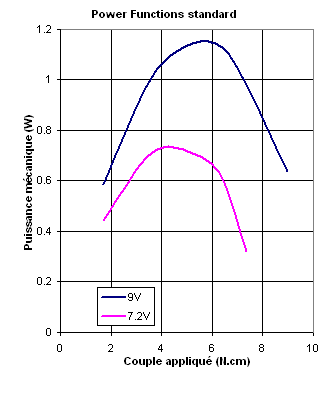

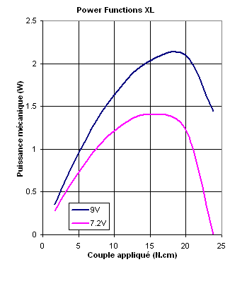
