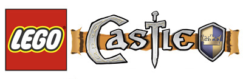

Traduction de l’article [Castle ’07 Designer Feedback](http://www.classic-castle.com/sets/articles/designerfeedback07.html) paru sur [Classic-Castle.com](http://www.classic-castle.com/). Merci à Classic-Castle.com pour l’aimable autorisation.

Translation into French of the article [Castle ’07 Designer Feedback](http://www.classic-castle.com/sets/articles/designerfeedback07.html) published on [Classic-Castle.com](http://www.classic-castle.com/). Thanks to Classic-Castle.com for the kind agreement.

Classic-Castle avait proposé à ses lecteurs de poser des questions aux désigners de la gamme Castle. Voici la réponse.

## Commentaires du designer de la gamme Castle 2007

Tout d’abord, j’aimerais tous vous remercier pour avoir poser vos questions au sujet de notre lancement de la gamme Castle 2007. J’ai lu toutes les questions et je vais essayer de répondre à celles auxquelles je peux, pour illustrer le comment et le pourquoi nous en sommes arrivés aux produits que nous avons réalisés pour ce lancement. Malheureusement, il y a bien évidemment des limites sur les informations que je peux divulguer au regard de certains sujets à cause de la confidentialité. Les réponses se focalisent essentiellement sur le prix, les techniques de tests, les procédures de fabrication et production etc., tout ce qui peut affecter la façon dont nous concevons les produits.

Plutôt que de répondre à chaque question individuellement, comme de nombreuses se recoupent, je vais donner une explication générale à travers différents sujets. J’espère que cela donnera un aperçu de la face cachée de ce lancement et que vous pourrez apprécier le processus qui a pris place dans la conception de ces produits.

Je sais que certains d’entre vous sont extrêmement satisfaits des nouveaux produits. Cela a été fantastique et grandement motivant de recevoir de tels commentaires positifs à la fois pour moi et mon équipe. Je sais également que certains d’entre vous sont moins satisfaits, ce que nous comprenons et respectons. J’espère vraiment que dans ce cas, vous pourrez comprendre que c’est une tâche très rude de satisfaire tout le monde dans le lancement d’un produit.

## Pourquoi une nouvelle gamme Castle pour 2007 ?

La décision de lancer une nouvelle gamme Castle en 2007 a été prise pour plusieurs raisons. Knights Kingdom arrivait sur la fin de son cycle de vie, cette série avait rencontré de nombreux succès mais aussi montrait ses limites. Initialement, KK a été développé pour introduire une gamme de figurines _ConstrAction_ et était fortement reliée à un fil conducteur avec un focus important sur un groupe de personnages. Toutefois, cela a causé de nombreuses restrictions quand il fallu développer les produits LEGO System qui devaient se retrouver sous la même ombrelle. Egalement, la stratégie de la compagnie s’orientait vers le retour à nos racines, et donc les produits System nécessitaient le lancement d’une nouvelle gamme plutôt qu’une série de figurines d’action.

Nous voulions effacer le tableau, retourner aux bases et venir avec une nouvelle gamme de produits qui correspondrait et exciterait notre clientèle cible (les garçons qui aiment construire, à partir de 5 ans) et également approvisionner nos clients de l’ombre, les fans adultes de châteaux.

De ce que nous avons appris de Knights Kingdom, il était vital de ne pas se limiter nous mêmes trop tôt en développant un fil conducteur complexe. Chaque produit que nous avons réalisé dans la gamme 2007 devait être complètement indépendant et devait raconter visuellement sa propre histoire aux enfants, pour stimuler leur imagination. A travers la collection et la combinaison, ils seraient alors capables de créer leurs propres aventures épiques.

## Les bons et les méchants !

Vous êtes nombreux à avoir commenté les différentes factions et demandé pourquoi nous avions choisi des squelettes plutôt que deux factions humaines. Cette décision a été prise pour plusieurs raisons.  
Premièrement, nous avons fait tester un grand nombre de personnages auprès de différents enfants, où nous comparions différents scénarios, produits avec différents personnages, incluant de très classiques chevaliers contre d’autres chevaliers et d’autres opposants basés sur le fantastique. Pratiquement tous les enfants trouvaient que les méchants basés sur le fantastique étaient plus excitants, magiques et prenants. Quand nous présentions deux factions humaines, la réponse ressemblait surtout à _"c’est juste des chevaliers dans deux couleurs différentes !"_ et ils trouvaient la gamme entière et les produits beaucoup moins attirants et inspirants.

Je pense personnellement que c’est une vraie illustration de notre époque. Si vous regardez les films, spectacles télévisés, jeux vidéos, livres, bandes dessinées et autres jouets desquels les enfants sont entourés actuellement, c’est différent de ce que nous avions quand nous étions petits. La perception des enfants sur un thème comme le château est aujourd’hui beaucoup plus inspirée par les histoires et personnages fantastiques.

Une autre raison pour introduire cet aspect fantastique était d’arriver à enthousiasmer les revendeurs également ! Cela peut sembler stupide, mais nous avions besoin de quelque chose qui apparaisse vraiment différent de Knights Kingdom... Les revendeurs vendent des LEGO Castle depuis des années avec différents niveaux de succès, ils avaient besoin d’une nouvelle approche là-dessus également... Qu’est ce qui va faire que les consommateurs vont davantage acheter cette gamme plutôt que les autres gammes du passé ? Qu’est ce qui la rend différente ?

Ainsi, les ingrédients devaient être : des chevaliers classiques, avec des châteaux classiques, des armes classiques, des boucliers classiques, des chevaux classiques pour vous garder contents :) et quelques méchants fantastiques pour épicer les choses pour les enfants et les revendeurs.

Nous avons choisi en premier les squelettes comme ils sont les plus représentatifs et les plus faciles pour les fondations du nouveau thème. Il n’y a pas de doute que ce sont les méchants, en considérant que d’autres personnages fantastiques peuvent être différemment interprétés dans l’esprit des enfants. Utiliser les squelettes signifiait aussi que nous pouvions réellement différencier les structures et les véhicules entre les bons et les méchants. Concevoir tout cet ensemble pour les méchants pour sembler osseux et squelettique permettait de rendre la gamme plus variée. Notez toutefois que cela ne veut pas dire que nous ne ferons jamais plus deux factions humaines, c’est juste la tendance actuelle de prendre une telle direction fantastique.

## Assortiment des produits

L’assortiment Castle 2007 est un assortiment standard de jeux, d’un point de vue de prix et de mélange de produits. Notre principal objectif était de s’assurer que nous délivrions une gamme de produits réellement différents, accessibles depuis l’argent de poche aux gros cadeaux pour Noël. Il était également important que nous n’ayons pas trop de produits, pour leur permettre à tous de réussir.

Nous voulions un équilibre entre les produits orientés vers les bons et ceux orientés vers les méchants, mais tout en s’assurant que chaque set contiennent des deux, pour ajouter de l’excitation sur la couverture de la boîte, tout comme une valeur instantanée de jeu une fois le produit construit.

## Héraldique, couleurs et graphiques

**Les bons**

Nous les voulions beaux et classiques, mais en même temps pas trop naïfs dans l’expression du design, ainsi, l’utilisation du bleu foncé les rendait plus mûrs et ils ne paraissaient pas trop enfantins (c’est quelque chose que nous étions conscients de changer par rapport au sentiment rose bonbon des KK). Nous voulions ajouter l’aspect métallique pour augmenter l’authenticité, pour faire comme si les figurines portaient de vraies armures de métal, ce que les enfants aiment beaucoup. Les points culminants et les emblèmes de couleur doré ont été utilisés pour ajouter un aspect majestueux au thème et promouvoir la qualité du roi et de ses chevaliers. Nous avons choisi d’utiliser la couronne pour le blason des gentils car nous sentions que cela symbolisait réellement la qualité, la royauté, l’honneur etc... C’est très symbolique, nous ne l’avions pas fait depuis longtemps (et j’avais le château jaune quand j’étais petit et je voulais alors lui rendre hommage ! )

**Les méchants**

Rouge et noir, ça ne peut pas être plus méchant que ça ! Du blanc pour faire ressortir les os, les dents, les cages et les épines dans les modèles ! Le symbole du crâne pour les boucliers etc... les enfants adoraient, c’était très représentatif !

## Briques contre éléments pré-fabriqués !

Avec cette gamme Castle, nous avions le sentiment qu’elle devait être une des gammes les plus riches en briques. Cela s’y prête naturellement eu l’égard du thème et des modèles eux-mêmes. Nous avions pour objectif d’avoir autant que possible des briques standards et réduire le nombre de pièces pré-moulées. A cause des contraintes de prix, des capacités à construire des enfants dans la tranche d’âge cible, des notices de construction et de la taille finale de certains modèles, nous avons du toutefois les utiliser par moment, mais nous avons essayé de le faire au minimum. Je suis très heureux de dire que je pense que nous avons atteint le plus grand nombre de pièces depuis toujours dans le nouveau grand château.

## Conception du château du Roi

Nous savions que la plupart des châteaux récents que nous avions lancés étaient construits comme simple façade ou sur des plaques de base et nous voulions faire le nouveau château différemment. Nous savions que vous préfèreriez avoir un château entièrement muré, c’était donc notre premier objectif à atteindre.

Nous avions besoin de construire le château en modules, pour faciliter l’expérience de construction pour les jeunes enfants : construire le château par blocs nous autorisait de l’empaqueter dans différents sachets, pour rendre plus facile aux enfants l’identification des briques et pour réduire le temps de recherche des éléments. Nous savons qu’un temps de recherche trop long pour trouver une pièce apporte de la frustration. Des enfants peuvent abandonner et remplacer des briques par d’autres similaires, ou bien ils s’imaginent que la pièce est manquante... cela mène à des modèles incorrectement construits et les enfants sont déçus du résultat, ce qui doit être évité à tout prix.

Les constructions creuses des tours arrières sont généralement dues aux contraintes de prix, évidemment pour chaque modèle nous devons atteindre le prix cible fixé. Nous devons faire de notre mieux pour créer un modèle attirant qui a une impression de grande taille et qui sera également bien photographié pour la couverture de la boîte. A l’origine, les tours à l’arrière étaient plus condensées et plus basses, mais elles étaient impossibles à voir sur les photos, car elles étaient cachées derrière les tours frontales. Cela signifia que nous devions réduire les tours frontales et élever celles de derrière, de sorte que le plus de détails soient visibles. Nous voulions être sûrs que le trône du roi, le trésor, l’épée et la prison soient facilement visibles sur le devant de la boîte comme ce sont les éléments principaux pour créer des histoires chez les enfants.

C’est un des problèmes auquel nous avons du faire face lors de la conception d’un château complètement fermé, une partie de ce pourquoi nous dépensons notre budget étant cachée derrière le mur frontal. Les façades de château sont plus faciles pour créer une image forte, puisque tout le budget est pratiquement employé pour rendre le mur frontal aussi impressionnant que possible. Aussi, les tours aérées facilitent l’accès à l’intérieur pour que les enfants puissent y mettre leurs mains. Nous devons nous rappeler que ces modèles sont conçus pour jouer avec et non être simplement exposés.

## Classic-Castle.com et l’implication des AFOLs

Nous avons utilisé Classic-Castle.com comme une de nos sources d’informations sur les fans adultes, ce qui a été bénéfique dans le développement des nouveaux produits. Nous avons également été assez chanceux d’obtenir l’assistance d’un groupe d’AFOLs, à savoir Ben Ellermann, Nathan Wells, Paul Janssen, Robin Sather, Johannes Koehler, Luis Baixinho, David Tabner, Lenny Hoffman, et Andrzej Szlaga. Tous ont contribué à notre processus de conception, nous inspirant de leurs idées, de visuels de modèles qu’ils ont faits pour nous, de leurs recommandations sur les éléments que les fans préfèreraient etc.

Ben Ellermann a également pris part à un atelier de travail ici à Billund, lorsque nous avons lancé le projet Castle, comme représentant des fans. Il est venu travailler avec l’équipe des designers durant plusieurs jours construisant et travaillant avec nous pour nous conseiller sur les choses que nous pourrions faire pour s’assurer d’obtenir le soutien des fans adultes pour la nouvelle ligne Castle. Cela a été très bénéfique, en mettant en avant l’importance des anciennes armes par exemple et nous menant à ressortir et réparer les vieux moules que nous avons pu trouver. Certains étaient complètement abimés, mais d’autres encore intacts et nous avons pu les remettre en production.

J’aimerais remercier personnellement tous les fans pour leur implication, car ils ont tous contribué au développement de cette gamme, d’une façon ou d’une autre.

Merci !!

## Figurines d’action type KK.

Il n’y aura pas de figurines _ConstrAction_ en tant qu’élément de la nouvelle ligne Castle. L’assortiment sera exclusivement orienté mini-figurines, avec l’addition de créatures fantastiques dans certains sets.

## Sets civils et médiévaux.

A travers tous les tests que nous avons faits pour la gamme Castle, nous avons inclus de nombreux sets du genre civils pour que les enfants puissent évaluer nos propositions. Malheureusement quand vient le temps de classer les produits, ils arrivent toujours à la fin de la liste ; même quand nous essayons de les rendre plus attractifs en incluant des sortes de batailles ou d’attaques dans le produit, ils n’atteignent pas un rang élevé. Les enfants préfèrent vraiment avoir simplement un gros château à protéger et plein de de machines de guerre et de véhicules.

Si nous faisions un set civil pour la vente au détail, c’est comme si il serait toujours pris en dernier par les enfants dans leur liste de collection et qu’en fait ils n’atteindraient guère. Nous ne pouvons pas nous permettre d’avoir des produits dormants sur les rayons qui seraient longs à réussir car la place sur les rayonnages est limitée dans les différents magasins. Une boîte comme celle-ci pourrait prendre la place d’une boite StarWars ou Exo-Force qui pourrait se vendre cinq fois plus. Généralement, si des produits ne fonctionnent pas dans les deux premiers mois, ils peuvent être facilement retirer de l’assortiment.

Cela ne signifie pas que nous n’allons jamais refaire des choses comme ça, nous avons fait des choses fabuleuses en interne que je suis sûr que vous adorerez, nous avons juste besoin de trouver la meilleure façon de vous les mettre à disposition, ce n’est qu’une question de business. Je discute actuellement avec shop@home / Direct pour voir si nous pouvons trouver une solution de ce côté... Je ne peux rien promettre mais je regarde ce que je peux faire, nous devons surtout faire attention à ne pas inonder le marché avec trop de produits Castle.

## Pack armées de bataille

Nous sommes aussi en discussion pour eux, ils ne seront pas lancés en masse au détail, mais nous regardons pour en faire des articles shop@home (à confirmer). Au même moment, nous lançons de petits articles qui incluent une minifig plus ses accessoires (comme vous avez déjà pu l’entendre sur Eurobricks), au moins l’un d’eux devrait permettre à vous aider à construire une armée... comme il s’agit d’un soldat avec un nouveau torse et des accessoires.

## Développement et longévité de la nouvelle gamme Castle

Nous espérons pour elle d’être plus longue que les Vikings par exemple. Nous avons fait exprès de faire une histoire très pauvre et ouverte, ce qui fait que nous avons la liberté de prendre différentes directions. Vikings est plus étroit comme un concept, une fois que vous avez fait un bateau, un fort et quelques véhicules, la portée pour de nouveaux produits très différents se réduit très rapidement. Avoir la nouvelle gamme Castle avec un coté fantastique signifie que nous avons un grand nombre de possibilités pour introduire de nouveaux personnages et développer des produits différents et excitants.

2008 va voir la bataille grossir, car les deux côtés sont rejoints par de nouveaux alliés. Ces renforts apporteront avec eux de nouveaux véhicules, machines et bâtiments pour rendre le thème encore plus épique. Je sais que vous avez déjà dans les mains un aperçu d’un des nouveaux produits, laissant deviner ce qui va arriver.

Concernant la longévité de la ligne, c’est très dépendant du succès de son lancement, mais nous espérons la conserver aussi longtemps que nous pourrons. Concernant les trolls vus sur l’image du catalogue, vous n’aurez plus à attendre trop longtemps !

En 2008, nous avons deux articles _Impulse_, six nouveaux produits au détail incluant une exclusivité et un article très spécial prévu pour la fin de l’année. C’est tout ce que je vous dirais, mais je suis sûr que vous arriverez à dénicher l’information quelque part.

## Informations sur les éléments et composants :

**Décoration Viking du torse du Roi**

J’aimerais vous raconter qu’il y a une réelle et profonde histoire qui a été crée derrière ce fait, et pourrais détruire vos nombreuses illusions en racontant la vérité... A chaque gamme de produits chez LEGO, est assigné un certain nombre de nouveaux éléments, de changement de couleurs et de décorations que nous ne pouvons dépasser... Ainsi, c’était simplement pour rester dans notre budget que nous avons réutiliser cette décoration. Nous savions qu’il était mieux d’utiliser un torse décoré plutôt qu’un sans dessin, et comme il n’apparaissait pas sur l’emballage... C’est purement pour des questions de production que nous pris celui-ci. Si nous compliquions les choses en ayant trop d’éléments ou de variations de couleurs, il en aurait été de même au niveau de l’approvisionnement. Nous avons besoin de rester concentré sur chaque produit que nous lançons. La même chose s’applique au torse du sorcier.

**Plumes**

Oui je sais !!! Nous avions eu de nombreux problèmes avec la production, l’emballage et les coûts avec les plumes que nous ne pouvions les inclure dans les sets. J’essaye de régler cela pour le futur car nous avons besoin de trouver une nouvelle solution, mais je suis au regret de dire que les anciennes plumes n’apparaitront plus dans les futurs produits. Désolé d’être le porteur de mauvaises nouvelles... :(

**Dragons - Pourquoi sont-ils dans les deux gros sets ?**

Nous avons besoin d’un conflit dramatique dans toutes nos boîtes pour cette gamme, les enfants adorent les dragons et en les plaçant dans les grosses boites, nous pouvions mettre dans les petites les catapultes et véhicules. Nous ne voulions pas finir avec une abondance de catapultes dans chaque set, comme certains des produits KK. Nous ne voulions pas non plus vendre les dragons séparément, car nous avions besoin d’être sûr qu’il y ait suffisamment de briques de bases dans chaque boîte.

**Conception des dragons**

Evidemment, tout le monde a une opinion très différente sur ce à quoi doit ressembler un dragon LEGO, et je peux vous assurer qu’il en est de même en interne ou pour vous. Nous avons décider de faire les dragons ainsi pour plusieurs raisons. Nous avions en interne un réel mélange, du dragon de Harry Potter à ceux des Vikings (style Technic / Bionicle). Comme le thème voulait que nous mélangions les dragons avec des animaux existants, comme les chevaux, rats, chouettes etc. nous avons pensé que le style des dragons Vikings semblait trop robotique et futuriste (et aussi compliqué à construire pour de jeunes enfants) et aurait trop juré avec le reste de la gamme. Le dragon Harry Potter était trop statique et n’avait pas de fonctionnalité ou d’articulation que nous voulions pour cette gamme. Nous avions aussi besoin d’être sûr que nous évitions que nos dragons ressemblent trop au style tout de briques des créatures Creator. Nous avions besoin de nouveaux dragons pour être assez authentiques, réalistes et jouables (ce qui veut dire que les enfants peuvent réellement se battre avec et les faire voler). Nous savions aussi qu’ils allaient être animés pour les publicités télévisées et ainsi devaient avoir une sorte de personnalité, ce qui est très dur à atteindre avec des personnages construits de briques dans un ensemble réaliste. Je sais que certains d’entre vous les aiment, d’autres les détestent mais j’espère que que vous comprendrez pourquoi nous les avons faits ainsi et je suis assez confiant que nous ayons fait la bonne chose pour le thème et les enfants.

**Cheveux de la princesse**

Nous étions vraiment en manque de coiffure pour filles dans notre portfolio que nous nous sommes dit qu’il était temps d’en faire une nouvelle. Idéalement, quand nous faisons un nouvel élément, il doit être aussi générique que possible pour pouvoir être utilisé dans d’autres thèmes. Nous nous décidions pour celui ci, qui pouvait être utilisé pour le Castle, Hermion dans Harry Potter et Marion dans Indiana Jones. On m’a demandé quel designer a travaillé dessus... son nom est Gitte Thorsen... qui a précédemment travaillé avec moi sur les Clikits... elle a sculpté les personnages des porte-clé Clikits et a depuis réalisé de nombreuses coiffures pour les nouveaux thèmes Castle, Indie, tout comme les nouveaux casques des nains, barbes, trolls, dragons, chevaux squelettes etc.

**Chevaux squelettes : Statique ou Articulé ?**

C’était initialement un problème à cause du coût des éléments. Nous pouvions fournir un cheval articulé pour tirer le chariot ou alors si nous prenions le non-articulé, nous pouvions en mettre trois, tout comme nous pouvions alors en mettre dans les deux petits sets. J’espère que vous comprendrez pourquoi la décision nous a semblé claire. Si nous ne l’avions pas fait, nous n’aurions pas été capables de faire le boîte du tournoi pour un prix raisonnable... signifiant que nous n’aurions pas du tout lancé ce produit. D’un point de vue du produit, la seule différence entre ce cheval et le vrai cheval est que la tête ne bouge pas. Nous avons choisi d’accepter ce compromis pour nous permettre de rendre les chevaux squelettes accessibles pour les petits sets.

## Mes plus grandes déceptions avec cette gamme.

Globalement, je suis très heureux avec la ligne entière et je ne souhaite pas vraiment apporter l’attention sur les choses avec lesquelles nous avons eu des problèmes dont de nombreuses sont des choses que vous n’avez sans doute pas remarqué ! :)

Mais généralement être un designer signifie aussi que vous avez à faire des compromis sur toutes les choses que vous faites, et que ce n’est pas juste chez LEGO ou uniquement dans l’industrie du jouet, c’est partout dans le monde du design. A la fin de la journée, chaque produit que nous faisons a un plan commercial derrière lui et doit être profitable... et une partie pour être un bon designer est d’arriver à concilier ces compromis et décider ce qui peut être réduit ou mis de côté sans affecter l’appel du produit et sa valeur jouable. Je pense que la gamme Castle est une des gammes où j’ai géré tout ceci très bien, chaque produit ayant une bonne raison d’être, un haut niveau d’attirance, une bonne valeur de jouabilité, une bonne expérience de construction et un bon prix... Réussir tout ceci dans tous les produits est un challenge.

Faire des compromis et restreindre des choses des produits blesse toujours, et nous ne le faisons pas toujours de la bonne manière mais tout ceci se fait de façon professionnelle et avec un objectif commercial. Bien sûr, nous aimerions faire d’énormes et fantastiques modèles , avec des milliers de briques, des centaines de figurines, plein de fonctionnalités etc. mais ce n’est pas possible. Les parents ont une limite sur ce qu’ils peuvent dépenser dans les produits LEGO, et nous avons aussi une concurrence très rude, ce qui n’était pas le cas dans une époque révolue de l’histoire de la société LEGO, et donc nous avons besoin d’être beaucoup plus compétitifs. Concevoir des jouets pour la société LEGO aujourd’hui est complètement différent de que cela était dans les années 80 et début 90.

## Au revoir pour le moment ! Nous serons de retour !

Allez, je pense avoir répondu à toutes les questions, j’espère avoir satisfait votre faim d’informations concernant la gamme Castle. Vous pouvez être ravi ou déçu avec les produits que nous avons faits, vous pouvez ne pas être d’accord avec toutes les décisions que nous avons prises, j’espère juste vous avoir fait comprendre nos challenges, nos pensées et aussi un peu nos processus qui ont fait que nous avons abouti à ce résultat. Il est aussi sain pour moi de prendre du recul, et voir pourquoi et comment nous avons fait les choses, puisque cela fait un an et demi que nous avons développé la gamme Castle. Dans les studios de la société LEGO, nous sommes toujours en train de nous refocaliser sur le projet suivant, et d’avoir le prochain thème prêt à être lancer qu’il y a peu de temps pour voir ce que nous avons fait !

Mais en regardant en arrière, je suis très fier de ce que mon équipe a réussi... Bjarke, Nick, Gitte, Lauge, Chriss, Laurence... si vous lisez ceci, bien joué ! et croisons les doigts que tout cela va se vendre comme des petits pains chauds !

La gamme pour 2008 est déjà complète et prête ! L’équipe Castle composée de quatre designers, un graphiste un sculpteur et moi même s’est éclatée laissant chacun sur des chemins différents pour travailler sur différents thèmes pour 2008 et 2009. Nous espérons reformer le même groupe autour du printemps 2008 pour commencer à travailler sur la prochaine vague de produits Castles pour 2009.

Merci à vous, pour votre soutien continu, nous gardons un oeil sur ce qu’il se passe sur Classic-Castle.com car tout ce que nous avons lu est bénéfique !

Merci encore !

Meilleurs voeux !  
Appréciez les produits.

Matthew Ashton  
Creative Director  
LEGO Playthemes / Playthemes IPs. (Licensed Properties)

Article d’origine : [Castle ’07 Designer Feedback](http://www.classic-castle.com/sets/articles/designerfeedback07.html)
