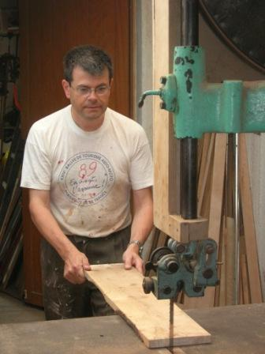
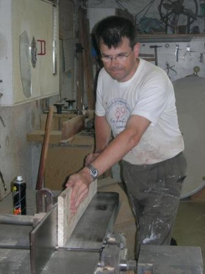
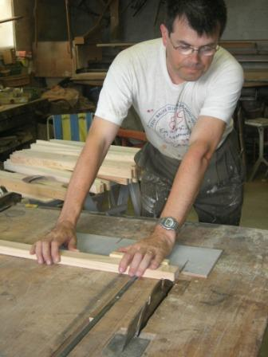
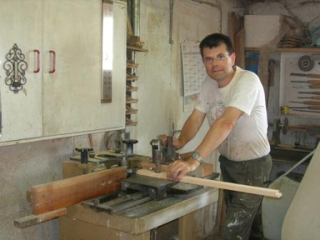
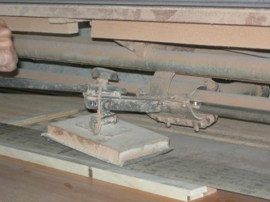
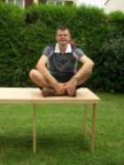

Basé sur la conception de BeLUG, ces tables sont au standard FreeLUG.

Présentées pour la première fois à l’Assemblée Générale 2006, une pré-série a été utilisée pour l’AG 2007 et pour le Mondial de la Maquette en avril 2007.

Vous trouverez ci-dessous la notice d’assemblage et de montage, mais auparavant faisons un petit tour dans les coulisses de la fabrication.

## La fabrication

**Le débit**

**Le dégauchissage - rabotage**

**La mise aux cotes**

**Le toupillage**

**Le ponçage**

Il reste enfin la découpe des plateaux et la suite se trouve dans la notice.

## Assemblage et montage

Vous constaterez que leur robustesse est assurée par un plateau avec ceinture rigide et que leur montage sur le site d’exposition est simplifié par le pré-assemblage d’une seule patte double par table (2 boulons et c’est tout !).

Ces tables sont légères, peu encombrantes et un astucieux assemblage permet un transport aisé des accessoires.

En voici la notice dont la consultation vous donnera tous les détails :

**Notice table DELA02**

## Budget

Un dernier mot sur le prix de revient d’une table de 3 x 3 (soit 9 plaques LEGO de 32 x 32 tenons) :

| Qté | Désignation | Montant |
| --- | --- | --- |
| 1 | Plateau de Contre-Plaqué de 8mm | 9,35 € |
| 1 | Ceinture | 2,50 € |
| 1 | Double patte | 0,90 € |
|  | Boulonnerie | Gratis |
|  | Total | 12,75 € |

(Montants indicatifs pour Août 2007)

Et voilà !

Autonomie et modularité sont des atouts pour faciliter l’organisation de belles expositions où grands et petits, fans et curieux seront enchantés.

**A bientôt sur de prochaines manifestations !**
