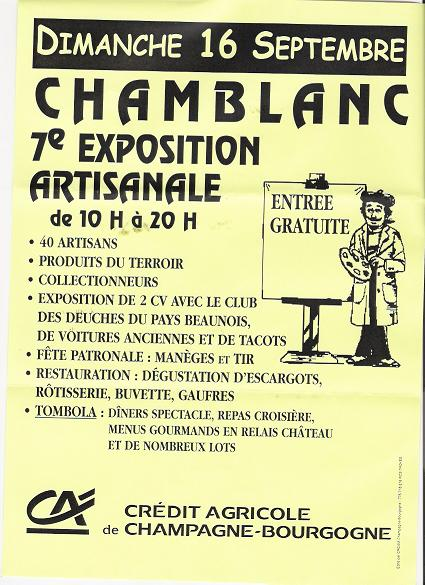

Invitation pour le 16 septembre 2007 par le maire lui même de Chamblanc à participer à la 7ième exposition artisanale qui rend hommage cette année aux collectionneurs en tout genre.

Le maire de Chamblanc Monsieur Michel Bourdot, suite à  
l’article du journal _Le bien public_ dans lequel je  
parle de ma passion du LEGO a été très intéressé par  
ce que je faisais. Il m’invite donc à participer à  
cette manifestation. Les tables ainsi que les repas  
sont fournis par la municipalité. Je serai en contact  
avec le club de modélisme de Bourbon-Lancy (71140).

Malgré mon invitation personnelle, j’ai fait part de mon  
attachement à FreeLUG et je leur ai dit qu’il se  
pourrait que d’autres membres de FreeLUG puissent  
participer à cette exposition. Cela dit comme je l’ai  
souvent exprimé ma position géographique n’est pas du  
tout un avantage pour réaliser des expositions "en  
improvisation". En effet vu la date assez proche il y  
a de forte chance que je sois le seul FreeLUGien à y  
participer. Cela dit j’emmène avec moi un collectionneur de figurines "les chevaliers du zodiac" qui s’était déplacé à Dijon le 14 juillet pour me voir, il apprécie le LEGO sans en faire et est né une véritable amitié entre nous.

Thème LEGO : libre... cependant vu que cette année cette  
7ième exposition fait honneur aux collectionneurs il  
va sans dire que cette exposition est placée  
principalement sous le mouvement Tradilug tout en  
acceptant les Mocs.

Contacts : Michel Bourdot (maire de Chamblanc)  
Madame Paget (Secrétaire de mairie et membre du club  
de modélisme de Bourbon-Lancy) TEL : 03.80.20.40.37

Place disponible : 1m par 12m

