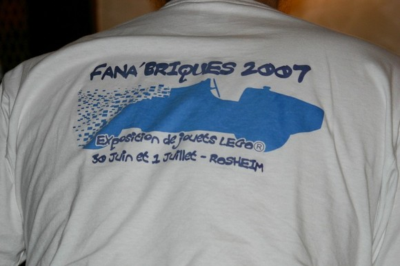
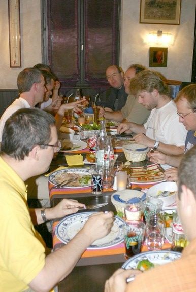
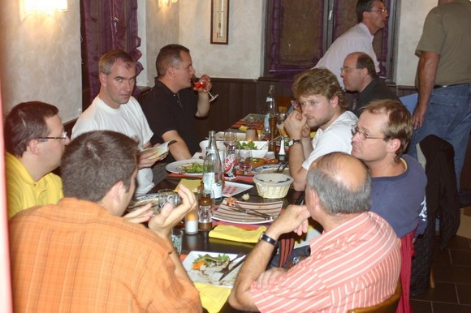
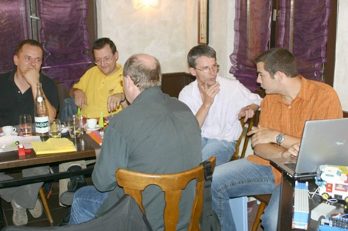
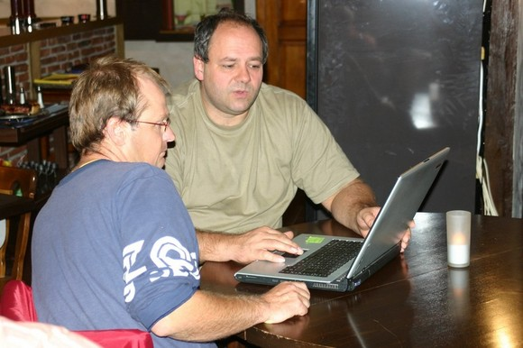
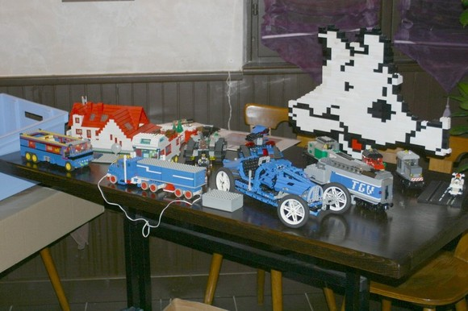
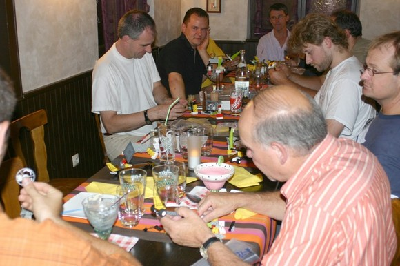
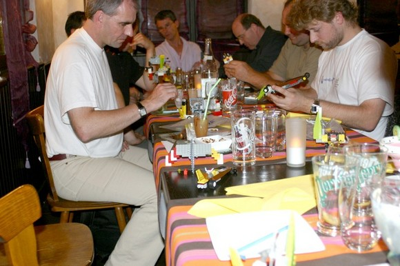

Vendredi 31 août 2007, un repas Afols a eu lieu à l’Hacienda, à Strasbourg, l’occasion d’une rencontre autour d’un bon repas et quelques briques pour faire le point sur Fanabriques 2007 puis évoquer l’édition 2008 entre membres alsaciens, organisateurs et nouveaux venus de la région.

C’est le restaurant l’Hacienda qui nous accueillait vendredi soir pour ce premier restaurant Afols sur Strasbourg : un chouette cadre, un service très sympa et une carte alléchante présageaient de très bonnes choses côté assiette.  
Nous ne furent pas déçus !

Côté ambiance, le plaisir de se retrouver pour cet échange ne passa pas inaperçu particulièrement lorsque l’une des tables voisines se remplit de MOCs sous les regards amusés.

Le décor était planté, place à l’action !

Une dizaine de personnes, une bonne partie du groupe de Fana’briques, dont Christian, venu spécialement d’Allemagne pour nous rejoindre, plus quelques nouveaux (ou futurs) adhérents, dont Sébastien, l’auteur de l’Odysseus (cf photos Fanabriques) et Nicolas, ingénieur en chef d’un projet TGV prometteur dont nous avons eu un avant-goût lors de la soirée.

Fana’briques, il y en a même un qui en portait encore fièrement les couleurs !

Alors, puisque c’était la première, une soirée Afols au resto à Strasbourg, comment ça se passe ?  
Trèèèèèèèès Bien ! :o)  
on ne s’est pas ennuyé une minute et le temps a filé très vite.

bien sûr, on a mangé

... discuté

... échangé sur nos projets, nos connaissances, notre pratique

Nous avions bien sûr aussi amené des briques, en l’occurrence quelques MOCs, des projets achevés ou en cours, et du coup, nous avons même exposé !

Fana’briques 2008 était aussi au menu de la soirée, et l’évocation de cet évènement et de l’organisation de sa 3ème édition a amené plusieurs questions face au succès rencontré.  
Mais l’essentiel du débat tournait autour du projet à mener pour 2008 sur lequel nous pourrons communiquer, après le vélo géant en 2006 et la Bugatti en 2007.  
Si le projet TGV est déjà sur les rails (arf trop facile celle là) d’autres idées et propositions de constructions ont été avancées. Un tour de table pour désigner les favoris de chacun a permis de dégager une première tendance, mais chut... rien n’est encore décidé.

L’arrivée du dessert conforta la qualité du repas tandis que le concours de MOCs lancé par Thierry comblait les esprits créatifs réunis autour de la table.  
Et oui, on a même construit lors de cette soirée !

A sachet identique en pièces pour tous, le challenge était de réaliser un petit MOC (60 pièces) chacun de son côté et de comparer les différentes créations.

Finalement il n’y eu aucun vote, aucun vainqueur, et tous nous repartîmes avec notre petit MOC.

Enfin, tandis que les chaises s’empilaient déjà sur les tables à l’autre bout de la salle, nous réalisions qu’il était temps de quitter les lieux, non sans envie de renouveler l’expérience...

...en attendant la grande rencontre de Fana’briques !

[Les photos de la soirée](http://photos.freelug.org/main.php/v/legophil/resto-afols-310807/)
