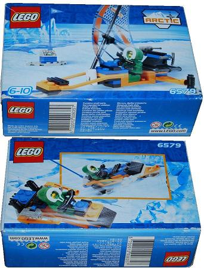
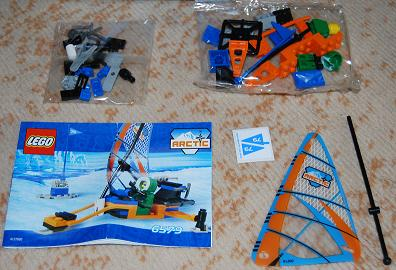
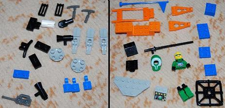
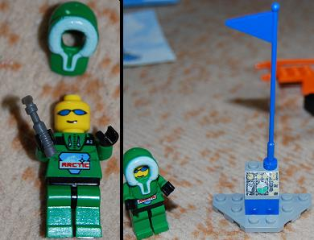
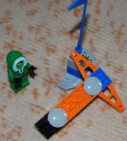
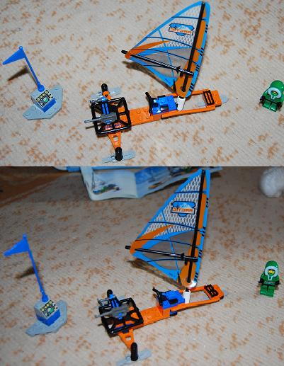
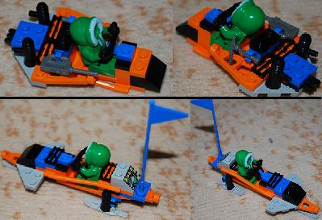
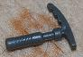

J’ai découvert la série Arctic lors de l’achat d’un lot. La boîte était neuve, l’occasion de revenir sur une vieille boîte peut-être peu connue.

**–** Référence : 6579  
**–** Nom : Le surfeur des glaces (Ice Surfer)  
**–** Nombre de pièces : 42  
**–** Prix : 5.00$ sur [Peeron](http://www.peeron.com/inv/sets/6579-1)

## La boîte

La face avant représente le char à voile en action avec la base en arrière plan et le dos présente deux modèles alternatifs.

## Le contenu

A l’intérieur de la boîte, il y a :  
**–** 2 sachets (un pour les grosses pièces et un pour les petites)  
**–** Une voile  
**–** Un mat  
**–** Une notice de montage  
**–** Une planche d’autocollant

## Montage du modèle

Comme toujours, tout commence par l’ouverture des deux sachets. Le premier contient 22 pièces (à gauche) et le second, 18 pièces (à droite).

Le montage se fait rapidement (18 étapes). On commence par la minifig et la base.

Ensuite, on attaque le char qui possède 2 patins sous le châssis

Et voila le char prêt à prendre le vent.

## Montages alternatifs

## Conclusion

Un petit modèle rapidement monté, avec quelques pièces sympas et des couleurs peu courantes. Ce qui était bien à l’époque, c’était de proposer des modèles alternatifs sans notice, ce qui permet de chercher un peu pour le montage.

Les pièces en plus dans le set :  
**–** 1 piolet

La planche d’autocollants

**autocollants**
