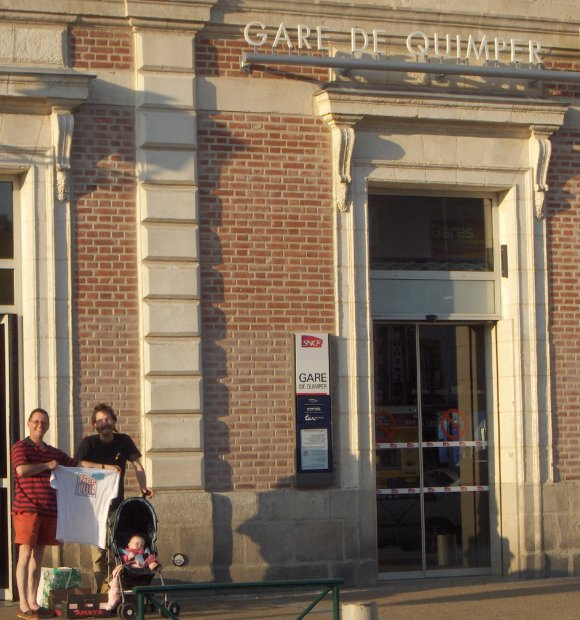

Ca y est !!!!

Le Finistère et ses Afols du bout du monde va connaître une série de rencontres régulières.

J’avais demandé à Dominick de Brest, et deux autres non adhérents de venir avec nous, mais ils n’étaient pas libres.

Un premier contact a donc eu lieu le 8 septembre dernier, avec Ronan accompagné de son amie et de leur petite fille, à la gare de Quimper.

Avant le repas, je leur ai présenté la panoplie du parfait freelugien (tee shirts, sweet shirt, badge, etc...) parlé des expositions chez nous, en Bretagne, et en France, sans oublier la petite brique.

Ronan a déjà une bonne connaissance des adhérents du club via Freelug.

Puis, vient le repas dans une pizzaria.

Enfin ,avant de se quitter, nous avons discuté d’une nouvelle rencontre prochainement. Notre exposition : animation LEGO en gare de Quimper le 12 octobre 2007.

jean marc de Morlaix
