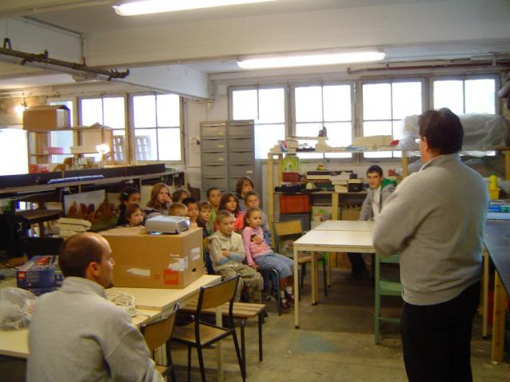
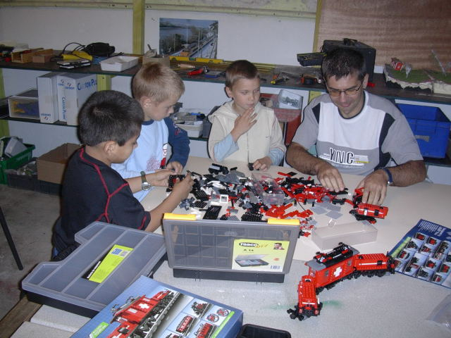
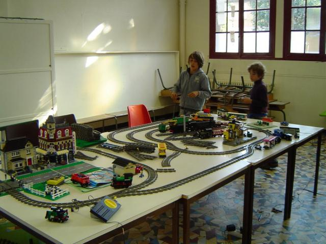

C’est à l’invitation de Bruno Saunier, responsable des activités jeunes au sein de la [FFMF](/articles/314/) et principal animateur de cette activité au sein de son club de [Montreuil](http://vfmontreuil.free.fr/), que FreeLUG, association affiliée à la FFMF, est venue animer un atelier de construction trains LEGO.

Six sets [Hobby Train](/articles/582/) ont été mis en oeuvre pour faire partager la passion à une douzaine d’enfants de 5 à 10/14 ans et un petit réseau à permis ensuite de faire tourner les créations de tous à l’issue de l’atelier et de présenter aux parents venus récupérer leurs enfants toutes les possibilités de réalisation à partir des briques LEGO.

Un des objectifs inscrits dans les statuts de notre association FreeLUG est de faire partager la passion. A ce titre nous avons pris l’habitude de mettre en oeuvre, sur certaines expositions, des ateliers où quelques briques en vrac permettent à ceux qui le souhaitent, petits et grands, de mettre la main à la pâte.

Ici pour la première fois, la FFMF nous a demandé d’animer un atelier, c’est à dire au-delà de la fourniture des briques, nous sommes également intervenus pour aider les enfants à mettre en oeuvre quelques techniques de montage et nous les avons aidé dans la réalisation de leur modèles. C’est un grand moment d’échange, même si nous avons été débordés par l’enthousiasme des jeunes modélistes. Nous n’étions pas de trop avec les deux Ericks, Nicolas et moi-même pour encadrer avec Bruno Saunier tout ce jeune public.

**Présentation**

L’atelier a commencé par la présentation de quelques techniques de construction, purement AFOLs, réalisée à partir des [articles réalisés par Didier Enjary](https://www.freelug.org/spip.php?article361), présentant les techniques de construction de James Mathis et par Erik Amzallag.

**Présentation réalisée aux enfants (6.6 Mo)**

Nous avons également pu présenter quelques logiciels permettant de réaliser des plans de réseaux trains LEGO ou ses propres modèles tels que LDD et MLCAD.

**Eric sur son atelier**

Ensuite nous avons mis à disposition les pièces des 6 sets Hobby Train (dont 2 fournis pour l’occasion à la FFMF par la société LEGO) sur 3 tables, où les enfants ont pu piocher les pièces nécessaires à leurs réalisations.

Un groupe s’est chargé avec l’aide de Nicolas de la réalisation du réseau.

**Le réseau**

Après 2h 1/2 de montage, il est temps de se retrouver autour du réseau et de faire rouler toutes les créations.

A noter que les jeunes modélistes ferroviaires ne sont pas sectaires, car ils se sont aussi beaucoup intéressés au nouveau [Bulldozer Technic](/articles/639/), venu pour l’occasion se dérouiller les chenilles et qui a connu un beau succès.

_Eric :_  
Je me suis bien amusé et c’est avec plaisir que j’ai voulu participer à cette animation. J’espère qu’il y en aura d’autres :-). Je remercie également Didier M. pour son implication à la réalisation de cette activité, un peu nouvelle pour notre association.
