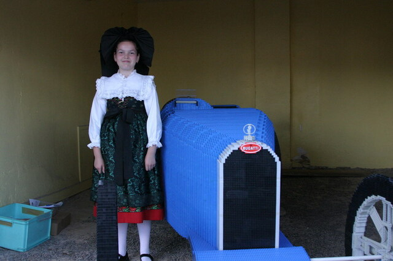
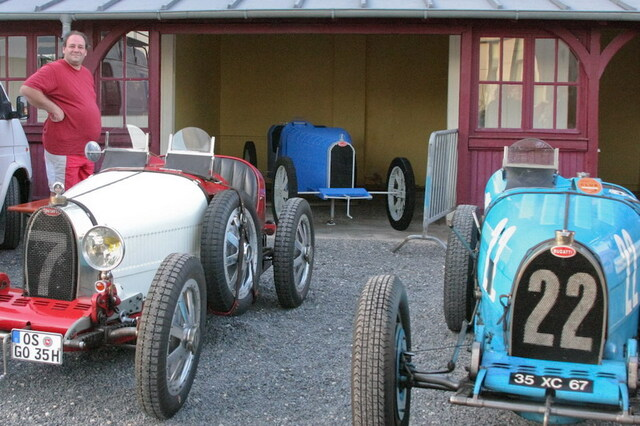
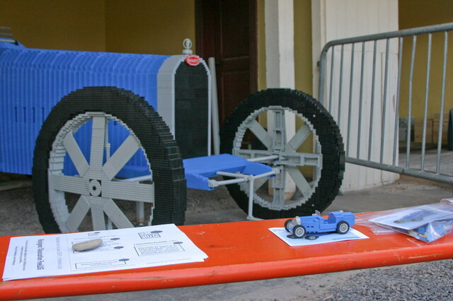
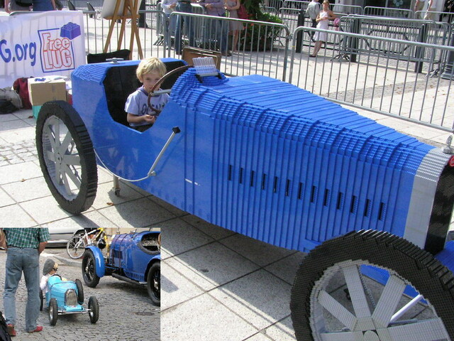
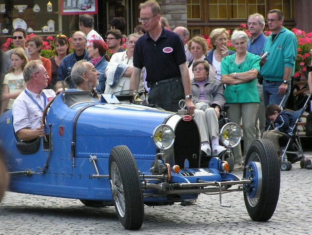

Du 14 au 16 septembre à Molsheim, le traditionnel "Festival Bugatti" attirait tous les enthousiastes de la célèbre marque de voitures.  
Evidemment, Thierry et moi-même étions les bienvenues avec notre réplique "Bugatti Type 35".

Quelle beau tableau ! Une charmante alsacienne pose au coté de notre bolide :)

Le vendredi après-midi était consacré à la réception des participants et de leur "Pur Sang". Notre modèle en brique LEGO a eu un immense succès auprès des "Bugattistes" de toute nationalité.

Dommage qu’elles bloquent la voie...Thierry aurait bien aimé faire une virée avec notre "Pur Briques", histoire de voir ce qu’elle a dans le ventre...

\_

La petite réplique c’est vendu comme des petits pains.

Samedi après-midi, nous étions également convié à montrer notre réplique au public, Place de l’hôtel de ville à Molsheim, en parallèle du défilé des "Pur Sang", pour le plaisir des yeux et des oreilles...

Z’avez vu !! la mienne est plus grosse !!!!!!

\_

Dites ! Vous n’auriez pas vue une Bugatti en briques bleues par ici ?

Par ici, [quelques photos en prime](http://photos.freelug.org/main.php/v/samrotule/festbugatti2007/)...

A bientôt pour de nouvelles aventures.
