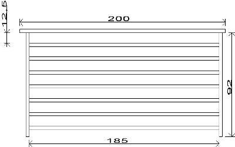
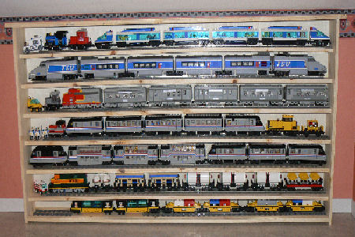
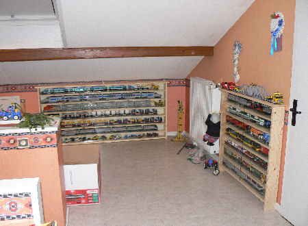
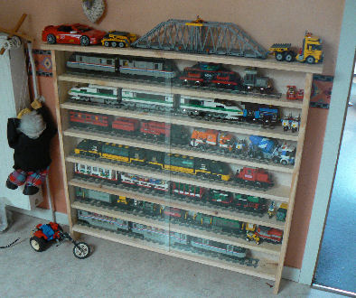

Une idée simple et efficace contre la poussière et les gros cartons : une étagère de fabrication maison...

Comme beaucoup de monde au début de ma collection LEGO, j’exposais mes trains sur une petite armoire, sur un rebord de fenêtre, le long d’un mur. Le problème est qu’au bout d’un moment la poussière se joint à l’exposition... et pour les briques c’est pas le top...

C’est à ce moment que j’ai commencé à réfléchir au moyen de pouvoir les présenter à la maison, à la famille et aux amis. L’idée est toute simple : une vitrine.

J’ai alors commencé par me renseigner en magasin, puis sur internet et voir les vitrines proposées par des professionnels et là, les dimensions n’étaient jamais les bonnes (à ma convenance), et le sur-mesure hors de prix !!!

Alors j’ai décidé dans un premier temps de réfléchir aux dimensions, à l’emplacement dans la maison, aux caractéristiques qu’il fallait pour la réaliser moi-même.

## Voici ce qui ressort de mes premières idées

Pour information :

**–** Les étagères sont en pin (épaisseur 18mm) et ont une largeur de 14cm (passage aisé du rail et des locomotives).  
**–** Prévoir une hauteur suffisante pour le passage des locomotives entre deux étagères. (_Attention_ bien prendre en compte l’épaisseur des rails et surtout du bois lors de la conception. Ca parait simple mais pour le menuisier novice que je suis cela évite de redémonter trois fois son étagère et de courir au magasin de bricolage parce que les montants de l’étagère sont devenus un vrai gruyère à force de perçages pour le passage des vis).  
**–** Les trois vitres ont une épaisseur de 4mm (plus solide que du 3mm). Prendre des précautions lors de la manipulation des vitres : risque de casse, et surtout risque de grave coupure !!! aïe les doigts.  
**–** Pour permettre un bon coulissement de la vitre dans les rainures, j’ai choisi de faire ces dernières avec une largeur de 6 mm. (Astuce : pour ceux qui n’ont pas la possibilité de faire des rainures, collez des baguettes le long des vitres afin de créer un "guide" pour le coulissement).  
**–** Le contreplaqué situé derrière l’étagère est coupé en deux parties égales de manière à laisser "travailler" le bois.  
**–** Les étagères sont issues de panneaux 50cm x 200cm et coupées en longueur (attention aux doigts lors de cette opération et surtout à scier le bois correctement pour ne pas faire de "zig-zag").  
**–** Pour éviter de "bailler", léger plissement de la planche sur de grandes longueurs, ces dernières sont vissées sur les deux panneaux de contreplaqué.

## Voici le résultat final :

\_

\_

\_

## Coût moyen d’une étagère :

**–** Planche de pin 50cm x 200cm épaisseur 18mm : entre 25 et 30€ (bien choisir une plaque sans trop de noeuds et surtout rabotée si vous ne voulez pas encore passer les planches sous les lames du rabot).  
**–** Les 3 vitres commandées sur mesures en 4mm : 45€60 (les trois). Attention au stock du détaillant : généralement prévoir la commande ou alors prendre toutes les découpes avec en sachant que les chutes vous seront facturées même si vous les laissez au magasin.  
**–** Quelques vis (plus longues pour fixer les étagères aux deux montants et plus courtes pour les deux plaques de contreplaqué... il faut que ça tienne).

En bref pour un bon bricoleur et pour une étagère d’une dimension de 2m, le coût final est d’environ 100€ à 150€.

## Et pour la suite :

A savoir que j’envisage également de créer des étagères vitrines pour y loger les maisons (Corner café...) et autres. Je suis en train de réfléchir à cette possibilité... dans ce cas les contraintes suivantes seront prises en compte :  
**–** transport facile ;  
**–** module assemblable et empilable ;  
**–** taille appropriée par rapport aux maisons LEGO ;  
**–** facilité de construction.

Niconico57
