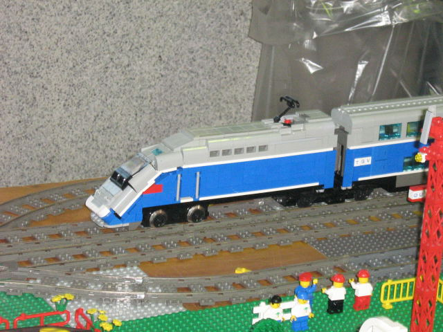
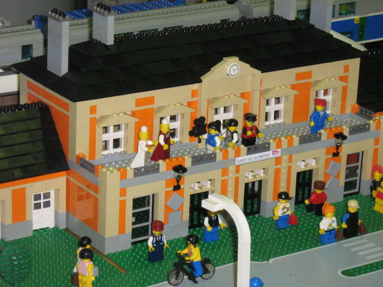
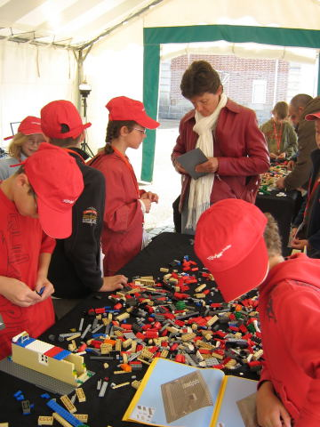
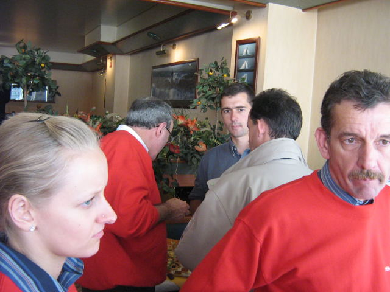

Cette fête du TGV a été l’occasion d’attirer l’attention du public sur l’activité ferroviaire de la région et sur les projets de développement attendus à l’horizon 2013.

Cela a été également l’occasion de faire partager, à deux classes de CM1, la passion du train en les invitant à venir découvrir les trains réels, mais aussi sous une forme plus ludique nos petits trains en LEGO.

## Déroulement de la fête

Il a fallu effectivement prendre le train en marche, car tout s’est déroulé très vite et si l’ami Jean-Marc est "toujours prêt" et que Ronan venait en voisin depuis Concarneau, j’ai rejoint l’équipe à la dernière minute, afin de pouvoir mettre en oeuvre un atelier de construction pour permettre aux enfants d’apporter leurs petites briques à cet évènement.

Parfaitement organisée par l’équipe régionale de la SNCF, qui nous avais contacté il y a quelques mois, nous nous sommes retrouvés ce vendredi matin avec une table dressée dans le hall de la gare pour que Jean-Marc et Ronan nous dresse un petit réseau 9V et une tente à l’extérieur pour mettre en oeuvre 3 tables avec des briques de vrac pour occuper les enfants.

**Le TGV... ...Duplex**

Jean-Marc avait réalisé pour l’occasion un TGV, Duplex précisait-il, que nous avons pu en avant première faire arriver en gare de Quimper. En effet grâce à l’équipe SNCF, j’ai pu récupérer quelques photos qui m’ont permis de réaliser pour l’occasion une reproduction en LEGO de la gare de Quimper.

**La Gare de Quimper**

Pendant qu’à l’intérieur Jean-Marc et Ronan avaient réalisé un réseau de train 9V, à l’extérieur, sous la tente, les enfants ont pu participer aux ateliers avec pour seule consigne "faites ce que vous voulez". Après une petite présentation de quelques techniques de construction, les enfants ont pu se répartir sur les différentes tables et laisser libre cours à leur imagination.

Certains y ont pris tellement de plaisir, qu’ils sont revenus pendant les discours des officiels pour une deuxième séance, avant d’assister sur le parvis à un spectacle gonflé d’Astrobulles.

Un dernier détour vers le buffet de la gare nous a permis de saluer toute la sympathique équipe qui nous a assisté durant cette animation.

Merci à Mme MENUSIER et à M. ABARNOU d’avoir pensé à nous pour les assister dans cet évènement et merci à Florence (si je ne me trompe) pour son aide avec les enfants.

## Le point de vue de Jean-Marc

Avec l’aide de notre ami Didier (qdm) qui a supervisé les relations avec la SNCF (Rennes, et Lorient), la section Bretonne de FreeLUG a animé deux secteurs différents :  
**–** Un réseau ferroviaire avec deux circuits sur 6.40 m2 à l’intérieur de la gare (Ronan, Marine et moi-même) (voir photos).  
**–** Didier et ses briques en vrac, sous son barnum de 40m2 pour l’animation avec les enfants.

**Atelier pour petits et grands**

Ce fut un gros succès, le TGV Duplex et la gare de Quimper en LEGO ont été à l’honneur.

La SNCF nous a "habillé", non pas en Christian LACROIX, mais, avec un superbe sweat shirt ROUGE.

Nous espérons que la SNCF renouvellera ce genre de manifestation en Bretagne pour fêter le TGV, tellement les cheminots et cheminotes (elles étaient belles !!!!!) ont été conquis(es) par les petites briques.

**Buffet de la gare**

Merci à Didier qui nous a fait l’amitié de venir chez nous pour quelques heures avec sa gare, bientôt visible à MORLAIX.

Merci à Ronan qui m’a aidé tout au long de la journée.

Le legoman Breton Circus trés content de sa journée

[Galerie de photos](http://gallery.freelug.org/main.php/v/La-Gallerie-de-qdm/Actualit_-et-Presse/2007+-+SNCF+Quimper/)
