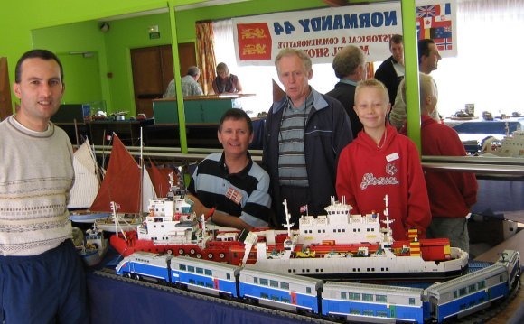

Disons tout de suite que ce salon ne figurait pas dans mon planning legotique, mais plutôt dans celui de mon club de la maquette. Pour 10m de tables, les places étaient très chères et à la dernière minute, trois collègues de la maquette se sont désistés en ma faveur.

Pour 2 mètres carrés à peine, j’ai emmené quelques modèles (ferry blanc, remorqueur rouge, un bateau des phares et balises de Morlaix, la grande échelle américaine et en avant première pour Brigitte : le TGV DUPLEX, par minibus municipal (réservé aux associations de la ville).

Sur place, Brigitte, la représentante normande de FreeLUG (très active), est venue me voir plusieurs fois.  
Tout au long du week end, nous avons beaucoup discuté autour de la petite brique.

Durant les 2 jours, le public a été très étonné par mes réalisations. Deux mamans ont osé me dire que c’était des Playmobil sauf leurs bambins, ouf !!!

Bref, ce fut une petite escapade bien ensoleillée dans une région très marquée par le Débarquement 39/45.

Merci à Brigitte et Alain de nous avoir reçus chez eux où les petites briques sont partout...

[photos, par Brigitte](http://photos.freelug.org/main.php/v/EURY/eury/)

Jean-Marc
