Le rendez-vous était pris pour le 17 octobre 2007 : départ pour le LEGOWorld, pour une semaine pleine de LEGO. C’est ainsi que 10 adhérents de FreeLUG se sont retrouvés pour participer à cette grande fête.

## Mercredi 17 octobre : le départ

Rendez-vous fixé à 5h30 pour les premiers à partir. Second point de rencontre sur l’autoroute A1 afin de continuer en convoi (Manu, Erik, Stéphane et Eric). Comme à son accoutumée, Jean-Louis (accompagné de Pierre) est en retard, on le retrouvera en Belgique. La route est chargée autour de Paris. Cette veille de grève des transports n’annonce rien de bien.

La route fut bonne, parsemée de pluie. Pour s’occuper, Manu n’hésite pas à construire en voiture deux boites Exo-Force qui occuperont la base Exo-Force.

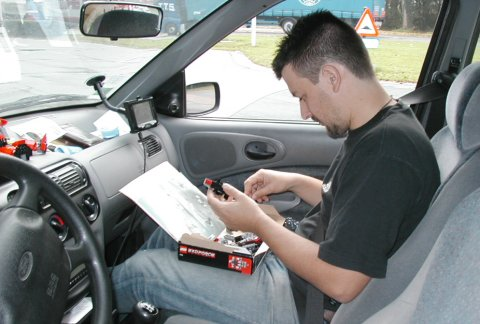

Nous arrivons sur les coups des 15h30 à Zwolle, objectif de notre voyage. Dès lors, nous prenons possession de notre stand et commençons l’installation. Nous sommes rejoins par Jérémy puis par Thierry et Christian. Thomas et Ronan arrivant par train viennent compléter l’équipe.

Mais trêve de bavardage sur cette première journée, que s’est-il passé les autres jours ?

## Le stand FreeLUG

Commençons par un tour de notre stand.

Notre stand était tout en longueur, à côté du stand Mindstorms, car nos amis hollandais avaient compris que nous amènerions du Technic, ce qui n’était pas le cas. Bref, nous nous répartissons l’espace.

**La base Exo-Force**

Manu et Erik ont présenté une montagne Exo-Force, comprenant en hauteur la Cité dorée et en contre-bas des plates-formes motorisées de manutention des robots de nos gentils humains, pendant que les ponts étaient assaillis par les vilains robots.

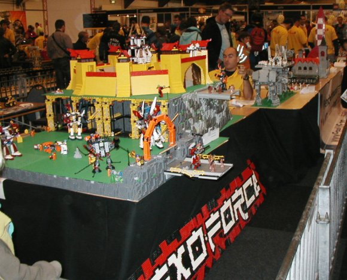

**Plate-forme Endor**

Jean-Louis a exposé sa plate-forme Endor. Le thème StarWars permettant de nombreuses originalités, il n’y avait pas moins de trois plate-formes présentées au LEGOWorld cette année :) Son jeu d’échec a également été le terrain de jeu d’un bulldozer.

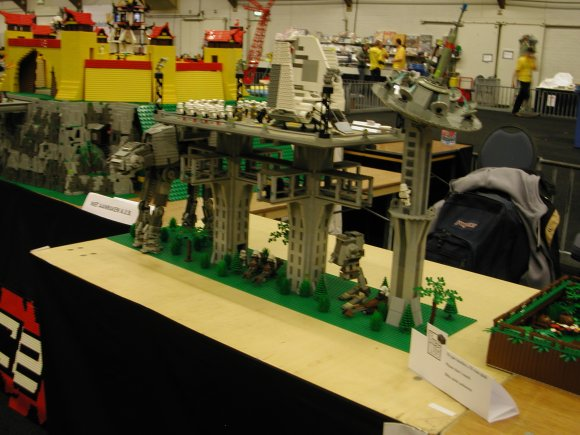

**Cloître**

Eric a amené un cloître construit à base de modules. Autant dire que le bâtiment a connu quelques variantes au cours de la semaine :)

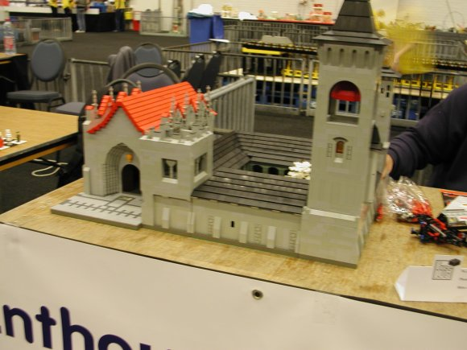

**Diorama city**

Jérémy a amené une ville, dont le layout a du être réadapté compte-tenu de la forme du stand. Qu’à cela ne tienne, c’est du LEGO, c’est modulable et même destructible à coup de bulldozer.

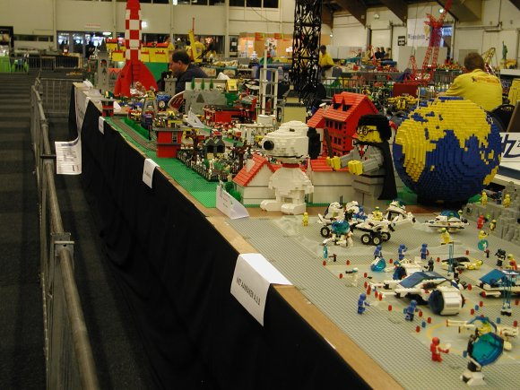

**Mosaïques**

Stéphane a amené des mosaïques sur le thème de Cars et Nemo, ainsi que quelques éléments qui ont pris place dans la ville.

**Base lunaire**

Thomas est venu avec une base lunaire Futuron, envahie par quelques monstres animés.

**Espace Bugatti**

La Bugatti T35 échelle 1:1 de Thierry n’était malheureusement pas à notre stand, mais était placée dans le hall Racers, à proximité de la Formule 1 Ferrari LEGO. Thierry et Christian ont été courageux de rester à coté d’elle durant la quasi totalité du salon. Sur notre stand, des reproductions échelle miniature et Technic rappelaient la marque alsacienne.

Notons aussi la présence au début du LEGOWorld de Ronan qui est venu avec un château-aventure.

Le LEGOWorld, c’est quand même éprouvant, et la traditionnelle sieste sous le stand à fait de nouveaux adeptes.

## Et sur les autres stands ?

Le LEGOWorld, c’est aussi de nombreux autres clubs européens.

**De Bouwsteen, club organisateur**

Fort de la diversité de ses 700 membres, De Bouwsteen, qui organise le LEGOWorld a pu présenté de nombreuses choses. Entre les stands Train, City, Technic, la particularité de cette année fût sans doute le musée. Un petit hall a été dédié à un ensemble de vitrines présentant une rétrospective de nombreuses gammes. On y retrouvait au complet des gammes Town, Castle, Space, Technic de tout âge mais aussi des gammes plus inhabituelles comme les Fabuland ou Paradisa.

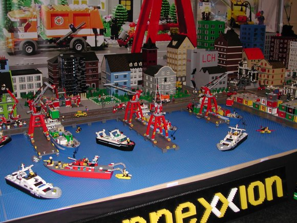

Coté Mindstorms, après l’usine à voitures et le flipper, nous avions droit cette année à un bowling quasi fonctionnel, avec ramassage et placement des quilles, comptage des points, retour de la boule au joueur...

**Stand BeLUG**

Comme ces dernières années, nos amis Belges ont fait très fort sur leur réseau, riche en détails et finition. Les photos parlent d’elles mêmes.

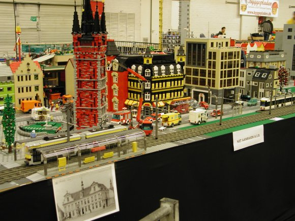

**Stand ItLUG**

Les Italiens ne sont venus que pour 3 jours, malgré la longue route qui les sépare de Zwolle. Une base IcePlanet 2012 en lumière noire, des pelleteuses Technic et un atelier motorisé étaient au programme.

Des danois de Byggepladen, des Portugais de Comunidade 0937 et des Anglais de Brickish étaient également présents.

## Côté LEGO

LEGO, qui fête cette année ses 50 ans aux Pays-Bas avaient également apporté quelques surprises.

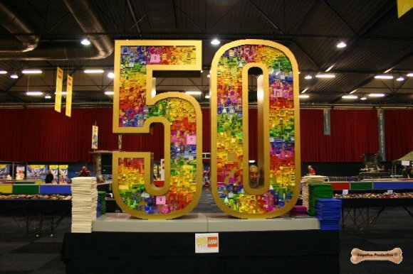

La première, sans doute la plus marquante, était la présentation du set Town Plan 10184, boîte anniversaire pour les 75 ans de LEGO à sortir en janvier 2008.

LEGO présentait également quelques nouveautés StarWars, Exo-Force et Technic 2008.

Dans l’espace musée, LEGO avait sorti de ses archives un rayonnage complet tel qu’on pouvait les trouver dans le milieu des années 80.

Des designers étaient également présents : StarWars, City, Castle, Exo-Force et Technic, les gammes en vogue étaient représentées par ces personnes qui répondaient volontiers aux questions du public.

Pierre s’est même immiscé le temps d’une après-midi dans le stand City pour construire quelques véhicules dont il a le secret.

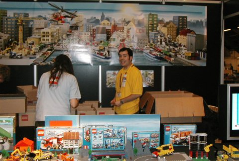

Deux tentes Pick-a-Brick faisaient notre bonheur (et le malheur du porte-monnaie) : d’un côté des sachets de briques tout droit sortis de boîtes (y’a bon les sachets de minifigs StarWars, Harry Potter ou Bob l’éponge ou bien les sachets de train), d’un autre des caisses de vrac.

Le traditionnel magasin InterToys était là, pour ceux qui n’avait pas encore fait une surdose de LEGO.

Citons aussi "la vente spéciale" de boîtes abîmées où pour des prix plus ou moins intéressants, nous pouvions repartir avec des boîtes plus ou moins complètes. Mais il fallait se frayer un chemin jusqu’aux palettes !

## Mais à part les LEGO ?

Parler du LEGOWorld sans parler de l’ambiance qu’il y a autour serait un raccourci non pardonnable.

Les restaurants du jeudi soir et lundi soir, au Tyrol, énorme buffet à volonté, étaient pour nous l’occasion de se refaire du repas plutôt frugal du midi.

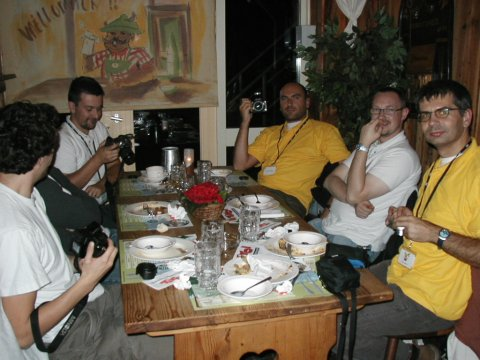

Mais les moments les plus animés avaient bien lieu aux chalets.

Grands moments de convivialité aussi, qu’étaient le lancer de matelas et la mêlée de draps. Les matelas étaient légers. Tant mieux !

La soirée au bungalow des Belges où nous nous sommes retrouvés jusqu’à une trentaine, fût sans doute la soirée la plus symbolique : belges, français, portugais, anglais, allemands (et même australienne), tous retrouvés autour de notre thème favori des briques, mais aussi de quelques bouteilles d’origine aussi variées que nos nationalités.

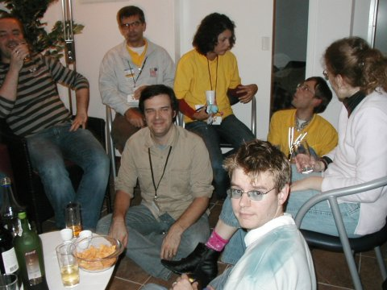

Le repas préparé par Thierry le samedi fût pour nous aussi l’occasion de se retrouver autour d’un bon repas, les autres repas ayant été pris aux halles.

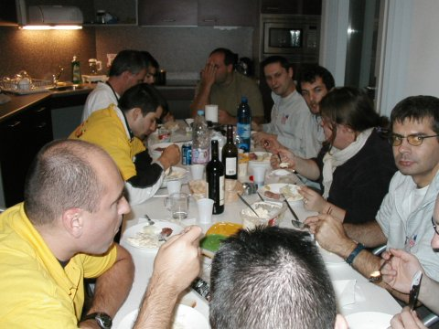

## Le mot de Thierry

Oui, oh oui, que ce fut une grande et belle semaine.  
Du monde partout, des LEGO partout et beaucoup de belles rencontres.

L’ambiance fut assurée par Manu, qui affronta de maintes reprises par le verbe et le geste, Jean-louis qui restait imperturbable. La proie choisie par nos compères fut un temps Erik, qui fit belle impression, dans sa défense héroïque pour garder son pantalon un temps soit peu présentable.

Côté Bugatti, j’avais loué un 20 M3 pour en assurer le transport. Elle est arrivée entière à l’aller comme au retour. Ouf...

La Bugatti était présentée au public à coté de la Ferrari LEGO que j’aurais tant voulu avoir pour Fana’briques.  
Entourée d’une simple corde, elle fut la proie facile d’un public impressionné.  
Le deuxième jour, je découvrais une roue à terre. C’est fragile une roue ! Après l’avoir réparée je décidais de rester à côté de la voiture les cinq jours restants. Ce fut long, mais les remarques et encouragements du public me faisait trouver le temps moins long.

Ce qui m’a fait sourire, c’est que certains gamins arrivaient à côté de la Bugatti, après avoir certainement passé deux heures à voir du LEGO partout, et s’écriaient en voyant la voiture : "Ouah, mama, Lerho (prononciation approximative de LEGO en hollandais) ....".

Ce qui m’a fichu un peu le moral à plat, est qu’en amenant la Bugatti, je comptais croiser les boss de LEGO.  
Arrivés le Lundi, ils firent le tour de LW conduits par les responsables DE BOUWSTEEN mais ne passèrent pas devant la Bugatti. Très grosse déception...

Côté langue, pas facile ! Le hollandais est surprenant !  
Une recette pour éviter d’être interrogé par le public est de ne pas le regarder. Un croisement de regard et c’est foutu, la question fuse... Pour éviter ces questions j’avais dessiné un drapeau français à coté de mon nom pour que le public comprendre que je n’y comprenais rien.  
A plusieurs reprises j’ai du m’assurer que je tournais le drapeau dans le bon sens...

Finalement j’ai décidé d’apprendre à dire "je ne parle pas le hollandais, je parle français ou allemand" ce qui fait : "Ik spruch quai nederlands, ik spruch franzosich op deutsch".

En conclusion, cette semaine en Hollande fut magnifique.  
Merci à Christian pour ses nombreux coups de mains.

Nous avons appris qu’auraient lieu prochainement en 2008 deux LW, l’un au Danemark, l’autre en Finlande.  
A quand un LW en France ?

Thierry

## Le mot de Eric

Cela faisait deux ans que je n’était pas retourné à cet événement unique qu’est le LEGOWORLD !  
La version 2007 a été encore grandiose, même trop courte à mon goût ! :)

La surface pour le stand de FreeLUG a été suffisante, nous avons réussi à tout caser ! Comme Thierry j’ai été un peu déçu de la séparation qui a été faite pour l’emplacement de la Bugatti, mais la place ce n’est pas toujours facile à gérer !

L’organisation pour les repas de midi a été bien améliorée et nous avons eu droit à quelques plats chauds ! :) Le club DE BOUWSTEEN est passé maître dans l’art d’organiser une exposition et n’a pas failli à sa tâche.  
Je souligne également une petit déception concernant les différentes activités qui ont lieu pendant ces quelques jours, ou je n’ai pas toujours su ce qu’il se passait et ce qu’il y avait à faire, la barrière de langue en étant la principale cause. :-)

Coté ambiance sur le stand et au chalet, je garderai un bon souvenir des jeux de Manu, ainsi que sa bonne humeur inépuisable, qui a su nous mettre l’ambiance jusqu’à parfois fort tard dans la nuit... :-)

Merci à tous et à bientôt peut être.

## Galeries de photos

Quelques galeries :  
**–** [Eric](http://photos.freelug.org/main.php/v/f1tvf/expositions/expo_lw2007/)  
**–** [Erik](http://photos.freelug.org/main.php/v/brickerik/expositions/2007/lw2007/)  
**–** [Manu](http://photos.freelug.org/main.php/v/Gyclore/Expositions/LW2007/)  
**–** [Jérémy](http://www.brickshelf.com/cgi-bin/gallery.cgi?f=295498)  
**–** [Thomas](http://www.brickshelf.com/cgi-bin/gallery.cgi?f=281909)
